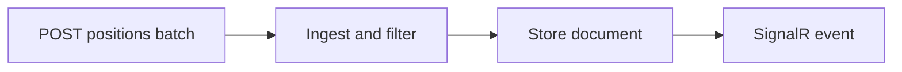

# Clear PR description

Goal: a reviewer understands the PR in two minutes. Short sentences, no filler. Diagrams over paragraphs.

Attribution: see the last section. Branch, commit and merge rules: [delivery-workflow](../delivery-workflow/SKILL.md).

## Template

Keep these sections, in this order. Drop a section only where noted.

````markdown
## Purpose
SS-<n>: <title>. Covers <requirement IDs, e.g. TRK-01, TRK-02>. <One or two sentences: the problem and what this PR does about it.>
Closes #<n>.

## What it touches
- `backend/...`, `simulator/...`: <one line>
- `tests/...`: <one line>
- `data/`: <only if any>
- `docs/`: <ADR, ASSUMPTIONS, AI_LOG: only if any>
- Store: new document type, index or format change, or none
- Config: compose, realm export, `.env.example`, or none
- Endpoints and config keys: new ones listed by name, or none
- Dependencies: new ones with a reason, see [dotnet-coding](../dotnet-coding/SKILL.md) §14, or none

## Idea and implementation
<The design in a few lines, then the diagram(s).>



<Why this way, only if not obvious. Alternatives rejected in one line each.>

## Risks
- <What could break, who is affected, and the mitigation or rollback in the same bullet. "None known" only if you checked.>

## Things to check
- [ ] <something not verified yet, and how to check it>
- [ ] <something not verified yet, and how to check it>

## Screenshots
<Drop this section when the PR has no visible change. See the Screenshots rules.>
````

## Rules per section

- **Purpose:** the why, not the file list. Name the story (`SS-<n>`) and the requirement IDs it covers. The last line is `Closes #<n>.`
- **What it touches:** one bullet per area, path in backticks, a few words each. Name new endpoints, config keys and dependencies. Use `Store:` for any document change, or `none`. No database or migration lines.
- **Idea and implementation:**
  - Pick the diagram that fits:

    | Diagram | Use for |
    |---|---|
    | `flowchart` | flow or architecture |
    | `sequenceDiagram` | calls between parts over time |
    | `erDiagram` | store document or model changes |
    | `stateDiagram-v2` | status changes |

  - One to three diagrams per PR, each with at most ~10 nodes.
  - Label edges when the meaning is not obvious. Quote node text that has spaces or symbols: `A["POST positions batch"]`.
  - Plain Mermaid, no custom styling, so it renders in light and dark mode.
  - Under each diagram, at most 3 lines: the key decision and why. No line-by-line walkthrough.
  - For a refactor, show before and after.
  - Store change example:

    ```mermaid
    erDiagram
      TRACK ||--o{ POSITION : "contains"
    ```

- **Risks:** concrete. Good examples:

  | Risk | Example mitigation |
  |---|---|
  | Contract break (contract field names) | contract test on the changed endpoint |
  | Tenant leak | tenant filter in the query and a test for another tenant |
  | Data loss on crash | atomic write, see [sitesense-architecture](../sitesense-architecture/SKILL.md) |
  | Late data duplicates | idempotency key, see [sitesense-architecture](../sitesense-architecture/SKILL.md) |

- **Things to check:** only what is **not yet checked**. Write what to check and how, so a reviewer can do it. Do not list what you already verified: tick it instead (see the procedure below).

## Keep "Things to check" up to date

The list is live. Whenever you verify an item (test run, build, browser flow, review, manual check):

1. Read the current body. The reviewer may have changed it: `gh pr view <n> --json body --jq .body > body.md` (use a temp file).
2. Edit only the list in `body.md`:

   | Result | Edit |
   |---|---|
   | passed | `- [x] <item>: <result in a few words>` |
   | failed | keep `- [ ]` and add `FAILED: <first error line>` |
   | new item found | add `- [ ] <item>` |

3. Publish: `gh pr edit <n> --body-file body.md`.

Do this right after each verification step, not once at the end. When everything is checked, the list is all `[x]`. Leave it in place as the record.

## Screenshots

- Only for visible changes. Demo client and map UI only (API-06). Real screens of the page, not a cropped component or a mock-up.
- Desktop (800 px viewport) and mobile (375 px preset). Hide dev overlays first.
- Save the files, then attach them to the PR:

  ```bash
  gh pr edit <n> --attach './desktop.png#Desktop: <what it shows>' --attach './mobile.png#Mobile: <what it shows>'
  ```

- Put `` in the body under "Screenshots". `gh` rewrites it to the uploaded image.
- Re-attach after a visible change. Read the body first (procedure above) so you do not overwrite edits.

## Attribution

Attribution follows `../delivery-workflow/SKILL.md` (Proposed Q54: keep the Co-Authored-By trailer; PR descriptions end with the Claude Code generated line).

The last line of every PR body is:

```text
🤖 Generated with [Claude Code](https://claude.com/claude-code)
```

## Checklist before publishing

1. Every section present, in order. Screenshots only for a visible change.
2. The diagram renders. Check the PR page, not only the source.
3. Nothing in "Things to check" that you already verified.
4. Body ends with the generated line.
