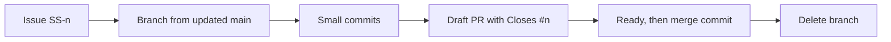

# Delivery workflow

Goal: one story at a time, a clean and gradable history, nothing lost at delivery.

Scope: git, GitHub and delivery only.

| Topic | Owner |
|---|---|
| Docs placement, AI steps, verification subagent | [ai-process](../ai-process/SKILL.md) |
| PR description text and "Things to check" | [clear-description](../clear-description/SKILL.md) |
| Tests and build commands | [sitesense-testing](../sitesense-testing/SKILL.md) |
| Secrets and coding rules | [dotnet-coding](../dotnet-coding/SKILL.md) |

## Flow



## Branches

| Item | Rule | Example |
|---|---|---|
| Story branch | `story/SS-<n>-<slug>` | `story/SS-12-position-log` |
| Skill branch | `skill/SK-<n>-<slug>` | `skill/SK-9-delivery-workflow` |
| Base | updated `main` (`git switch main && git pull`) | |
| Scope | one story or one skill per branch | |
| Stacked PRs | never; every PR targets `main` | |

## Commits

| Rule | Detail |
|---|---|
| Size | one logical change per commit |
| Subject | imperative English, under ~72 chars |
| Style | **Proposed:** Conventional Commits, `feat\|fix\|docs\|test\|chore(scope): <subject>` |
| Body | 1–3 lines: why, not what |
| Staging | `git status --porcelain`, then stage only the files of the step |
| Excluded | any secret, never staged |
| AI trailer | **Proposed (Q54, open):** keep `Co-Authored-By: Claude <model> <noreply@anthropic.com>` on AI-written commits, for transparency with `AI_LOG.md` |

Example message (blank lines are required):

```text
docs(skills): add delivery workflow (SK-9)

Branches, commits and closing steps.
```

## History

**Proposed (Q55, open):** merge commits only. History is never rewritten.

| Action | Rule |
|---|---|
| Merge | `gh pr merge <n> --merge` |
| Squash or rebase-merge | never |
| Force push | never on a pushed branch |
| Update a branch | merge `main` into it: `git merge main` |
| Merge commit subject | **Proposed (Q57, open):** `SS-<n>: <title>` for stories, `SK-<n>: <title>` for skills |
| After merge | delete the branch |

## Draft PR

1. Push the branch. Open the PR as draft against `main`.
2. Body follows `../clear-description/SKILL.md`.
3. Tick all "Things to check" items. Mark the PR ready.
4. Merge (see History).

## Definition of done

A story is done only when all rows pass.

| Check | Where it runs | Pass means |
|---|---|---|
| Tests | verify subagent ([ai-process](../ai-process/SKILL.md)) | all tests pass |
| Build | verify subagent | build succeeds |
| Browser | verify subagent, only if the demo client or any frontend changed | feature works in a real browser |
| Docs | per [ai-process](../ai-process/SKILL.md) | docs files: see `../ai-process/SKILL.md` |
| PR | this file and [clear-description](../clear-description/SKILL.md) | every "Things to check" item ticked |

## Closing

| # | Step | Done when |
|---|---|---|
| 1 | Story issues closed | every `Closes #<n>` issue shows closed |
| 2 | Working tree clean | `git status` is empty |
| 3 | Tag | annotated tag `v1.0` on the final commit: `git tag -a v1.0 -m "v1.0" <sha>`, then `git push origin v1.0` |
| 4 | Root deliverables | table below complete |
| 5 | ZIP | `SiteSense_<Surname>_<Name>.zip`, includes `.git` |
| 6 | Exclusions | no `bin/`, `obj/`, `node_modules/`, large external data |
| 7 | Empty-folder check | unzip into an empty folder; `git log` shows full history; `docker compose up` starts the system |

### Root deliverables

| Item | Note |
|---|---|
| `docker-compose.yml` and Dockerfiles | starts the whole system |
| IdP realm export (Keycloak) | imported automatically at start (IDN-04) |
| Simulator | console app, N devices, authenticates as gateway (SIM-01) |
| Demo client | minimal static HTML page or console app showing real-time events |
| Tests | automated tests (NF-02) |
| `verify.env` | repo root |
| `.env.example` | every variable read by compose; includes `SITESENSE_TEST_MODE=false` |
| `.http` file or Postman collection | tries the API |
| `data/` | site JSON, GeoJSON map, download or convert scripts |
| `README.md` | start, test credentials, tests, simulator, benchmark, Hangfire storage rationale |
| Docs | docs files: see `../ai-process/SKILL.md` |
