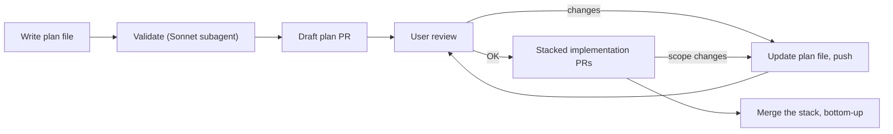

# Planning

Workflow steps and models: [ai-process](../ai-process/SKILL.md).
Branches, commits and merges: [delivery-workflow](../delivery-workflow/SKILL.md).
PR description text: [clear-description](../clear-description/SKILL.md).

## 1. When

Every task on the `plan/validate/approve/implement/verify` workflow gets a plan file.
The plan file replaces the chat-only plan: the approval happens on the plan PR.

## 2. Flow



| # | Step | Done when |
|---|---|---|
| 1 | Write `docs/plans/<ID>-<slug>.md` (template in §4). | All sections filled, no "TBD". |
| 2 | Validate it with a Sonnet subagent. Fix the file. | Every gap the subagent found is fixed or listed under "Open questions". |
| 3 | Commit only the plan file. Open a **draft** PR against `main`. Title: `<ID> plan: <title>`. | PR is open; body links the plan file. |
| 4 | Wait for the user's review. | The user gives an explicit OK on the plan PR or in chat. |
| 5 | Open the implementation PRs, stacked on the plan branch (§5). | Each implementation PR links the plan file. |
| 6 | Merge bottom-up when the whole stack is approved (§5). | Plan PR merged first, then each implementation PR. |

## 3. Writing rules

Write for a reader who knows nothing about the task: a reviewer opening the PR cold.

| Rule | Detail |
|---|---|
| Plain words | Short sentences. Explain each domain term the first time, or link `../sitesense-context/SKILL.md`. |
| Problem first | Say what is wrong or missing today, and who it hurts, before any solution. |
| Diagrams | At least one Mermaid diagram for the problem (today) and one for the solution (after). Flowchart, sequence or state diagram: pick the one that shows the mechanism. |
| Concrete | Name exact files, endpoints, config keys. Give one small example (a request, a JSON, a log line). |
| Small steps | One file or one concern per step, each with "done when". |
| No hidden choices | Every open choice goes under "Open questions" with options and a recommended one. The user decides. |
| Short | Aim for one screen per section. Cut what the reader does not need to decide. |

## 4. Template

````markdown
# <ID> — <Title>

- Status: Draft | In review | Approved | Done
- Issue: #<n>
- Plan PR: #<n>   Implementation PRs: #<n>, #<n>

## Problem
<What is wrong or missing today, in 3–6 plain lines. Who notices it.>

```mermaid
<diagram of today>
```

## Goal
<What is true when this is done, in 1–3 lines. What is out of scope.>

## Solution
<The idea in plain words, then how it works.>

```mermaid
<diagram of the solution>
```

## Steps
| # | Step | Files | Done when | PR |
|---|---|---|---|---|

## Risks
| Risk | Impact | Mitigation |
|---|---|---|

## Tests
<What proves it works: test names or checks.>

## Open questions
| # | Question | Options (recommended first) | Decision |
|---|---|---|---|

## Changelog
| Date | Change | Why (review comment or finding) |
|---|---|---|
````

## 5. Stacked PRs

| Item | Rule |
|---|---|
| Plan PR | Branch `<story or skill branch>` from updated `main`, target `main`. Contains only the plan file. |
| Implementation PRs | One or more. The first targets the plan branch; each next one targets the previous one. Split where a reviewer can check each PR alone. |
| Updating the stack | A change lower in the stack is merged up: `git merge <lower-branch>` in each branch above. Never rebase. |
| Merge order | Bottom-up, merge commits only (see [delivery-workflow](../delivery-workflow/SKILL.md)). After a branch merges and is deleted, GitHub retargets the next PR to `main`. |

## 6. Keep the plan alive

The plan file is the trace of every decision. It must match what was built.

| Event | Action on the plan file |
|---|---|
| A review comment on the plan PR | Change the file, add a Changelog row, push to the plan branch, reply to the comment with the commit. |
| A change asked in chat | Same as above. |
| An implementation PR changes scope, steps or a decision | Update the plan file on the plan branch in the same review round, then merge it up the stack. |
| An open question is decided | Fill the Decision column. Record it in `ASSUMPTIONS.md` too (see [ai-process](../ai-process/SKILL.md)). |
| All PRs merged | Set Status to `Done`. |

Never resolve a review comment on the plan without a matching change in the file, or a reply saying why not.

## 7. Checklist

- [ ] Plan file in `docs/plans/`, all template sections filled (§4)
- [ ] Problem and solution diagrams present (§3)
- [ ] Validated by a Sonnet subagent (§2)
- [ ] Draft plan PR open, user OK received before implementing (§2)
- [ ] Every review change in the file and in the Changelog (§6)
- [ ] Implementation PRs stacked and linked to the plan (§5)
