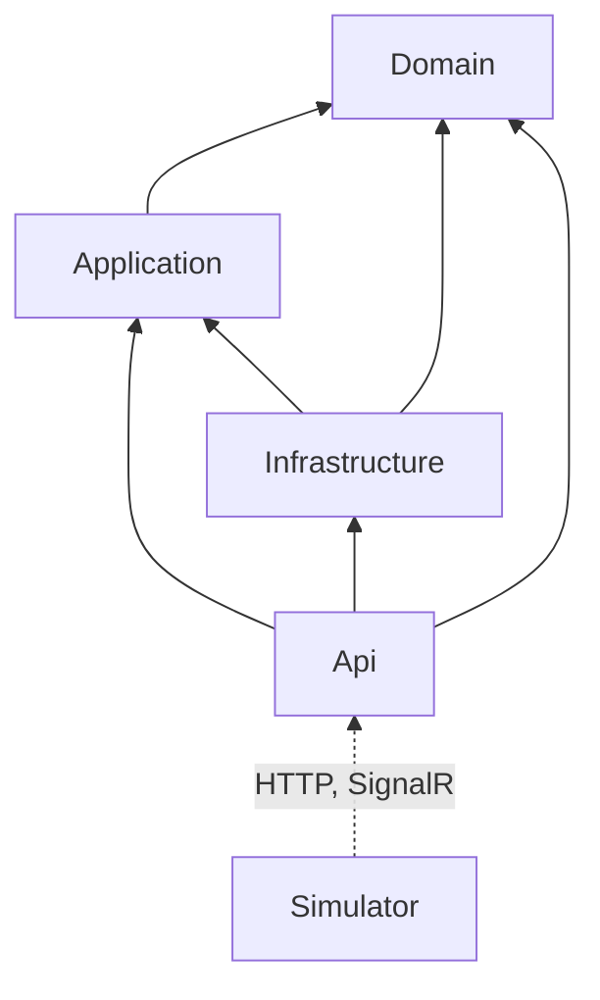

# Architecture

How the solution is laid out. Rules for adding code: `.claude/skills/sitesense-architecture/SKILL.md`.

## Projects

| Project | Layer | Holds |
|---|---|---|
| `src/SiteSense.Domain` | Domain | Entities, geometry, graph and routing, filters, area assignment, rules |
| `src/SiteSense.Application` | Application (core) | Use-case services, store and detector interfaces |
| `src/SiteSense.Infrastructure` | Infrastructure | JSON document store, file IO, ML.NET detectors |
| `src/SiteSense.Api` | Host | Composition root: endpoints, auth, SignalR hub, Hangfire, options |
| `src/SiteSense.Simulator` | App | Console device simulator; talks to the API over HTTP and SignalR only |

Each project has a test project at `tests/SiteSense.<Project>.Tests` (xUnit) that references only the project under test.

## References



Dependencies point inward. The simulator has no project reference to the server.

## Build settings

| File | Sets |
|---|---|
| `SiteSense.slnx` | The solution |
| `Directory.Build.props` | `net10.0`, nullable enabled, implicit usings, for every project |
| `Directory.Packages.props` | Central package management: every package version, exact |
| `.editorconfig` | Formatting and C# style (suggestions) |
| `.github/workflows/ci.yml` | Restore, build and test on every PR and on `main` |

## Build and test

```bash
dotnet build
dotnet test
```

Run from the repository root.
