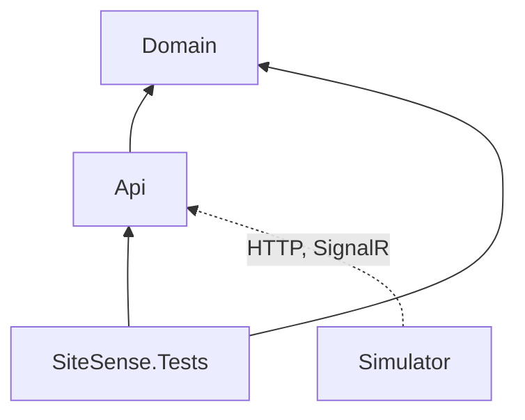

# Architecture

How the solution is laid out. Rules for adding code: `.claude/skills/sitesense-architecture/SKILL.md`. Decision: `ASSUMPTIONS.md` (Q66).

## Projects

| Project | Holds | References |
|---|---|---|
| `backend/SiteSense.Domain` | Pure domain code: core types, geometry, pedestrian graph and routing, GPS filters, area and alarm rules | none |
| `backend/SiteSense.Api` | Composition root: controllers, DTOs, services, store, auth, ML.NET, SignalR, Hangfire jobs | Domain |
| `simulator/SiteSense.Simulator` | Console device simulator; talks to the API over HTTP and SignalR only | none |
| `tests/SiteSense.Tests` | All server tests, in `Domain/` and `Api/` subfolders | Domain, Api |



The domain has no package or project references, so the compiler keeps it free of ASP.NET, IO, the clock, logging and ML.NET. It returns results or events and never publishes them itself.

## Api folders

Standard type-based ASP.NET Core layout (Q66). Each folder is created by the first story that needs it.

| Folder | Holds |
|---|---|
| `Controllers/` | One controller per area: `SitesController`, `TrackingController`, `NavigationController`, `AuthController` |
| `Models/` | Request and response DTOs only; domain types stay in `SiteSense.Domain` |
| `Services/` | Application logic: `PositionIngest`, `AnomalyDetector` (ML.NET), `SiteService` |
| `Store/` | JSON document store (`IDocumentStore<T>`); takes the place of a `DbContext` |
| `Realtime/` | SignalR hub, `IRealtimePublisher`, `SignalRPublisher`; the only code that uses `IHubContext` |
| `BackgroundJobs/` | Hangfire jobs, `<What>Job.cs`: trigger only, each calls a service in `Services/` |
| `Auth/` | Authentication and authorization setup and policies |

No `Helpers/` folder: shared code goes in Domain, `Store/` or `Realtime/`. Every recurring job schedule is registered in `Program.cs`, one line per job.

## Build settings

| File | Sets |
|---|---|
| `SiteSense.slnx` | The solution |
| `Directory.Build.props` | `net10.0`, nullable enabled, implicit usings, for every project |
| `Directory.Packages.props` | Central package management: every package version, exact |
| `.editorconfig` | Formatting and C# style (suggestions) |
| `.github/workflows/ci.yml` | Restore, build and test on every PR and on `main` |

## Build and test

```bash
dotnet build
dotnet test
```

Run from the repository root.
