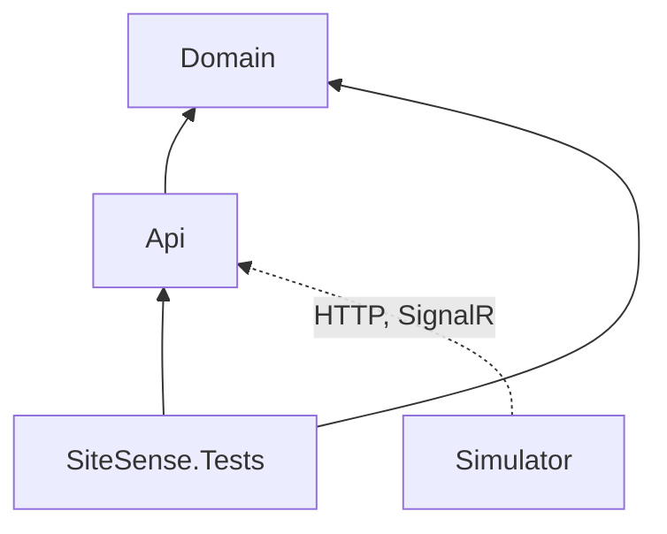
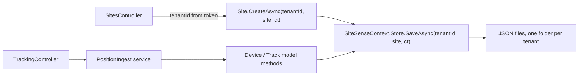

# Architecture

How the solution is laid out. Rules for adding code: `.claude/skills/sitesense-architecture/SKILL.md`. Decision: `ASSUMPTIONS.md` (Q66).

## Projects

| Project | Holds | References |
|---|---|---|
| `backend/SiteSense.Domain` | Pure algorithms and geometric primitives: `Coordinate`, `Polygon`, geometry (point in area, distance), pedestrian graph and route finder, GPS filters | none |
| `backend/SiteSense.Api` | Composition root: controllers, entities and DTOs, services, store, auth, ML.NET, SignalR, Hangfire jobs | Domain |
| `simulator/SiteSense.Simulator` | Console device simulator; talks to the API over HTTP and SignalR only | none |
| `frontend/` (reserved) | The demo client, added in its own story; talks to the API over HTTP and SignalR only. Never under `simulator/`. | none |
| `tests/SiteSense.Tests` | All server tests, in `Domain/` and `Api/` subfolders | Domain, Api |



The domain has no package or project references, so the compiler keeps it free of ASP.NET, IO, persistence, the clock, logging and ML.NET. It returns results or events and never publishes them itself.

## Api folders

Standard type-based ASP.NET Core layout (Q66). Each folder is created by the first story that needs it.

| Folder | Holds |
|---|---|
| `Controllers/` | One controller per area: `SitesController`, `TrackingController`, `NavigationController`, `AuthController` |
| `Models/` | Persisted entities (`Site`, `Device`, ...) with their static persistence methods, plus request and response DTOs |
| `Services/` | Only multi-entity flows and external engines: `PositionIngest` (filter, area, realtime), `AnomalyDetector` (ML.NET), navigation and evacuation |
| `Store/` | The single generic JSON document store implementation; takes the place of a `DbContext` |
| `Realtime/` | SignalR hub, `IRealtimePublisher`, `SignalRPublisher`; the only code that uses `IHubContext` |
| `BackgroundJobs/` | Hangfire jobs, `<What>Job.cs`: trigger only, each calls a service or a model method |
| `Auth/` | Authentication and authorization setup and policies |
| `Diagnostics/` | Correlation id (NF-03): the middleware, the log scope helper and the `Correlated<T>` carrier |
| `Helpers/` | Only the app-wide static context, `SiteSenseContext` (`Store`, `Time`); no general utilities |

Shared logic goes in Domain, `Store/` or `Realtime/`, never in `Helpers/`. Every recurring job schedule is registered in `Program.cs`, one line per job.

## Models and persistence

Active Record over one generic store (Q67).



- Each entity in `Models/` carries `Id`, `TenantId` and `Version`, and exposes static async methods for its own persistence and single-entity rules.
- `SiteSenseContext` (`Helpers/SiteSenseContext.cs`) holds `Store` and `Time`, both set once in `Program.cs` (`Time` is `TimeProvider.System`) and shared by HTTP requests, Hangfire jobs and SignalR (single process). Models and services read the current time only through `SiteSenseContext.Time`. Tests set a store on a temp folder and a fake `TimeProvider`.
- Controllers call model methods directly; only multi-entity flows and external engines go through `Services/`.
- `tenantId` is always an explicit parameter, never read from an ambient or HTTP context. The store rejects a read or write whose `tenantId` does not match the document.
- Models use Domain primitives, e.g. `Site.Boundary` is a Domain `Polygon`.

## Build settings

| File | Sets |
|---|---|
| `SiteSense.slnx` | The solution |
| `Directory.Build.props` | `net10.0`, nullable enabled, implicit usings, for every project |
| `Directory.Packages.props` | Central package management: every package version, exact |
| `.editorconfig` | Formatting and C# style (suggestions) |
| `.github/workflows/ci.yml` | Restore, build and test on every PR and on `main` |

## Configuration

Only `backend/SiteSense.Api/appsettings.example.json` is committed; `appsettings.json` and `appsettings.*.json` are gitignored (Q68). Before the first run:

```bash
cp backend/SiteSense.Api/appsettings.example.json backend/SiteSense.Api/appsettings.json
```

A new config key is added to `appsettings.example.json` in the same PR.

## Build and test

```bash
dotnet build
dotnet test
```

Run from the repository root.
