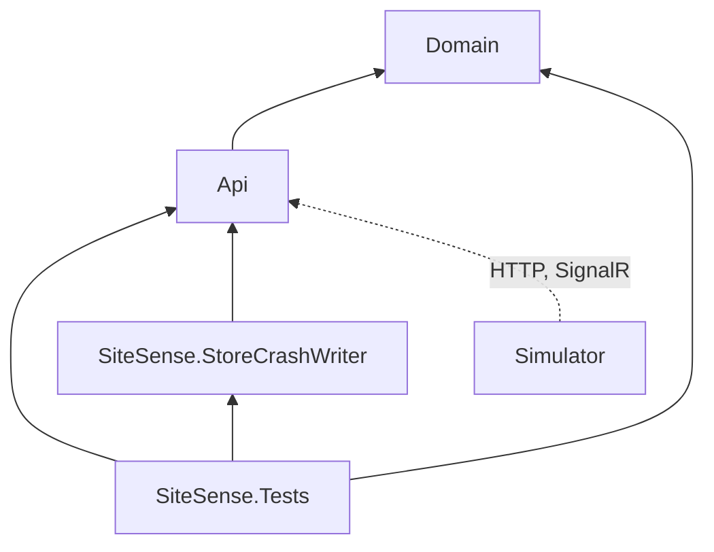
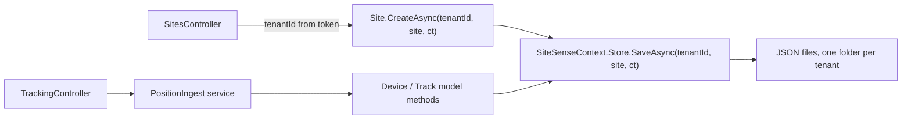
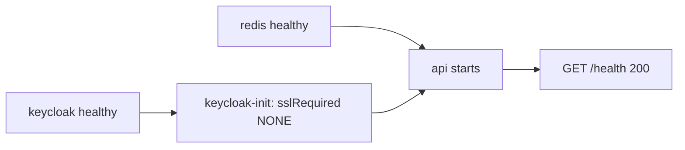

# Architecture

How the solution is laid out. Rules for adding code: `.claude/skills/sitesense-architecture/SKILL.md`. Decision: `ASSUMPTIONS.md` (Q66).

## Projects

| Project                         | Holds                                                                                                                                                 | References  |
| ------------------------------- | ----------------------------------------------------------------------------------------------------------------------------------------------------- | ----------- |
| `backend/SiteSense.Domain`      | Pure algorithms and geometric primitives: `Coordinate`, `Polygon`, geometry (point in area, distance), pedestrian graph and route finder, GPS filters | none        |
| `backend/SiteSense.Api`         | Composition root: controllers, entities and DTOs, services, store, auth, ML.NET, SignalR, Hangfire jobs                                               | Domain      |
| `simulator/SiteSense.Simulator` | Console device simulator; talks to the API over HTTP and SignalR only                                                                                 | none        |
| `frontend/` (reserved)          | The demo client, added in its own story; talks to the API over HTTP and SignalR only. Never under `simulator/`.                                       | none        |
| `tests/SiteSense.Tests`         | All server tests, in `Domain/` and `Api/` subfolders                                                                                                  | Domain, Api, StoreCrashWriter |
| `tests/SiteSense.StoreCrashWriter` | Console child process for the store crash test: writes documents until the test kills it                                                        | Api |



The domain has no package or project references, so the compiler keeps it free of ASP.NET, IO, persistence, the clock, logging and ML.NET. It returns results or events and never publishes them itself.

## Api folders

Standard type-based ASP.NET Core layout (Q66). Each folder is created by the first story that needs it.

| Folder            | Holds                                                                                                                                          |
| ----------------- | ---------------------------------------------------------------------------------------------------------------------------------------------- |
| `Controllers/`    | One controller per area: `SitesController`, `TrackingController`, `NavigationController`, `AuthController`                                     |
| `Models/`         | Persisted entities (`Site`, `Device`, ...) with their static persistence methods, plus request and response DTOs                               |
| `Services/`       | Only multi-entity flows and external engines: `PositionIngest` (filter, area, realtime), `AnomalyDetector` (ML.NET), navigation and evacuation |
| `Store/`          | The single generic JSON document store implementation; takes the place of a `DbContext`                                                        |
| `Realtime/`       | SignalR hub, `IRealtimePublisher`, `SignalRPublisher`; the only code that uses `IHubContext`                                                   |
| `BackgroundJobs/` | Hangfire jobs, `<What>Job.cs`: trigger only, each calls a service or a model method                                                            |
| `Auth/`           | Authentication and authorization setup and policies                                                                                            |
| `Helpers/`        | Only the app-wide static context, `SiteSenseContext` (`Store`, `Time`); no general utilities                                                   |

Shared logic goes in Domain, `Store/` or `Realtime/`, never in `Helpers/`. Every recurring job schedule is registered in `Program.cs`, one line per job.

## Models and persistence

Active Record over one generic store (Q67).



- Each entity in `Models/` carries `Id`, `TenantId` and `Version`, and exposes static async methods for its own persistence and single-entity rules.
- `SiteSenseContext` (`Helpers/SiteSenseContext.cs`) holds `Store` and `Time`, both set once in `Program.cs` (`Time` is `TimeProvider.System`) and shared by HTTP requests, Hangfire jobs and SignalR (single process). Models and services read the current time only through `SiteSenseContext.Time`. Tests set a store on a temp folder and a fake `TimeProvider`.
- Controllers call model methods directly; only multi-entity flows and external engines go through `Services/`.
- `tenantId` is always an explicit parameter, never read from an ambient or HTTP context. The store rejects a read or write whose `tenantId` does not match the document.
- Models use Domain primitives, e.g. `Site.Boundary` is a Domain `Polygon`.

### Document store

`IDocumentStore` (`Store/`) is the one generic API for every document type (JDB-01): `GetAsync<T>`, `SaveAsync<T>`, `DeleteAsync<T>`, with `T : IDocument` (`Id`, `TenantId`, `Version`). `FileDocumentStore` implements it. Append-only records (positions, events) get their own interface later (Q75).

| Rule | How |
|---|---|
| Layout | `<Store:RootPath>/<tenantId>/<type name>/<id>.json`: one folder per tenant (JDB-07), one file per document, overwritten on save (Q04) |
| Atomic write (JDB-02) | Write `<id>.json.tmp`, fsync, rename over `<id>.json`. A killed process leaves the old or the new file, never half of one. Orphan `.tmp` files are deleted when the store opens. |
| Thread safety (JDB-04) | One async lock per document. Reads take no lock: the rename is atomic. |
| Version (JDB-03) | The caller saves with the version it read (`0` = new); under the lock the store compares it with the stored one. Equal: write, version + 1. Different: `ConcurrencyException`, nothing written. `DeleteAsync` takes the expected version too. |
| ETag (JDB-10, Q45) | The API sends the version as `ETag: "3"` and copies `If-Match` into `doc.Version` (missing = 0). `ConcurrencyException` becomes 412 ProblemDetails (`StatusCodeSelector` in `Program.cs`). |
| Names | `tenantId` and `id` accept only `[A-Za-z0-9_-]`, so no path can leave the tenant folder. Ids are case-sensitive: in file and folder names each uppercase letter becomes `!` + lowercase (`DEV-001` → `!d!e!v-001.json`), so case-insensitive disks (macOS, Windows) keep them apart (Q76). |

## Build settings

| File                       | Sets                                                            |
| -------------------------- | --------------------------------------------------------------- |
| `SiteSense.slnx`           | The solution                                                    |
| `Directory.Build.props`    | `net10.0`, nullable enabled, implicit usings, for every project |
| `Directory.Packages.props` | Central package management: every package version, exact        |
| `.editorconfig`            | Formatting and C# style (suggestions)                           |
| `.github/workflows/ci.yml` | Restore, build and test on every PR and on `main`               |

## Configuration

Only `backend/SiteSense.Api/appsettings.example.json` is committed; `appsettings.json` and `appsettings.*.json` are gitignored (Q68). Before the first run:

```bash
cp backend/SiteSense.Api/appsettings.example.json backend/SiteSense.Api/appsettings.json
```

A new config key is added to `appsettings.example.json` in the same PR.

| Key              | Default                                                                                                         | Rule                                                                               |
| ---------------- | --------------------------------------------------------------------------------------------------------------- | ---------------------------------------------------------------------------------- |
| `Store:RootPath` | `.store` (template), relative to the working directory: `backend/SiteSense.Api/.store/` with `dotnet run` (Q73) | Required and writable; checked at start, the API does not start otherwise (NF-04). |
| `Auth:Issuer` | `http://localhost:8081/realms/sitesense` | Required; the only accepted `iss` (Q02). |
| `Auth:Audience` | `sitesense-api` | Required; the token `aud` must contain it. |
| `Auth:MetadataAddress` | empty (template); compose: `http://keycloak:8081/realms/sitesense/.well-known/openid-configuration` | Where the signing keys are read; empty means the issuer (Q02). |
| `Auth:RequireHttpsMetadata` | `true` (code); `false` in the template and compose | Keys only over HTTPS unless turned off; off only for the local plain-HTTP Keycloak (Q74). |

## Run with Docker

`docker compose up` from the repository root starts everything. No `appsettings.json` is needed: compose sets the config through environment variables, and the image never contains a local `appsettings*.json` (`.dockerignore`).

| Service         | Image                                                          | Host port | Volume                                                     | Health check                                                       |
| --------------- | -------------------------------------------------------------- | --------- | ---------------------------------------------------------- | ------------------------------------------------------------------ |
| `api`           | built from `backend/SiteSense.Api/Dockerfile`                  | 8080      | `store-data` at `/var/lib/sitesense/store`                 | `GET /health`                                                      |
| `keycloak`      | `quay.io/keycloak/keycloak:26.5.0`, `start-dev --import-realm` | 8081      | `docker/keycloak` read-only at `/opt/keycloak/data/import` | `/health/ready` on internal port 9000                              |
| `keycloak-init` | same Keycloak image, runs once                                 | none      | none                                                       | exits 0 after setting the master realm to `sslRequired=NONE` (Q73) |
| `redis`         | `redis:8.4.0-alpine`, `--appendonly yes --appendfsync always`  | none      | `redis-data` at `/data`                                    | `redis-cli ping`                                                   |



- The API starts only after Redis is healthy and `keycloak-init` has finished.
- Everything runs on plain HTTP, Keycloak included: `http://localhost:8081` from the host (browser, the API started with `dotnet run`, the simulator), `http://keycloak:8081` from other containers. No certificate to trust anywhere (Q74).
- `Store__RootPath=/var/lib/sitesense/store` overrides the local default, so the store survives restarts (NF-05).
- Keycloak keeps its data inside the container. The realm is imported only if it does not exist yet, so after editing `docker/keycloak/sitesense-realm.json` recreate the container: `docker compose up -d --force-recreate keycloak`.
- Reset all data: `docker compose down -v` (also fixes a store volume created with the wrong owner by an older image).

Variables compose reads (all have defaults; override them in `.env`, template `.env.example`):

| Variable                      | Default | Use                                                             |
| ----------------------------- | ------- | --------------------------------------------------------------- |
| `SITESENSE_TEST_MODE`         | `false` | Passed to the API; turns on the test endpoints once they exist. |
| `KC_BOOTSTRAP_ADMIN_USERNAME` | `admin` | Keycloak admin console user, local test credential (Q70).       |
| `KC_BOOTSTRAP_ADMIN_PASSWORD` | `admin` | Keycloak admin console password, local test credential (Q70).   |

## Identity realm

`docker/keycloak/sitesense-realm.json` is the whole IdP config, versioned and imported at start (IDN-04). Roles and policies: `.claude/skills/sitesense-security/SKILL.md`.

| Item                     | Value                                                                                                                   |
| ------------------------ | ----------------------------------------------------------------------------------------------------------------------- |
| Realm                    | `sitesense`, `sslRequired: none` (Q73)                                                                                  |
| Issuer                   | `http://localhost:8081/realms/sitesense`, fixed by `KC_HOSTNAME` for every caller; also in `verify.env`                 |
| Realm roles              | `Admin`, `Safety`, `Viewer`; one per user (Q61)                                                                         |
| Users                    | `admin-a`, `safety-a`, `viewer-a` (tenant-a), `admin-b`, `safety-b`, `viewer-b` (tenant-b); password `Password1!`       |
| `sitesense-verify`       | public client, password grant only, for verification                                                                    |
| `gateway-a`, `gateway-b` | confidential, client credentials only, secrets `gateway-secret-a` / `gateway-secret-b`, default scope `positions:write` |

Access token claims, set by mappers on each client (the realm has no default client scopes, so nothing else is added):

| Claim                | Users                                 | Gateways                   |
| -------------------- | ------------------------------------- | -------------------------- |
| `sub`                | user id                               | service account id         |
| `tenant_id`          | user attribute `tenant_id`            | hardcoded per client (Q59) |
| `roles`              | the user's realm role, as a flat list | none                       |
| `aud`                | `sitesense-api`                       | `sitesense-api`            |
| `scope`              | none                                  | `positions:write`          |
| `preferred_username` | user name                             | none                       |

- `KC_HOSTNAME_BACKCHANNEL_DYNAMIC=true`: discovery fetched from `http://keycloak:8081` returns `jwks_uri` and `token_endpoint` on `keycloak:8081`, while the issuer stays `http://localhost:8081`. So the API validates the same tokens from a container or from `dotnet run`.
- `keycloak-init` is still needed: the import skips realms that exist, and the bootstrap admin creates `master` first.

## Build and test

```bash
dotnet build
dotnet test
```

Run from the repository root.
