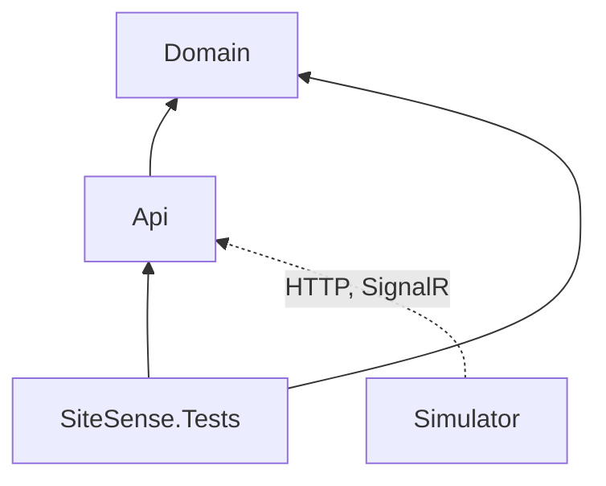

# Architecture

How the solution is laid out. Rules for adding code: `.claude/skills/sitesense-architecture/SKILL.md`. Decision: `ASSUMPTIONS.md` (Q66).

## Projects

| Project | Holds | References |
|---|---|---|
| `backend/SiteSense.Domain` | Pure domain code: core types, geometry, pedestrian graph and routing, GPS filters, area and alarm rules | none |
| `backend/SiteSense.Api` | Composition root and every feature: endpoints, services, store, auth, ML.NET, SignalR, Hangfire | Domain |
| `simulator/SiteSense.Simulator` | Console device simulator; talks to the API over HTTP and SignalR only | none |
| `tests/SiteSense.Tests` | All server tests, in `Domain/` and `Api/` subfolders | Domain, Api |



The domain has no package or project references, so the compiler keeps it free of ASP.NET, IO, the clock, logging and ML.NET. It returns results or events and never publishes them itself.

## Api feature folders

Each folder is created by the first story that needs it.

| Folder | Holds |
|---|---|
| `Store/` | JSON document store and its interfaces (`IDocumentStore<T>`) |
| `Auth/` | Authentication and authorization policies |
| `Sites/` | Sites and map import |
| `Tracking/` | Position ingest, tracks, area occupancy |
| `Navigation/` | Routing and evacuation endpoints, using the graph and routing code in Domain |
| `Anomalies/` | ML.NET anomaly detectors |
| `Realtime/` | SignalR hub and `IRealtimePublisher`; the only code that uses `IHubContext` |
| `Jobs/` | Hangfire registration and job wrappers |

## Build settings

| File | Sets |
|---|---|
| `SiteSense.slnx` | The solution |
| `Directory.Build.props` | `net10.0`, nullable enabled, implicit usings, for every project |
| `Directory.Packages.props` | Central package management: every package version, exact |
| `.editorconfig` | Formatting and C# style (suggestions) |
| `.github/workflows/ci.yml` | Restore, build and test on every PR and on `main` |

## Build and test

```bash
dotnet build
dotnet test
```

Run from the repository root.
