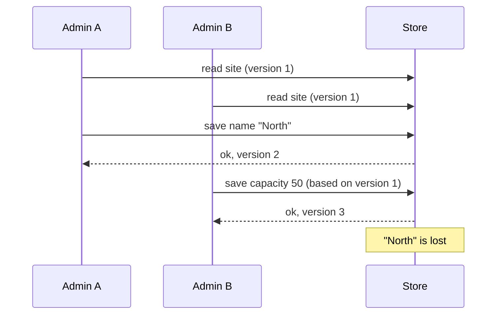
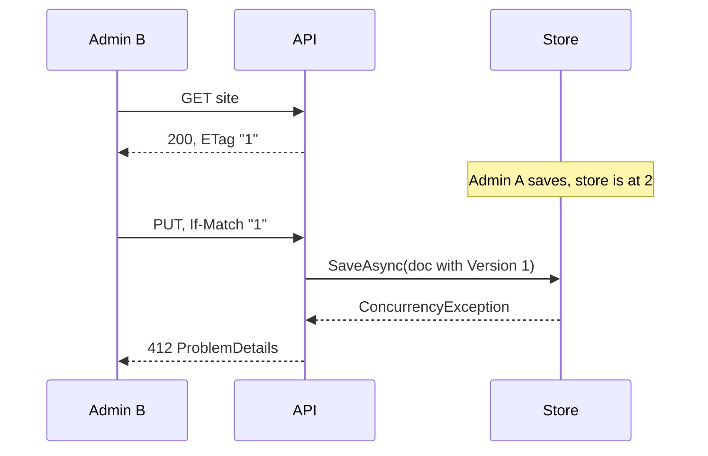

# SS-10 — Optimistic concurrency and ETag

- Status: Approved
- Issue: #42
- Plan PR: #54   Implementation PRs: #57
- Requirement IDs: JDB-03, JDB-10

## Problem

The document store saves every write blindly: it reads the stored version and writes `stored + 1`,
whatever version the caller started from. Two admins who edit the same site at the same time both
"win": the second save silently overwrites the first, and nobody is told.

## Goal

Check the version before saving; if it differs, return an error.

- Store: a save or delete based on a version that is not the stored one throws
  `ConcurrencyException` (JDB-03).
- API: the version goes out as `ETag: "3"` and comes back as `If-Match: "3"`; a stale one
  returns **412** (JDB-10).
- A multi-threaded test proves exactly one of many concurrent writers wins.

Out of scope: real document endpoints (SS-14, SS-15, SS-43 use this pattern), OpenAPI metadata
for `If-Match`.

## Solution

The caller saves the document with the version it read in `doc.Version` (`0` = new). Under the
per-document lock the store compares it with the stored version: equal → write, `Version + 1`;
different → `ConcurrencyException`, nothing written.

HTTP: `ETag` is a response header that labels the version the client read; `If-Match` is the
request header in which the client sends that label back ("save only if it is still version 3").

- The controller copies `If-Match` into `doc.Version`. A missing or unreadable `If-Match` counts
  as version 0, so a change to an existing document without it also gets 412 (Q45: `If-Match` is
  required). The version in the request body is never used.
- `ConcurrencyException` → 412 with one line in `Program.cs`:
  `UseExceptionHandler` with `StatusCodeSelector`. The body is the standard ProblemDetails with no
  ids or versions. No new class, no new folder.

## Steps

| # | Step | Files | Done when | PR |
|---|---|---|---|---|
| 1 | Add `ConcurrencyException`. Version check in `SaveAsync` before `doc.Version` is changed. `DeleteAsync<T>(tenantId, id, expectedVersion, ct)`: missing → `false`, different version → throw. | `backend/SiteSense.Api/Store/ConcurrencyException.cs`, `Store/IDocumentStore.cs`, `Store/FileDocumentStore.cs` | Builds. | impl |
| 2 | Map `ConcurrencyException` to 412. | `backend/SiteSense.Api/Program.cs` | API test 412 passes. | impl |
| 3 | Callers pass the version they read: crash writer, `Save_Existing_IncrementsVersion`, `Delete_Existing_ReturnsTrueThenGetNull`. | `tests/SiteSense.StoreCrashWriter/CrashWriter.cs`, `tests/SiteSense.Tests/Api/Store/FileDocumentStoreTests.cs` | Existing tests and crash test pass. | impl |
| 4 | Tests (below). Test-only `ETagProbeController` (`GET` and `PUT` on a `TestDoc`) shows SS-14 the pattern. Every class that starts the API host goes in one xUnit collection `Api`, since each start replaces the static `SiteSenseContext.Store`. | `tests/SiteSense.Tests/Api/ETagProbeController.cs`, `tests/SiteSense.Tests/Api/ETagTests.cs`, `HealthTests.cs`, `OpenApiTests.cs`, `ErrorResponseTests.cs` | `dotnet test` green. | impl |
| 5 | Docs: Q45 in `ASSUMPTIONS.md`, version row in `docs/architecture.md`, step 7 of "Add an endpoint" in the architecture skill shows the pattern, `AI_LOG.md` entry. | those files | No text says "the stale-version check comes with SS-10". | impl |

## Risks

| Risk | Impact | Mitigation |
|---|---|---|
| Callers that relied on blind saves | Their saves fail | Only test code saves today; step 3 fixes each one. |
| Static `SiteSenseContext.Store` shared by parallel test classes | Flaky API tests | One xUnit collection (step 4). |
| SS-11 changes `FileDocumentStore.cs` in parallel | Merge conflict | SS-10 touches only `SaveAsync` and `DeleteAsync`. |

## Tests

- Store: `Save_StaleVersion_ThrowsConcurrencyException`, `Delete_StaleVersion_ThrowsConcurrencyException`,
  `Save_ConcurrentWritersSameVersion_ExactlyOneWins` (16 writers on real threads read version 1
  and save; one wins, 15 throw; stored version 2 with the winner's content). The last one
  replaces `Save_ParallelSameDocument_EndsAtVersionN`, which assumed blind saves.
- API: `Get_ReturnsETag`, `Put_MatchingIfMatch_Returns200WithNextETag`,
  `Put_StaleIfMatch_Returns412Problem`, `Put_MissingIfMatch_Returns412Problem`.
- Build: 0 warnings, 0 errors.

## Open questions

| # | Question | Options (recommended first) | Decision |
|---|---|---|---|
| 1 | Which documents get ETag, is `If-Match` required, how does the caller pass the version? | All documents; required; `doc.Version`, missing `If-Match` = 0 → 412. | Decided by the user (Q45) |

## Changelog

| Date | Change | Why (review comment or finding) |
|---|---|---|
| 2026-11-24 | First draft | — |
| 2026-11-24 | Check order, 404, 428/400, edge cases, collection for `HealthTests` | Plan validation (Sonnet) |
| 2026-11-24 | Cut to the minimal version: no 428/400, no helper class or folder, 412 via `StatusCodeSelector` | User review: "check the version before saving, if it differs return an error" |
