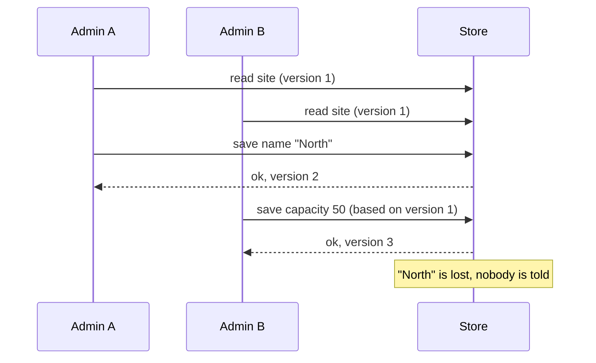
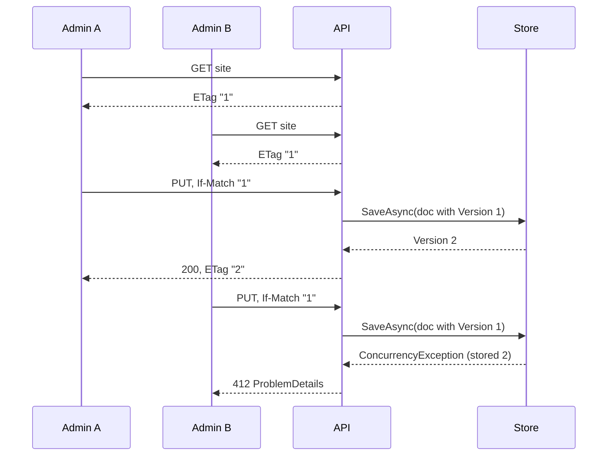

# SS-10 — Optimistic concurrency and ETag

- Status: In review
- Issue: #42
- Plan PR: (this PR)   Implementation PRs: (after approval)
- Requirement IDs: JDB-03, JDB-10

## Problem

The document store (SS-9) saves every write blindly: it reads the stored version and writes
`stored + 1`, whatever version the caller started from. Two admins who edit the same site at the
same time both "win": the second save silently overwrites the first, and the first admin's change
is lost. Nothing tells the client that its copy is out of date.



## Goal

- The store rejects a save or delete based on a version that is no longer the stored one, with
  `ConcurrencyException` (JDB-03).
- The API sends the document version as `ETag` and requires `If-Match` on every change to an
  existing document; a stale `If-Match` returns **412**, a missing one **428** (JDB-10, Q45).
- A multi-threaded test proves exactly one of many concurrent writers wins.

Out of scope: real document endpoints (sites, maps, devices come with SS-14, SS-15, SS-43; they
use this mechanism). OpenAPI metadata for `If-Match` is added with those endpoints.

## Solution

The version a caller read travels with the document. `IDocument.Version` already holds it: the
caller saves the document with the version it read (`0` for a new document). Under the per-document
lock the store compares it with the stored version (it already reads it there). Equal: write and
return `Version + 1`. Different: throw `ConcurrencyException`, write nothing.

At the API the version is the `ETag`, as a strong quoted number: version 3 → `ETag: "3"`. A client
sends it back in `If-Match: "3"`. The controller puts that number into `doc.Version` before saving.
One exception handler turns the errors into ProblemDetails:

| Case | Status |
|---|---|
| `If-Match` missing on PUT or DELETE of an existing document | 428 Precondition Required |
| `If-Match` not a single quoted number (e.g. `*`, `W/"3"`, `abc`) | 400 |
| `If-Match` version is not the stored one | 412 Precondition Failed |



Example of a 412 body:

```json
{ "type": "https://tools.ietf.org/html/rfc9110#section-15.5.13", "title": "Precondition Failed", "status": 412,
  "detail": "The document was changed by someone else. Read it again and retry." }
```

The detail never contains ids, paths or versions of other tenants' data.

## Steps

| # | Step | Files | Done when | PR |
|---|---|---|---|---|
| 1 | Add `ConcurrencyException` (type name, id, expected and stored version as properties; message without paths). | `backend/SiteSense.Api/Store/ConcurrencyException.cs` | Builds. | impl |
| 2 | Version check in the store. `SaveAsync`: under the lock, compare `doc.Version` with the stored version (missing document = 0) **before** touching `doc.Version`; different → throw, `doc.Version` unchanged. `DeleteAsync<T>(tenantId, id, expectedVersion, ct)`: under the lock read the document with `GetAsync`; missing → `false`; version different → throw. Update the interface comments. | `Store/IDocumentStore.cs`, `Store/FileDocumentStore.cs`, `Store/IDocument.cs` | Store unit tests of step 6 pass. | impl |
| 3 | Fix the existing callers to pass the version they read: `CrashWriter` sets `Version = current?.Version ?? 0`; `Save_Existing_IncrementsVersion` saves with the returned version; `Delete_Existing_ReturnsTrueThenGetNull` passes the version; `Save_ParallelSameDocument_EndsAtVersionN` is replaced (step 6). No other callers (grep). | `tests/SiteSense.StoreCrashWriter/CrashWriter.cs`, `tests/SiteSense.Tests/Api/Store/FileDocumentStoreTests.cs` | Crash test and existing store tests pass. | impl |
| 4 | ETag helper: `Format(long version)` → `"3"`; `ParseIfMatch(string? header)` → `long`. Missing → throws the built-in `BadHttpRequestException` with status 428; malformed → the same with 400 (no new exception types). Exception handler (`IExceptionHandler`, registered with `AddExceptionHandler<T>()`) maps `ConcurrencyException` → 412 and `BadHttpRequestException` → its status code, writing through `IProblemDetailsService` so the type is `application/problem+json`; any other exception returns `false`, so the generic 500 path is unchanged. In .NET 10 an exception handled by an `IExceptionHandler` is not logged as an error by the middleware, so expected conflicts do not look like failures; the handler logs one Information line. Folder: open question 1. | `<folder>/ETag.cs`, `<folder>/ConcurrencyExceptionHandler.cs`, `backend/SiteSense.Api/Program.cs` | Unit and API tests of step 6 pass. | impl |
| 5 | Test-only `ETagProbeController` (test assembly, like `ErrorProbeController`), fixed tenant (no auth yet): `POST` (forces `Version = 0`), `GET`, `PUT`, `DELETE` on a `TestDoc` through `SiteSenseContext.Store`. Order on PUT/DELETE: parse `If-Match` (428/400) → read the document (missing → 404) → set `doc.Version` from the header only, never from the body → save/delete (stale → 412). Every 200/201 sets `ETag`. It is the pattern SS-14 copies. | `tests/SiteSense.Tests/Api/ETagProbeController.cs` | API tests of step 6 pass. | impl |
| 6 | Tests (below). One xUnit collection `Api` for every class that builds a host: the `ApiFactory` classes **and** `HealthTests` (its own `WebApplicationFactory<Program>`), because each host start overwrites the static `SiteSenseContext.Store`. | `tests/SiteSense.Tests/Api/Store/FileDocumentStoreTests.cs`, `tests/SiteSense.Tests/Api/ETagTests.cs`, `tests/SiteSense.Tests/Api/ETagHelperTests.cs`, `tests/SiteSense.Tests/Api/ApiCollection.cs`, `HealthTests.cs`, `OpenApiTests.cs`, `ErrorResponseTests.cs` | `dotnet test` green, twice in a row. | impl |
| 7 | Docs: Q45 in `ASSUMPTIONS.md`; document store section (version row, concurrency row) in `docs/architecture.md`; 412 and 428 rows in the status table of the coding skill §5 (one place); step 7 of "Add an endpoint" in the architecture skill links it and names the helper and the check order; folder table if open question 1 adds or changes a folder; `AI_LOG.md` entry. | `ASSUMPTIONS.md`, `docs/architecture.md`, `.claude/skills/dotnet-coding/SKILL.md`, `.claude/skills/sitesense-architecture/SKILL.md`, `AI_LOG.md` | No text still says "the stale-version check comes with SS-10". | impl |

## Risks

| Risk | Impact | Mitigation |
|---|---|---|
| SS-11 (index and paging) changes `FileDocumentStore.cs` in parallel | Merge conflict | SS-10 touches only `SaveAsync` and `DeleteAsync`; SS-11 adds new methods. |
| Callers that relied on blind saves | Every save of a new copy fails | Only test code saves today; step 3 fixes each one. SS-14+ read before they write. |
| Static `SiteSenseContext.Store` shared by parallel test classes | Flaky API tests | One xUnit collection for every class that starts a host (step 6). |
| Client sends `version` in the body | Bypasses the check | The controller takes the version from `If-Match` only; a test proves a body version is ignored. |
| Create through `SaveAsync` with `Version 0` on an existing id | Throws `ConcurrencyException` | Intended: a create never overwrites. The create endpoint maps it to the contract's duplicate error (SS-14). |
| 412/428 body leaks data | Privacy, tenant isolation | Fixed detail text, no ids or versions; a test asserts it. Another tenant's document is 404 (missing for this tenant), never 412. |
| Browsers cannot read `ETag` cross-origin | Demo client cannot send `If-Match` | No CORS yet; the story that adds CORS exposes `ETag` (`Access-Control-Expose-Headers`). |

## Tests

Store (`FileDocumentStoreTests`):
- `Save_StaleVersion_ThrowsConcurrencyExceptionAndKeepsStored` (also: the passed object's `Version` is unchanged)
- `Save_NewWithExistingId_ThrowsConcurrencyException`
- `Save_MissingWithVersion_ThrowsConcurrencyException`
- `Delete_StaleVersion_ThrowsConcurrencyException`
- `Delete_Missing_ReturnsFalse`
- `Save_ConcurrentWritersSameVersion_ExactlyOneWins` (testing skill §4): create at version 1; 16
  writers on real threads (`Task.Run` behind a `Barrier`) each read version 1 and save a different
  name; exactly one succeeds, 15 throw; stored version is 2 and the name is the winner's. Replaces
  `Save_ParallelSameDocument_EndsAtVersionN`, which assumed blind saves.

ETag helper (`ETagHelperTests`): `"3"` → 3; missing or empty → 428; `3`, `"3`, `""`, `"-1"`, `"03"`, overflow, a
list `"1", "2"`, `*`, `W/"3"` → 400; surrounding whitespace is trimmed.

API (`ETagTests`, through `ETagProbeController`):
- `Post_Returns201WithETag1`
- `Get_ReturnsETagWithVersion`
- `Put_MatchingIfMatch_Returns200WithNextETag`
- `Put_StaleIfMatch_Returns412Problem` (problem+json, body has no id or version)
- `Put_IfMatchZeroOnExisting_Returns412Problem`
- `Put_MissingIfMatch_Returns428Problem`
- `Put_MalformedIfMatch_Returns400Problem`
- `Put_MissingDocument_Returns404`
- `Put_BodyVersionIgnored_UsesIfMatch`
- `Delete_StaleIfMatch_Returns412Problem`, `Delete_MissingIfMatch_Returns428Problem`
- `Put_ConcurrentSameIfMatch_OneSucceedsOthers412` (real threads, `Task.WhenAll`)

Tenant isolation over HTTP needs the token's tenant claim: the probe has no auth, so this test
comes with SS-14 on the real endpoints. Build: 0 warnings, 0 errors.

## Open questions

| # | Question | Options (recommended first) | Decision |
|---|---|---|---|
| 1 | Where do `ETag` and the exception handler go? The architecture skill (Api folders, Q66) allows only `SiteSenseContext` in `Helpers/`, so it does not turn into a mixed bag of utilities; `Store/` is "store implementation and file IO". `ConcurrencyException` stays in `Store/` in every option. | a) New `Http/` folder for cross-cutting HTTP code (ETag, exception handler); the folder table gets one row. b) `Helpers/`, widening its rule to "app-wide static context and HTTP helpers". c) `Store/`: no new folder, but HTTP code in the store folder. | Open |
| 2 | Which documents get ETag, and is `If-Match` required? | All documents, required (428 when missing). | Decided by the user (Q45) |
| 3 | How does the caller pass the expected version? | `doc.Version` (the version it read; 0 = new). No blind saves. | Decided by the user (Q45) |

## Changelog

| Date | Change | Why (review comment or finding) |
|---|---|---|
| 2026-11-24 | First draft | — |
| 2026-11-24 | Check order, 404 on missing, body version ignored, built-in `BadHttpRequestException` for 428/400, problem+json via `IProblemDetailsService`, `HealthTests` in the collection, all broken store tests listed, ETag edge cases, CORS risk, open question 1 options reordered | Plan validation (Sonnet) |
