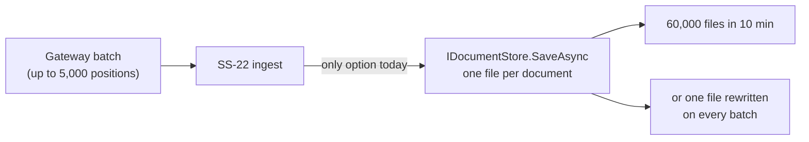
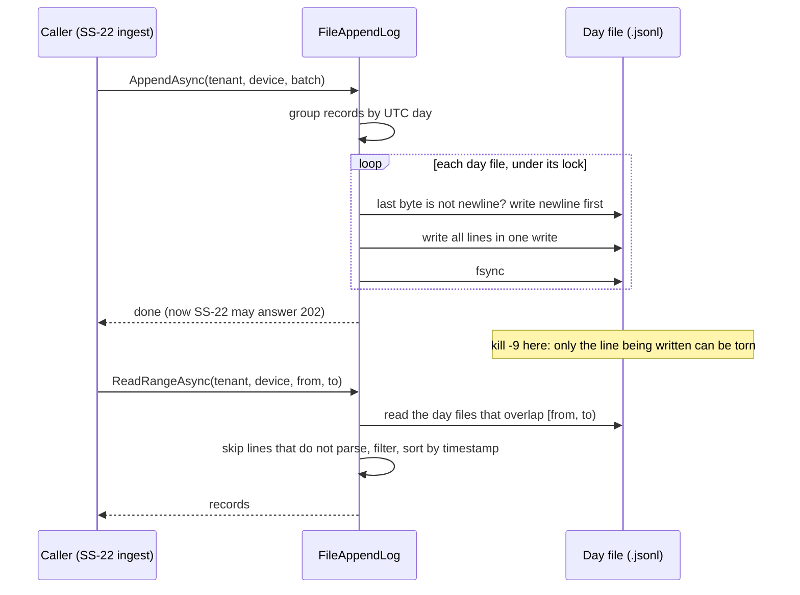

# SS-12 — Position log for write-heavy load

- Status: Draft
- Issue: #83
- Plan PR: #<n>   Implementation PRs: #<n>
- Requirement IDs: JDB-06 (designed for JDB-02, JDB-07, JDB-09)

## Problem

GPS devices send positions all the time: the target load is 100 positions per second for
10 minutes (60,000 records) with none lost, and a one-hour track of one device must load in
under 200 ms. Today the only persistence is the document store (SS-9): one JSON file per
document, replaced whole on every save.

A position is not a document: it never changes, it has no version, and there are many of them.
Stored as documents, each position is one file (60,000 files in 10 minutes, 3,600 files to open
for one hour of track), or one "track" document rewritten whole on every batch (the file grows
and every batch rewrites all of it). Nothing can append yet, so the ingest story (SS-22,
`POST /api/v1/positions`) has nowhere to write.



## Goal

An append-only log for records that never change, next to the document store (Q75: two
interfaces).

- Records are lines of JSON (JSONL), one file per tenant, key (the device) and UTC day.
- An append writes all lines of one call and fsyncs before it returns.
- A crash (`kill -9`) at any moment loses no record whose append returned; a torn last line
  is skipped on read.
- Read: all records of one key in a time range, ordered by timestamp.
- First record type: `Position` (raw, as received). The filtered `TrackPoint` (Q16) and events
  reuse the same log later, each in its own folder.

Out of scope: ingest and dedup (SS-22), the filtered track (tracking story), cursor paging (SS-11,
postponed), retention delete (SS-32), the benchmark command and `docs/RESULTS.md` (SS-13).

## Solution

A new `FileAppendLog` in `Store/`, beside `FileDocumentStore`. Both use the same store root, the
same name check and the same case encoding for file names (Q76), through shared static helpers.

### API

```csharp
// Store/ILogRecord.cs
public interface ILogRecord
{
    long TimestampMs { get; }
}

// Store/IAppendLog.cs
public interface IAppendLog
{
    // Writes every record to the file of its UTC day and fsyncs before returning.
    Task AppendAsync<T>(string tenantId, string key, IReadOnlyList<T> records, CancellationToken ct)
        where T : class, ILogRecord;

    // Records with fromMs <= TimestampMs < toMs, ordered by TimestampMs (append order on ties).
    // Lines that do not parse (a line torn by a crash) are skipped.
    Task<IReadOnlyList<T>> ReadRangeAsync<T>(string tenantId, string key, long fromMs, long toMs, CancellationToken ct)
        where T : class, ILogRecord;
}
```

Same shape as `IDocumentStore`: one non-generic interface with generic methods, one instance in
`SiteSenseContext`. Entities use it through static methods (Active Record, Q67):

```csharp
// Models/Position.cs
public sealed record Position(string DeviceId, long TimestampMs, double Lat, double Lon, double AccuracyM) : ILogRecord
{
    public static Task AppendAsync(string tenantId, string deviceId, IReadOnlyList<Position> positions, CancellationToken ct);
    public static Task<IReadOnlyList<Position>> ReadAsync(string tenantId, string deviceId, long fromMs, long toMs, CancellationToken ct);
}
```

### Files on disk

```text
<root>/tenant-a/Position/dev-001/2026-11-26.jsonl
{"deviceId":"dev-001","timestampMs":1793268000000,"lat":45.5001234,"lon":9.2004567,"accuracyM":4.5}
{"deviceId":"dev-001","timestampMs":1793268001000,"lat":45.5001301,"lon":9.2004602,"accuracyM":4.1}
```

- Path: `<root>/<tenantId>/<TypeName>/<key>/<yyyy-MM-dd>.jsonl`. Tenant and key go through the
  same name check and Q76 encoding as document ids. The day is the UTC day of `TimestampMs`, so
  a position that arrives hours late still lands in the file of its own day.
- One directory per tenant (JDB-07). A one-hour read opens one file, two around midnight.
  Retention (SS-32) deletes whole day files.

### Append, crash and read



- **Lock:** one `SemaphoreSlim` per encoded file path, as in `FileDocumentStore` (JDB-04). Two
  appends to the same file never interleave their lines. A call that spans two days takes the
  locks one at a time, in day order, so there is no deadlock. Locks are per instance: one
  `FileAppendLog` per root, the one in `SiteSenseContext` (same rule as the document store).
  Reads take no lock.
- **A line counts only when it ends with a newline.** The reader ignores the bytes after the last
  newline: they are a torn line or an append still being written, even if they happen to parse
  (a cut inside `"accuracyM":4.5` can leave a valid but wrong `4`). Complete lines that do not
  parse (an old torn fragment, see below) are skipped. The whole read never fails on one bad line.
- **Torn line repair (JDB-02):** a kill during a write can leave one partial last line. The writer
  opens the file with `FileMode.OpenOrCreate`, `FileAccess.ReadWrite`,
  `FileShare.ReadWrite | FileShare.Delete`, reads the last byte, and if it is not a newline writes
  one first. The fragment stays on its own line and is skipped; the new records start clean.
  Nothing is ever deleted or rewritten. The check runs on every append (nothing cached: a crash
  can happen at any time).
- **Partial batch:** one write of many lines can be cut after some whole lines. Those lines stay;
  the caller never got a return, so it retries and the raw log holds duplicates. That is allowed:
  dedup by device and timestamp is SS-22's job (TRK-01). The guarantee is "every record of a
  returned append is there, and no half record is ever returned", not all-or-nothing.
- **Durability:** one `Flush(flushToDisk: true)` per file per `AppendAsync` call. A gateway batch
  is one call, so the load is a few fsyncs per second, not one per position.
- **JSON:** `JsonSerializerDefaults.Web` (camelCase, as documents), no indentation. The serializer
  escapes newlines inside strings, so one record is always one line.
- **Input checks:** an empty list returns without touching the disk. A `Position` whose `DeviceId`
  is not the key throws `ArgumentException`. A `TimestampMs` outside the `DateTimeOffset` range
  throws `ArgumentOutOfRangeException`. `fromMs >= toMs` returns an empty list. Tenant and key go
  through the store name check (path traversal).
- **Read:** stream the day files line by line, keep only records in range, then a stable sort by
  `TimestampMs` (append order on ties).

## Steps

One implementation PR, stacked on this plan branch. Each step is one subagent task.

| # | Step | Files | Done when | PR |
|---|---|---|---|---|
| 1 | Move the name check, the Q76 file-name encoding and the shared `JsonSerializerOptions` into a static `StorePaths` helper. `FileDocumentStore.IsValidName` stays as a forwarding member, so its callers do not change | `backend/SiteSense.Api/Store/StorePaths.cs` (new), `backend/SiteSense.Api/Store/FileDocumentStore.cs` | Build passes; `grep -rn IsValidName backend tests` callers unchanged; all existing tests pass | impl |
| 2 | Add `ILogRecord`, `IAppendLog`, `FileAppendLog` as in "Solution" (path, input checks, day grouping, lock, newline repair, write, fsync, streaming read, complete-lines-only, skip, filter, stable sort) | `backend/SiteSense.Api/Store/ILogRecord.cs`, `IAppendLog.cs`, `FileAppendLog.cs` (new) | Build passes | impl |
| 3 | Add `Position` record with `AppendAsync` / `ReadAsync`; add `SiteSenseContext.Log`, set in `Init` on the same root | `backend/SiteSense.Api/Models/Position.cs` (new), `backend/SiteSense.Api/Helpers/SiteSenseContext.cs` | Build passes; existing API tests pass | impl |
| 4 | Unit, validation, load and concurrency tests (list under Tests) | `tests/SiteSense.Tests/Api/Store/FileAppendLogTests.cs` (new) | Tests pass | impl |
| 5 | Crash writer: `args[1] == "append"` selects append mode (batches of 500 positions, counter in `TimestampMs`, prints the last counter after each returned append); no `args[1]` keeps today's document mode, so `StoreCrashTests` is untouched | `tests/SiteSense.StoreCrashWriter/CrashWriter.cs` | Build passes; `StoreCrashTests` passes | impl |
| 6 | Crash test for the log, same pattern as `StoreCrashTests` (fixed seed, N runs on one folder, 30 s timeout, seed in failure messages) | `tests/SiteSense.Tests/Api/Store/AppendLogCrashTests.cs` (new) | Test passes | impl |
| 7 | Create `docs/adr/` and the first ADR, template in the ai-process skill §9 | `docs/adr/0001-position-storage.md` (new) | ADR has context, decision, alternatives, consequences | impl |
| 8 | Docs: architecture store section; Q04 status; the decisions of "Open questions" in `ASSUMPTIONS.md` (only the ones the user decided); `KNOWN_ISSUES.md` (new); `AI_LOG.md`; architecture skill (`Store/` and crash-writer rows); testing skill (append crash recipe) | `docs/architecture.md`, `ASSUMPTIONS.md`, `KNOWN_ISSUES.md`, `AI_LOG.md`, `.claude/skills/sitesense-architecture/SKILL.md`, `.claude/skills/sitesense-testing/SKILL.md` | Docs match the code | impl |

After step 8 a separate verify subagent runs build and all tests and returns a pass/fail report
(ai-process skill §3); failures go back to an implement subagent.

## Risks

| Risk | Impact | Mitigation |
|---|---|---|
| A day file of one busy device is large (1 position/s = 86,400 lines, ~9 MB); reading one hour parses the whole day | The 200 ms read target (JDB-09) may be missed for busy devices | Open question 9. A test reads one hour out of a full day file and prints the time; the measured figure goes in the PR. |
| The crash test cannot force a kill inside a write | It may never produce a torn line | The deterministic torn-line tests cut a file mid-line by hand. The crash test proves "every returned append survives and every returned record is whole", with large batches in a tight loop so some kills land in writes. |
| A partial last line that parses as a valid but wrong record | A wrong position would be returned | The reader uses complete (newline-terminated) lines only. |
| No fsync of the directory after creating a new day file; on macOS .NET `fsync` is not `F_FULLFSYNC` | A power loss (not a process kill) could lose recent data | Same limit as SS-9 (`shortcut:` comment); listed in `KNOWN_ISSUES.md`. JDB-02 asks for `kill -9`. |
| Many open semaphores (one per day file) | Memory grows slowly over days | Same shortcut as `FileDocumentStore`; listed in `KNOWN_ISSUES.md`, evict with retention (SS-32). |
| Duplicates are stored as sent (retries, partial batches) | A retried batch appears twice in the raw log | Dedup (TRK-01) is SS-22's job; the log stays a plain append. |

## Tests

`FileAppendLogTests`:

- `Append_ThenReadRange_ReturnsRecordsSortedByTimestamp` (records appended out of order)
- `ReadRange_ExcludesRecordsOutsideRange` (`from` inclusive, `to` exclusive)
- `Append_RecordsOnTwoUtcDays_WritesTwoFilesAndReadsAcrossMidnight`
- `ReadRange_TornLastLine_SkipsItAndReturnsEarlierRecords` (file cut mid-line by hand)
- `ReadRange_UnterminatedLastLineThatParses_IsIgnored` (cut inside a number)
- `Append_AfterTornLastLine_KeepsOldAndNewRecords`
- `ReadRange_OtherTenant_ReturnsNothing` (tenant isolation)
- `ReadRange_KeysDifferOnlyByCase_AreSeparate` (Q76)
- `Append_InvalidTenantOrKey_Throws` (path traversal)
- `Append_EmptyBatch_WritesNothing`
- `Append_DeviceIdNotKey_Throws`
- `Append_TimestampOutOfRange_Throws`
- `ReadRange_FromNotBeforeTo_ReturnsEmpty`
- `ReadRange_NoFile_ReturnsEmpty`
- `ReadRange_EqualTimestamps_KeepsAppendOrder`
- `Position_RoundTrip_KeepsAllFields` (camelCase, constructor binding)
- Load: `Append_SixtyThousandRecords_AllReadBack` (the 10-minute volume: 20 batches of 3,000 and
  600 of 100; asserts every record, not time)
- `ReadRange_OneHourFromFullDay_PrintsElapsed` (86,400 records; prints the time, asserts only
  correctness, so CI timing cannot make it flaky)
- Concurrency: `Append_ParallelWritersOnOneFile_EveryLineIntact` (8 writers × 200 batches plus one
  reader in a loop; the reader never sees a half record, and at the end every record is read back,
  none lost or merged)

`AppendLogCrashTests` (recipe in the testing skill, adapted to append):

- `Append_KilledMidWrite_LosesNoAcknowledgedRecord`: the child appends batches of 500 with
  increasing counters and prints the last counter after each returned append. The test kills it at
  seeded points, N runs on one folder, then reads: every returned record is whole, and every
  printed counter is present.

## Open questions

| # | Question | Options (recommended first) | Decision |
|---|---|---|---|
| 1 | Q59 (Brief) / Q75: one interface or two? | Two (`IDocumentStore`, `IAppendLog`) | Decided earlier: two (Q75) |
| 2 | File layout | tenant / device / UTC day · tenant / device / hour · tenant / day | User: tenant / device / UTC day |
| 3 | Who writes the files | New `FileAppendLog` with shared helpers · refactor into one `FileStore` | User: `FileAppendLog` with shared helpers |
| 4 | When to fsync | Once per `AppendAsync` call · periodic group commit · never | User: once per call |
| 5 | Record types now | Generic log + `Position` only · also `TrackPoint` | User: generic + `Position` only |
| 6 | Q16: keep raw positions and the filtered track apart? | Yes, one log per record type (`Position/`, later `TrackPoint/`), both under retention · store only the filtered track | Recommended: yes, two logs |
| 7 | Torn line before the next append | Write a newline first, keep the fragment, reader skips it · truncate the file to the last newline · checksum per line | Recommended: newline first (nothing is ever rewritten) |
| 8 | Read order on equal timestamps | Append order (stable sort) · undefined | Recommended: append order |
| 9 | What if the one-hour read from a full day file measures over 200 ms? | Keep day files, report the figure, fix it in SS-13 only if the benchmark misses (switch to hourly files: path function only) · switch to hourly files now | Recommended: keep day files and measure |

## Changelog

| Date | Change | Why (review comment or finding) |
|---|---|---|
| 2026-11-26 | First draft | — |
| 2026-11-26 | Complete-lines-only read, exact repair open mode, partial batches, input checks, stable streaming read, split crash steps, load and validation tests, open question 9 | Sonnet plan review |
