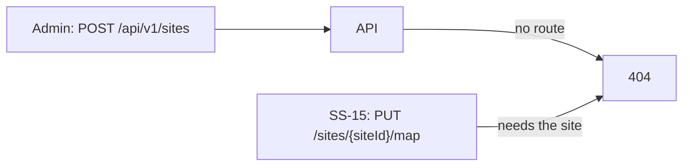
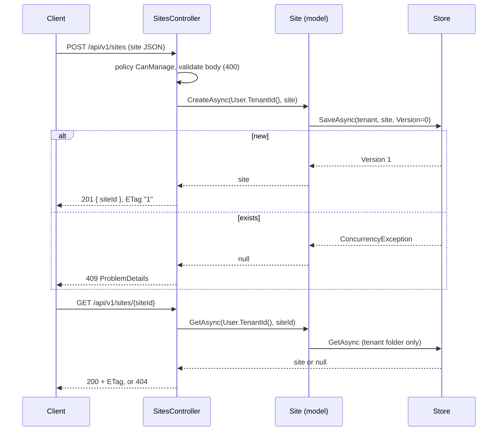

# SS-14 — Sites API

- Status: In review
- Issue: #45
- Plan PR: TBD-on-open   Implementation PRs: TBD-on-open
- Requirement IDs: API-01, C-7.3a, F-6.1

## Problem

A site is an outdoor work area of a tenant (glossary: [context](../../.claude/skills/sitesense-context/SKILL.md)).
Today the API cannot create one: there is no `Site` document and no endpoint. Every later
feature hangs on a site: the map import (`PUT /api/v1/sites/{siteId}/map`, SS-15), devices,
routes, occupancy. An Admin who sends the site JSON gets 404, because the route does not exist.



## Goal

- `POST /api/v1/sites` with the site JSON → `201 { "siteId" }`. Admin only (`CanManage`).
- Same `siteId` again in the same tenant → `409` ProblemDetails (Q43).
- `GET /api/v1/sites/{siteId}` → `200` with the site JSON and `ETag`, all roles (`CanSeeAggregates`, Q81).
  A site of another tenant, or a missing one → `404`.
- Invalid JSON → `400` `ValidationProblemDetails`, nothing stored (Q82).

Out of scope: update or delete of a site, list of sites, the map (SS-15), reading `mapFile` from disk.

## Solution

One `Site` document per site in the caller's tenant folder, id = `siteId`. The controller takes
the tenant from the token (`User.TenantId()`), never from the body. Creating saves with
version 0: the store rejects it with `ConcurrencyException` when the document already exists,
under its per-document lock, so two parallel creates give one 201 and one 409. `Site.CreateAsync`
turns that exception into `null`; the controller answers 409.

Example request (field names exactly as the site JSON format):

```json
{
  "siteId": "site-01",
  "name": "Stabilimento nord",
  "timeZone": "Europe/Rome",
  "mapFile": "map.geojson",
  "navigation": {
    "walkingSpeedMps": 1.3,
    "unpavedSpeedFactor": 0.8,
    "stepsSpeedFactor": 0.5,
    "connectToleranceM": 0.5,
    "maxSnapDistanceM": 30
  }
}
```

Response: `201`, `Location: /api/v1/sites/site-01`, `ETag: "1"`, body `{ "siteId": "site-01" }`.



Validation (Q82), at the boundary, before any write:

| Field | Rule |
|---|---|
| all fields | required (missing → 400) |
| `siteId` | valid store name (`FileDocumentStore.IsValidName`) |
| `name`, `mapFile` | not empty |
| `timeZone` | time zone id known to the runtime (`TimeZoneInfo.TryFindSystemTimeZoneById`; IANA on Linux and macOS) |
| `walkingSpeedMps`, `connectToleranceM`, `maxSnapDistanceM` | > 0 |
| `unpavedSpeedFactor`, `stepsSpeedFactor` | > 0 and ≤ 1 |

`GetAsync` returns `null` for an id that is not a valid store name, so a bad URL is a 404, not a 500
(the store throws `ArgumentException` on such names). `siteId` in the body is checked by the validator, never by the store.

Repeat creates are idempotent by rejection: the second one is a 409 and changes nothing (recipe step 8).
No PUT or DELETE in this story, so no `If-Match` yet (recipe step 7).

## Steps

| # | Step | Files | Done when | PR |
|---|---|---|---|---|
| 1 | Entity `Site : IDocument` (`Id`, `TenantId`, `Version`, `Name`, `TimeZone`, `MapFile`, `Navigation`) and record `NavigationSettings`; static `CreateAsync` (null on duplicate) and `GetAsync` (null on invalid id). New folder `Models/`. | `backend/SiteSense.Api/Models/Site.cs` | Builds. | impl |
| 2 | DTOs: `SiteRequest` + `NavigationRequest` with the validation above; `CreateSiteResponse(SiteId)`; `SiteResponse` (site JSON shape) for GET. | `backend/SiteSense.Api/Dtos/SiteRequest.cs`, `CreateSiteResponse.cs`, `SiteResponse.cs` | Builds. | impl |
| 3 | `SitesController`: actions named `Create` and `Get` (no `Async` suffix, for `CreatedAtAction`). `POST` (`CanManage`, 201/400/409 via `Problem(statusCode: 409)`, ETag) and `GET {siteId}` (`CanSeeAggregates`, 200 + ETag / 404). `[ProducesResponseType]` for 201/400/403/404/409. | `backend/SiteSense.Api/Controllers/SitesController.cs` | Builds; endpoints in `/openapi/v1.json` (`OpenApiTests` asserts the path). | impl |
| 4 | Tests (below). | `tests/SiteSense.Tests/Api/SitesTests.cs` | All pass. | impl |
| 5 | Create the first `.http` file, with POST and GET. | `backend/SiteSense.Api/SiteSense.Api.http` | Present. | impl |
| 6 | Docs: `Models/` already listed in the architecture skill (no change); Q43, Q81, Q82 in `ASSUMPTIONS.md`; AI_LOG entry. | `ASSUMPTIONS.md`, `AI_LOG.md` | Entries present. | impl |

## Risks

| Risk | Impact | Mitigation |
|---|---|---|
| Time zone ids differ by OS | A valid IANA id rejected in Docker | The Dockerfile uses the Debian `aspnet` image (not chiseled or Alpine), which has `/usr/share/zoneinfo`; checked on the running container in verify. Tests use `Europe/Rome` only. |
| Duplicate check races | Two 201 for one id | The store's version check runs under its per-document lock; a concurrency test proves one 201 and one 409. |
| SS-15 needs the site lookup | Map endpoint blocked | `Site.GetAsync(tenantId, siteId, ct)` is the lookup it uses (404 + `Navigation.ConnectToleranceM`). |

## Tests

`tests/SiteSense.Tests/Api/SitesTests.cs`. The valid body is the real site from `data/site.json`
(`cittadella-catania`, SS-18), inlined because `data/site.json` is not yet on this stack's base;
once the base is `main`, the test reads the file instead. The class uses `[Collection("Api")]` and
`IClassFixture<ApiFactory>` (shared static store); each test uses its own `siteId`. `Location` is
checked by `AbsolutePath`. "Nothing stored" = a GET of that `siteId` gives 404.

- `Create_Admin_Returns201WithSiteIdLocationAndETag`
- `Create_DuplicateSiteId_Returns409Problem`
- `Create_ParallelSameSiteId_OneCreatedOneConflict`
- `Create_NonAdmin_Returns403` (theory: Safety, Viewer, gateway)
- `Create_InvalidBody_Returns400Problem` (theory: unknown time zone, zero speed, factor 0, factor > 1, invalid `siteId`, missing `siteId`, missing or null `navigation`, empty `name`); nothing stored
- `Create_SameSiteIdOtherTenant_Returns201`
- `Get_OwnSite_Returns200WithBodyAndETag` (Viewer; all fields round-trip)
- `Get_OtherTenantSite_Returns404`
- `Get_UnknownOrInvalidId_Returns404` (theory: unknown, `..`, `a.b`, 129 chars)

## Open questions

| # | Question | Options (recommended first) | Decision |
|---|---|---|---|
| Q43 | Same `siteId` twice in one tenant | 409; overwrite (upsert) | 409 (issue #45) |
| Q81 | Who may read a site (`GET /api/v1/sites/{siteId}`)? | All roles (`CanSeeAggregates`); Admin only; no GET | All roles (owner) |
| Q82 | How strict is the site JSON check? | Full (required, IANA zone, ranges); required fields only | Full (owner) |

## Changelog

| Date | Change | Why (review comment or finding) |
|---|---|---|
| 2026-11-25 | First draft | — |
| 2026-11-25 | Action names, test collection and ids, 400 rows, OpenAPI test, invalid-id guard reason, tz wording | Sonnet review |
| 2026-11-25 | Valid test body = real site from `data/site.json` | SS-18 on `main` |
