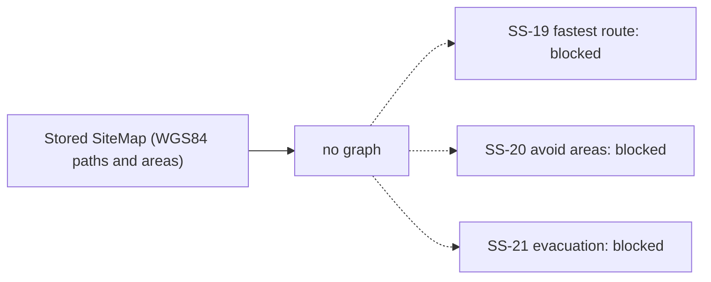
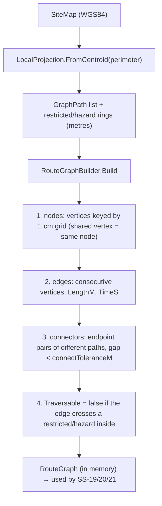

# SS-17 — Route graph

- Status: Approved
- Issue: #94
- Plan PR: #96   Implementation PRs: —
- Requirement IDs: MAP-03 (prepares NAV-02, NAV-03)

## Problem

A site map holds walk paths: GeoJSON `LineString`s in WGS84 `[lon, lat]`, each with `surface` (`paved`, `unpaved`),
`steps`, `slopePercent` and `widthM` (glossary: [context](../../.claude/skills/sitesense-context/SKILL.md)).
Today the map is only validated and stored (SS-15). Nothing knows which paths meet, how long a stretch is in metres,
or which stretches cross a `restricted` or `hazard` area. So the routing stories cannot start:
SS-19 (fastest route), SS-20 (avoid restricted areas) and SS-21 (evacuation) all need a graph to search.



## Goal

- A pure Domain builder turns the map paths and blocked areas, already in local metres, into an in-memory `RouteGraph`.
- Paths connect where they share a vertex, and where two path endpoints are closer than `connectToleranceM` (MAP-03).
- Each edge is one stretch between two consecutive vertices. An edge that crosses the inside of a `restricted` or
  `hazard` area stays in the graph with `Traversable = false` (prepares NAV-02).
- Each edge carries its length in metres and its walking time in seconds from the site navigation settings (prepares NAV-03).
- An ADR explains the graph structure.
- Out of scope: snapping, A*/Dijkstra, any endpoint, evacuation (SS-19, SS-20, SS-21). Slope and width in the cost (Q21).

## Solution

**Idea.** Every path vertex becomes a graph node; every pair of consecutive vertices becomes an undirected edge.
Two vertices with the same position (after projection, rounded to 1 cm, Q19) are the same node, so crossing paths
connect by construction. Then each path endpoint is compared with the endpoints of the other paths: when the gap is
below `connectToleranceM`, a short *connector* edge joins them (Q18). Last, each edge is tested against the
`restricted` and `hazard` polygons: if it passes through their inside, it is marked not traversable (Q25).

**Where the code goes** ([architecture](../../.claude/skills/sitesense-architecture/SKILL.md)):

| Part | File | Layer |
|---|---|---|
| Graph types | `backend/SiteSense.Domain/Navigation/RouteGraph.cs` | Domain (no packages) |
| Builder | `backend/SiteSense.Domain/Navigation/RouteGraphBuilder.cs` | Domain |
| Segment vs polygon test | `backend/SiteSense.Domain/Geometry/PlanarGeometry.cs` (new segment methods; point-in-polygon is SS-22's shared `Locate`) | Domain |
| Map → builder input | `backend/SiteSense.Api/Models/Map/SiteMap.cs` (new method `BuildRouteGraph`) | Api |

NetTopologySuite is not used: the Domain project has no package reference by rule, and the three geometric tests
needed (distance, point in polygon, segment crossing) are a few lines each.

**Types (Domain).**

```csharp
public sealed record GraphNode(int Id, double X, double Y);
// PathId is null for a tolerance connector.
public sealed record GraphEdge(int From, int To, double LengthM, double TimeS, bool Traversable, string? PathId);
public sealed record GraphPath(string Id, bool Unpaved, bool Steps, IReadOnlyList<(double X, double Y)> Points);
// Each blocked area is a list of rings (outer ring first, then holes), in local metres.
public sealed record GraphSettings(double WalkingSpeedMps, double UnpavedSpeedFactor, double StepsSpeedFactor, double ConnectToleranceM);

public sealed class RouteGraph
{
    public IReadOnlyList<GraphNode> Nodes { get; }
    public IReadOnlyList<GraphEdge> Edges { get; }
    public IReadOnlyList<IReadOnlyList<int>> EdgesOf { get; }   // edge indices touching each node (both directions)
}

public static class RouteGraphBuilder
{
    public static RouteGraph Build(IReadOnlyList<GraphPath> paths,
        IReadOnlyList<IReadOnlyList<IReadOnlyList<(double X, double Y)>>> blockedAreas, GraphSettings settings);
}
```

**Edge cost.** `TimeS = LengthM / (WalkingSpeedMps × f)`, where `f` is `UnpavedSpeedFactor` if the path is unpaved,
times `StepsSpeedFactor` if it has steps, else 1 (Q21). A connector edge uses `f = 1`. Example with the sample
settings (1.3 m/s, 0.8, 0.5): a 10 m unpaved stretch with steps takes 10 / (1.3 × 0.8 × 0.5) ≈ 19.2 s.

**Not traversable test (Q25).** For segment A→B and one polygon (outer ring plus holes):

1. Collect the parameters `t` in [0, 1] where A→B meets any ring edge: crossing points, touching points, and both
   ends of a collinear overlap. Add 0 and 1. Sort and drop duplicates.
2. For each pair of consecutive `t` values, take the midpoint of that piece.
3. Locate the midpoint with the shared `PlanarGeometry.Locate(p, rings, 1e-6)` added by SS-22 (even-odd rule,
   ring 0 outer, the rest holes). `OnBoundary` counts as not inside here (SS-22's perimeter check counts it as
   inside: each caller decides). SS-17 adds no point-in-polygon of its own.
4. The segment is blocked if any midpoint is inside.

So a segment that only touches or runs along the boundary stays traversable; a segment fully inside, or going from
boundary to boundary through the inside, is blocked. A cheap bounding-box check skips polygons far from the segment.

**Node and edge rules.**

- A segment whose two ends fall on the same node (duplicate consecutive vertex) gives no edge.
- A path with fewer than two distinct nodes gives no edge. A closed path (first vertex = last) is fine: its ends
  share a node.
- Two paths that overlap on the same stretch give two parallel edges; both are kept (the router takes the cheaper).
- Connectors: take the end nodes of every path. For each pair of end nodes from different paths, at distance
  strictly less than `connectToleranceM` ("less than" in MAP-03), that are not the same node and not already joined
  by an edge, add one connector (each pair once).
- Inputs are trusted: the Sites API already rejects non-positive speeds and tolerances (`Dtos/SiteRequest.cs`), and
  the map validator rejects unknown surfaces.

**Projection.** `SiteMap.BuildRouteGraph(NavigationSettings)` creates `LocalProjection.FromCentroid` of the
outer ring of the `perimeter` area. A stored map always has exactly one perimeter (SS-15 rejects the others), so
this is the same origin the validator uses for its tolerance check. Blocked areas are those with `AreaType`
`restricted` or `hazard` (lower case, as the validator stores them); `Coordinates` is outer ring first, then holes.
A `paved`/`unpaved` `Surface` maps to `Unpaved`.

**Check on the sample map.** A quick script on `data/map.geojson` (293 paths) with shared vertices and 0.5 m
endpoint connectors gives one connected component, so the sample-map test can assert full connectivity.



Small example: path `p1` from (0,0) to (10,0), path `p2` from (10.3,0) to (20,0), tolerance 0.5 m.
Result: nodes (0,0), (10,0), (10.3,0), (20,0); edges p1 10 m, connector 0.3 m, p2 9.7 m. With tolerance 0.2 m the
connector is missing and the two paths are separate.

## Steps

| # | Step | Files | Done when | PR |
|---|---|---|---|---|
| 1 | Segment vs polygon interior test (uses SS-22's `Locate`; needs SS-22 impl 1 merged into this branch first) | `backend/SiteSense.Domain/Geometry/PlanarGeometry.cs`, `tests/SiteSense.Tests/Domain/PlanarGeometryTests.cs` | The `PlanarGeometryTests` listed in "Tests" pass | impl |
| 2 | Graph types and builder (nodes, edges, cost, connectors, traversable) | `backend/SiteSense.Domain/Navigation/RouteGraph.cs`, `RouteGraphBuilder.cs` | Builds; Domain csproj still has no reference | impl |
| 3 | Builder tests | `tests/SiteSense.Tests/Domain/RouteGraphBuilderTests.cs` | The `RouteGraphBuilderTests` listed in "Tests" pass | impl |
| 4 | Map adapter | `backend/SiteSense.Api/Models/Map/SiteMap.cs` | `BuildRouteGraph` builds from a stored map | impl |
| 5 | Adapter tests | `tests/SiteSense.Tests/Api/Maps/RouteGraphMapTests.cs` | Synthetic WGS84 map and sample map tests pass | impl |
| 6 | ADR (creates `docs/adr/`) | `docs/adr/0001-path-graph-structure.md` (name fixed by the ai-process skill) | Context, decision, alternatives, consequences filled | impl |
| 7 | Records | `ASSUMPTIONS.md` (the decided open questions), `KNOWN_ISSUES.md`, `AI_LOG.md` (one story entry) | Entries in the skill formats | impl |

One implementation PR, stacked on the plan branch: the change is about 300 lines and reviewable alone.

## Risks

| Risk | Impact | Mitigation |
|---|---|---|
| Floating point: a segment that runs exactly on an area edge is seen as inside | A good path is blocked | Midpoint test with a 1e-6 m boundary tolerance; test "runs along edge" |
| Two paths cross without a shared vertex (map error) | No junction there | The map rules guarantee a shared vertex; documented in KNOWN_ISSUES |
| Endpoint near the middle of another path (T junction without shared vertex) | Not connected (Q18) | Documented; revisit if test maps need it |
| Connector check is all endpoint pairs, O(n²) | Slow on huge maps | A few hundred paths in practice; `shortcut:` comment, grid index if maps grow |
| Rounding grid: two vertices 1 mm apart on each side of a 1 cm cell edge stay separate | Missed junction | Only for non-identical coordinates; endpoints still meet through the tolerance connector |

## Tests

- `PlanarGeometryTests` (segment vs square, with and without a hole): crossing → inside; touching a corner → not;
  running along an edge → not; fully inside → inside; boundary to boundary through the inside → inside;
  crossing only the hole → not; crossing the ring around the hole → inside.
- `RouteGraphBuilderTests`:
  - `SharedVertex_JoinsPaths`: two paths crossing at a shared middle vertex give one node with 4 edges.
  - `EndpointsCloserThanTolerance_GetConnector` (0.3 m gap, 0.5 m tolerance).
  - `EndpointsFartherThanTolerance_StayApart` (0.7 m gap) and `GapEqualToTolerance_StaysApart` (strictly less).
  - `SharedEndpoint_NoConnector` (no zero-length connector).
  - `DuplicateVertex_NoSelfLoop` and `ClosedPath_Builds`.
  - `EdgeCrossingHazard_NotTraversable`, `EdgeTouchingRestrictedBoundary_Traversable`; the other edges of the same path stay traversable; a `work` area blocks nothing (only blocked areas are passed in, tested in the adapter).
  - `ConnectorCrossingRestricted_NotTraversable` (if Q87 = A).
  - `TimeS_UsesSurfaceAndStepsFactors` (the 19.2 s example).
- `RouteGraphMapTests`:
  - Synthetic WGS84 map: two paths sharing a `[lon, lat]` vertex join; two endpoints 0.3 m apart get a connector;
    an edge through a `hazard` area is not traversable, through a `work` area it is.
  - Sample map `data/map.geojson`: builds, and every node is reachable from node 0 over all edges.

## Open questions

| # | Question | Options (recommended first) | Decision |
|---|---|---|---|
| Q18 | Tolerance: endpoint to endpoint only, or also endpoint to the middle of another path (T junction)? | **A. Endpoint to endpoint only**, as the requirement text says; shared vertices cover crossings. B. Also endpoint to segment, splitting the segment. | A (user, 2026-11-26) |
| Q19 | "Shared vertex": exact coordinates or with a tolerance? | **A. Node key = local x/y rounded to 1 cm.** B. Exact WGS84 equality. C. Merge within any distance < 1 cm (grid with neighbour check, more code). | A (user, 2026-11-26) |
| Q25 | A stretch that only touches the boundary of a restricted/hazard area: traversable? | **A. Yes: blocked only if it passes through the inside.** B. Blocked on any contact. | A (user, 2026-11-26) |
| Q21 | Cost factors: slope and width ignored; unpaved and steps factors multiplied when both apply? | **A. Yes, as described in "Edge cost".** B. Use only the smaller factor. | A (user, 2026-11-26) |
| Q86 | Build once per map version: add the cache now or in SS-19? | **A. In SS-19**, its first user; SS-17 exposes `SiteMap.BuildRouteGraph` only. B. Add an in-memory cache keyed by tenant, site, map version now. | A (user, 2026-11-26) |
| Q87 | Connector edges and blocked areas: test connectors too? | **A. Yes, same test as other edges.** B. Always traversable (they are under 0.5 m). | A (user, 2026-11-26) |

## Changelog

| Date | Change | Why (review comment or finding) |
|---|---|---|
| 2026-11-26 | First draft | — |
| 2026-11-26 | Exact segment/polygon rule, node and connector edge cases, parallel edges kept, projection origin and area types stated, ADR renamed to the skill's name, more tests, sample-map connectivity checked | Sonnet validation |
| 2026-11-26 | Open questions decided (all recommended options); midpoint test reuses SS-22's shared `PlanarGeometry.Locate` | User approval; SS-22 plan open question 6 (user: one shared point-in-polygon) |
