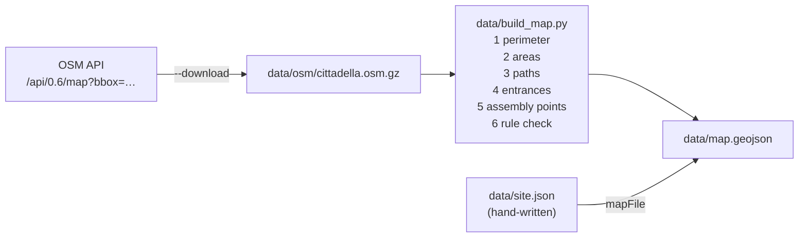

# SS-18 — Real site map from OpenStreetMap

- Status: In review
- Issue: #56
- Plan PR: #TBD-on-open   Implementation PRs: (after approval)

## Problem
SiteSense routes workers on a site map, but the repo has no map of a real site.
Map import (SS-15), the metric projection (SS-16), routing and evacuation have nothing realistic to test on.
Hand-drawn maps miss what real data has: concave perimeters, hundreds of paths, steps, gates, many buildings.
The delivery must ship `data/` with the site JSON, the map GeoJSON and the scripts that download or convert external data.


## Goal
`data/` holds a real site (Cittadella Universitaria, Catania, OSM way 231201634) in the SiteSense site and map formats.
The map passes every map rule, so SS-15 can use it as its real-world test input.
A Python script rebuilds the map from a saved OSM extract and gives byte-identical output.
Out of scope: elevation data (no slope source in OSM), a CI check of the output (decided: not needed).

## Solution
A single Python 3 script, standard library only, turns the OSM extract into `map.geojson`.
The OSM extract is saved in the repo (gzipped, about 400 KB), so a re-run gives the same file.
`--download` fetches a fresh extract from the OSM API; without it the script converts the saved one.
At the end the script checks the map rules and exits with an error if any rule fails.



### OSM to SiteSense mapping

| OSM | SiteSense | Rule |
|---|---|---|
| way 231201634 (`amenity=university`) | `kind: area`, `areaType: perimeter` | The only perimeter. |
| `construction=*`, `landuse=construction`, `building=construction`, `natural=water` | `areaType: hazard` | Highest priority when areas overlap. |
| `power=*` (generators, substations, transformers) | `areaType: restricted` | |
| `building=*` | `areaType: work` | |
| `amenity=parking` | `areaType: parking` | `amenity=parking_space` is skipped (spots inside a parking). |
| `leisure=garden/park/pitch`, `landuse=grass/meadow` | `areaType: rest` | |
| `highway=footway/path/pedestrian/steps/service/track/living_street` | `kind: path` | `steps: true` for `highway=steps`. |
| `entrance=*` or `barrier=gate/lift_gate` on a path node that is also a perimeter node; else any path node shared with the perimeter | `kind: entrance` | Site gates, not building doors. |
| `emergency=assembly_point` (5 nodes in OSM) | `kind: assemblyPoint` | Snapped onto the nearest path (new shared vertex). |

### How each rule is met

| Map rule | How |
|---|---|
| Exactly one perimeter that contains all other elements | The script asserts the perimeter ring is simple. An area is kept only if every vertex is inside or on the perimeter and no edge properly crosses a perimeter edge; else it is dropped and counted. Paths are cut at nodes into runs of nodes inside the perimeter (perimeter nodes count as inside). A run end must be a perimeter node or an original way end; a run that ends anywhere else is dropped and logged. |
| Areas do not overlap | Areas are taken in priority order (hazard, restricted, work, parking, rest; then OSM id). An area that overlaps one already taken (vertex inside the other ring, or proper edge crossing) is dropped and counted. |
| Valid geometries | Coordinates are rounded once, up front, to 7 decimals; all geometry and the rule check run on rounded values. Consecutive duplicate vertices are removed; rings or paths that degenerate are dropped. Self-intersecting rings are dropped. Rings are written counter-clockwise (RFC 7946). Multipolygon relations are skipped. |
| Paths that cross or touch share a vertex | OSM already shares nodes at junctions. For every pair of path segments, a proper crossing, a T-touch (end on the other segment's interior) or the ends of a collinear overlap become a vertex of both paths, deduplicated by rounded coordinate. The pass repeats until it finds nothing new. Ways with `layer≠0`, `bridge=*` or `tunnel=*` are kept but their crossings with other layers are not joined (a bridge is not a junction); the rule check accepts those crossings and logs them. |
| Assembly points and entrances lie on a path | Entrances: path nodes shared with the perimeter, deduplicated by node id (about 31 expected); name from `entrance`/`barrier` node tags when present. Assembly points: snapped to the nearest point on a **walkable** segment (one that does not intersect a restricted or hazard area); that point becomes a vertex of the path. An assembly point farther than `maxSnapDistanceM` (30 m) from a walkable segment fails the run. |

### Connectivity

Routing and evacuation need one connected walkable graph.
The rule check builds the graph the same way routing will: shared vertices, plus path ends closer than `connectToleranceM` (0.5 m), without segments that intersect restricted or hazard areas.
It keeps the largest component and drops paths outside it, logging the count.
Every entrance and assembly point must be in that component, else the run fails.

### Determinism

- Features sorted by (`kind`, `id`); OSM elements read in id order; no set iteration in output paths.
- JSON written with `sort_keys`, fixed separators, one feature per line, trailing newline; coordinates as rounded floats.
- The extract is gzipped with `mtime=0` and no file name. Gzip bytes may differ across zlib versions, so the reproducibility check compares `map.geojson`, not the `.gz`.
- Python 3.9 or later, standard library only.
- `--download` is the only non-reproducible step. It calls `https://api.openstreetmap.org/api/0.6/map?bbox=15.0670,37.5230,15.0790,37.5332` with a generic user agent and fails with a clear message on HTTP errors (the API caps a call at 50 000 nodes; this bbox has about 10 000).

### Path properties

| Property | Source | Default |
|---|---|---|
| `surface` | `surface=*`: asphalt, paving_stones, concrete, sett, paved… → `paved`; gravel, dirt, grass, ground, compacted… → `unpaved` | `track`, `path` → `unpaved`; others → `paved` |
| `steps` | `highway=steps` | `false` |
| `slopePercent` | `incline=*` when it is a number in % | `0` (OSM has no elevation) |
| `widthM` | `width=*` when it is a number in metres | footway 2, path 1.5, steps 2, pedestrian 4, track 3, service 4, living_street 5 |

Example output feature:

```json
{"type": "Feature", "geometry": {"type": "LineString", "coordinates": [[15.0721, 37.528], [15.0723, 37.5282]]},
 "properties": {"kind": "path", "id": "p-123456-0", "surface": "paved", "steps": false, "slopePercent": 0, "widthM": 2}}
```

Ids: `perimeter`, `a-<wayId>`, `p-<wayId>-<run>`, `e-<nodeId>`, `ap-<nodeId>`.
Names: the OSM `name` tag, else a generated one (`Building 123456`, `Gate 789`).
Assembly point `capacity`: OSM `capacity` tag, else 200. Area `capacity`: OSM `capacity` tag when present.
Numbers (`width`, `incline`, `capacity`) are parsed with a strict regex (`^\d+(\.\d+)?` plus an optional unit); anything else falls back to the default and is counted in the log.

`data/site.json` (hand-written):

```json
{"siteId": "cittadella-catania", "name": "Cittadella Universitaria", "timeZone": "Europe/Rome", "mapFile": "map.geojson",
 "navigation": {"walkingSpeedMps": 1.3, "unpavedSpeedFactor": 0.8, "stepsSpeedFactor": 0.5, "connectToleranceM": 0.5, "maxSnapDistanceM": 30}}
```

## Steps

Plan PR: this file only. One implementation PR, stacked on it (`story/SS-18-osm-map-data`).

| # | Step | Files | Done when | PR |
|---|---|---|---|---|
| 1 | Script: download, convert, rule check | `data/build_map.py` | `python3 data/build_map.py --download` writes the extract and the map; the rule check passes. | impl |
| 2 | Saved OSM extract | `data/osm/cittadella.osm.gz` | gzip written with a fixed mtime, so its bytes depend only on the OSM data. | impl |
| 3 | Map and site files | `data/map.geojson`, `data/site.json` | Map has 1 perimeter, ≥1 `restricted`, ≥1 `hazard`, paths, ≥1 entrance, 5 assembly points. `site.json` follows the site format. | impl |
| 4 | Reproducibility | — | A second `python3 data/build_map.py` (no download) leaves `git status` clean. | impl |
| 5 | Source and licence | `DATA_SOURCES.md`, `data/README.md` | Source (OSM way 231201634, API URL, bbox, download timestamp), ODbL statement with link, attribution "© OpenStreetMap contributors" for both the extract and the derived map; mapping table; how to re-run; known limits (slope 0, bridges). | impl |
| 6 | Decision record | `ASSUMPTIONS.md` (Q50), `AI_LOG.md` | Q50 entry Accepted; AI_LOG entry for SS-18. | impl |

## Risks

| Risk | Impact | Mitigation |
|---|---|---|
| OSM data changes after the download | A fresh `--download` gives a different map | The saved extract is the input; `DATA_SOURCES.md` gives the download date. |
| Crossing fix joins a bridge to the path under it | Routing may use a junction that does not exist | Crossings between different layers or with `bridge`/`tunnel` are not joined; they are logged. |
| Hazard or restricted areas cut the walkable graph | Evacuation unreachable from part of the site | Connectivity check keeps the largest walkable component and fails if an entrance or assembly point is outside it. |
| Dropping overlapping areas removes real buildings | Fewer `work` areas | Priority order keeps hazard and restricted areas; the script prints how many areas it dropped and why. |
| `slopePercent` is 0 almost everywhere | Slope cost is not exercised by the real map | SS-15/routing tests cover slope with hand-made maps. |
| OSM API down or rate-limited | `--download` fails | Only needed to refresh; the normal run is offline. |

## Tests
- The script's rule check (always runs, exit code 1 on failure): one perimeter; required properties and allowed values; every area inside the perimeter; no two areas overlap; every same-layer path crossing or touch has a shared vertex; every entrance and assembly point is a path vertex; one walkable component holds every entrance and assembly point.
- The script prints a summary: counts per `kind` and `areaType`, dropped areas/paths and why, fallbacks used.
- Re-run the script with no flags: `git status --porcelain data/` is empty.
- `python3 -m json.tool data/map.geojson` parses.
- SS-15 later imports this file in its own tests.

## Open questions

| # | Question | Options (recommended first) | Decision |
|---|---|---|---|
| Q50 | Which real site? | Cittadella Universitaria Catania; PoliMi Bovisa; CNR Bologna | Cittadella Universitaria, Catania (user, 2026-11-24) |
| — | Script language | Python 3 standard library; C# file-based app | Python 3 (user, 2026-11-24) |
| — | Save the OSM extract in the repo? | Yes, gzipped; no, always download | Yes (user, 2026-11-24) |
| — | CI check that the map matches the script | No; yes | No (user, 2026-11-24) |

## Changelog

| Date | Change | Why (review comment or finding) |
|---|---|---|
| 2026-11-24 | First draft | — |
| 2026-11-24 | Containment and run-end rules, T-touch and collinear crossings, layer-aware joins, walkable snap for assembly points, connectivity check, rounding up front, determinism section, ODbL notice details, `site.json` content, strict number parsing | Plan validation (Sonnet subagent) |
