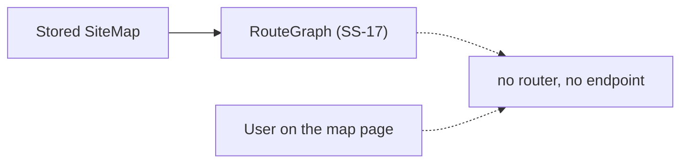
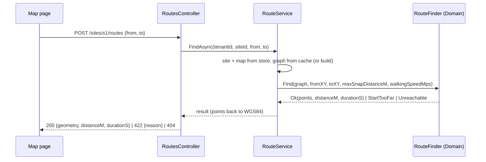

# SS-19 — Fastest route

- Status: Draft
- Issue: #149
- Plan PR: #<n>   Implementation PRs: #<n> (backend), #<n> (UI)
- Requirement IDs: NAV-01, NAV-02, NAV-03, API-03

## Problem

SS-17 builds a pedestrian graph from the site map (`SiteMap.BuildRouteGraph`, ADR 0001): one node per path vertex,
edges with length, walking time and a `Traversable` flag (false when the stretch crosses a `restricted` or `hazard` area).
Nobody searches that graph yet. A worker, a safety officer or a viewer cannot ask "how do I walk from here to there?",
and the map page cannot show a route. SS-20 and SS-21 (evacuation) wait for the same router.



## Goal

`POST /api/v1/sites/{siteId}/routes` returns the fastest walking route between two points, for every role.
The map page gets a route tool and a show/hide filter per layer.
Out of scope: evacuation (SS-21), slope and width in the cost (Q21), checking the off-path legs against blocked areas.

## Solution

1. **Snap** (NAV-01, Q22, Q23). `from` and `to` are projected to local metres with the map's projection (MAP-02).
   Each is snapped to the nearest point on a **traversable** edge. The start farther than `maxSnapDistanceM` gives
   `START_TOO_FAR`; the destination farther gives `UNREACHABLE` (detail: "destination too far from a path").
2. **Search** (NAV-01, NAV-02, NAV-03). A* written by us on the graph, with .NET `PriorityQueue`. The cost of an edge is
   its `TimeS` (speed × surface × steps factors, already in the graph, Q21). Edges with `Traversable = false` are skipped.
   The heuristic is straight-line distance / `walkingSpeedMps`: every factor is ≤ 1, so it never overestimates.
   The snap points are two virtual nodes: each links to the two ends of its edge with the time pro rata.
   Start and destination on the same edge: also try the direct stretch along that edge.
   No path between the snap points gives `UNREACHABLE`.
3. **Off-path legs** (Q24). The line starts at `from` and ends at `to`. The straight legs `from → snap` and
   `snap → to` count in `distanceM` and in `durationS` at plain `walkingSpeedMps`.
4. **Cache** (Q86). The graph is built once per (tenant, site, map version, site version) and kept in memory.
   The site version is in the key because a site PUT can change the speeds.
5. **UI**. A "Show route" button turns on route mode: first click = start, second click = destination, then the UI
   calls the endpoint and draws the line with distance and time; a 422 shows its reason in a toast; "Clear" removes it.
   A filter panel has one checkbox per legend item (Work, Rest, Parking, Restricted, Hazard, Path, Assembly point, Entrance),
   all on at load and not remembered. The perimeter and the live device dots are always shown. A hidden area also hides
   its occupancy label.



Example:

```json
POST /api/v1/sites/s1/routes
{ "from": { "lat": 45.4641, "lon": 9.1900 }, "to": { "lat": 45.4655, "lon": 9.1921 } }

200
{ "geometry": { "type": "LineString", "coordinates": [[9.19, 45.4641], [9.1902, 45.4642], [9.1921, 45.4655]] },
  "distanceM": 231.4, "durationS": 183.2 }

422 application/problem+json
{ "title": "No route", "status": 422, "reason": "START_TOO_FAR", "detail": "The start is 52.0 m from the nearest walkable path (max 30 m)." }
```

## Steps

| # | Step | Files | Done when | PR |
|---|---|---|---|---|
| 1 | Router in Domain: `RouteFinder.Find(graph, fromXY, toXY, maxSnapDistanceM, walkingSpeedMps)` with snapping, A*, virtual nodes, off-path legs; result `RouteResult(RouteStatus Status, IReadOnlyList<(double X, double Y)> Points, double DistanceM, double DurationS)`. Virtual-node links use the pro-rata `TimeS` of the snapped edge (its own factor). A snap at an edge end (t = 0 or 1) uses that node, no zero-length link. Duplicate consecutive points are dropped from `Points`. Heuristic invariant (every edge speed ≤ `walkingSpeedMps`) stated in a comment. Start too far is checked before destination too far | `backend/SiteSense.Domain/Navigation/RouteFinder.cs` | Domain tests in step 2 pass | backend |
| 2 | Domain tests (listed under Tests) | `tests/SiteSense.Tests/Domain/RouteFinderTests.cs` | `dotnet test --filter RouteFinderTests` green | backend |
| 3 | `SiteMap.BuildRouteContext(nav)` returns `(RouteGraph Graph, LocalProjection Projection)` from one projection, so they cannot diverge; `BuildRouteGraph` calls it | `backend/SiteSense.Api/Models/Map/SiteMap.cs` | existing RouteGraph tests still green | backend |
| 4 | DTOs: `LatLon(Lat, Lon)` with `[Range]` like `SiteRequest` (NaN rejected), `RouteRequest(LatLon From, LatLon To)` both required, `LineStringGeometry(Type, Coordinates)`, `RouteResponse(Geometry, DistanceM, DurationS)` | `backend/SiteSense.Api/Dtos/RouteRequest.cs`, `RouteResponse.cs` | build green | backend |
| 5 | `RouteService` (DI singleton, like the other `Services/` engines in `Program.cs`): loads site and map, cache `ConcurrentDictionary<(tenant, site), Lazy<Entry>>` holding (map version, site version, graph, projection). A request whose versions differ replaces the entry; an entry is never replaced by an older version. `Lazy` makes concurrent misses build once. Returns a domain result plus WGS84 points; null when site or map is missing. A singleton per host means a test host with a fresh store gets a fresh cache | `backend/SiteSense.Api/Services/RouteService.cs`, `backend/SiteSense.Api/Program.cs` | used by step 6 | backend |
| 6 | `RoutesController`: `POST api/v1/sites/{siteId}/routes`, policy `CanSeeAggregates` (Admin, Safety, Viewer; the response has no personal data); maps the service result to DTOs. 200; 400 `ValidationProblemDetails`; 404 site or map missing; 422 via `ProblemDetailsFactory` with `reason` in `Extensions` (`START_TOO_FAR` or `UNREACHABLE`) as in `MapController`. `[Produces]` and `[ProducesResponseType]` for 200, 400, 401, 403, 404, 422 | `backend/SiteSense.Api/Controllers/RoutesController.cs` | API tests in step 7 pass | backend |
| 7 | API tests (listed under Tests), setup as in `MapEndpointTests` (seed site, PUT map as Admin, tokens per role and tenant); one OpenAPI case for the new path | `tests/SiteSense.Tests/Api/RoutesTests.cs`, `tests/SiteSense.Tests/Api/OpenApiTests.cs` | `dotnet test` green | backend |
| 8 | `.http` entry for the new endpoint | `backend/SiteSense.Api/SiteSense.Api.http` | entry present | backend |
| 9 | Docs: ASSUMPTIONS Q22, Q23, Q24, Q119, Q120; KNOWN_ISSUES (cache done, router done, off-path legs not checked, O(E) snap); README routing line names the endpoint and the 422 reasons, Admin UI section names the route tool and filters; AI_LOG entry. No `docs/` page covers the API or the UI, so none to update | `ASSUMPTIONS.md`, `KNOWN_ISSUES.md`, `README.md`, `AI_LOG.md` | entries present | backend (UI lines in the UI PR) |
| 10 | UI types: `reason?: string` on `Problem`, `RouteResponse` type; the existing `toastError` shows title and detail | `frontend/src/api.ts` | `npm run build` green | UI |
| 11 | UI layer filters: checkbox panel (keyboard accessible), features filtered by kind/areaType; `GeoJSON` and `LiveLayers` keyed on `${etag}-${filterKey}` so occupancy labels re-apply; perimeter always on | `frontend/src/pages/MapView.tsx` | browser: unchecking Entrance hides entrances, dots and perimeter stay | UI |
| 12 | UI route tool: "Show route" / "Clear" buttons; clicks via `useMapEvents`; feature popups off while in route mode; route drawn as a `Polyline` in its own layer (survives filter changes) with a distance/time label; cleared when the map changes | `frontend/src/pages/MapView.tsx` | browser: route drawn on the real map as admin and viewer; START_TOO_FAR toast outside the site | UI |

## Risks

| Risk | Impact | Mitigation |
|---|---|---|
| Off-path legs are straight lines, not checked against blocked areas | A start inside a hazard area draws a line out of it | Legs are at most `maxSnapDistanceM` long; listed in KNOWN_ISSUES |
| Cache grows with sites × versions | Memory on many uploads | One entry per (tenant, site): a newer version replaces the old one |
| Stale graph after a map or site PUT | Route on old paths or speeds | Versions in the entry; tests `Post_AfterMapReplaced_UsesNewGraph`, `Post_AfterSiteSpeedChanged_UsesNewSpeed` |
| Graph build on a cache miss runs on the request | First route after an upload is slower | `Lazy` builds once; the real map builds in well under a second (SS-17 tests) |
| Snap scans every edge (O(E)) | Slow on huge maps | The real map has a few thousand edges; spatial index noted in KNOWN_ISSUES |
| Re-keying the GeoJSON layer on filter change resets occupancy styling | Labels missing until the next event | `LiveLayers` already re-applies on its `geo` effect; key both on the same filter key |

## Tests

- Domain `RouteFinderTests`: `Find_DetoursAroundBlockedEdge`, `Find_PrefersFasterOverShorter` (paved beats a shorter
  steps path), `Find_StartTooFar`, `Find_DestinationTooFar_IsUnreachable`, `Find_Disconnected_IsUnreachable`,
  `Find_SameEdge_BothDirections`, `Find_SamePoint_OnlyLegs`, `Find_SnapAtEdgeEnd`, `Find_IncludesOffPathLegs`.
- API `RoutesTests`: `Post_RealMap_Returns200LineString`, `Post_AvoidsRestrictedArea`, `Post_StartTooFar_Returns422`,
  `Post_Unreachable_Returns422`, `Post_BadLat_Returns400`, `Post_MissingTo_Returns400`, `Post_NoMap_Returns404`,
  `Post_OtherTenant_Returns404` (site and map in tenant A, call as tenant B), `Post_AllRoles_Allowed`,
  `Post_WithoutToken_Returns401`, `Post_GatewayToken_Returns403`, `Post_AfterMapReplaced_UsesNewGraph`,
  `Post_AfterSiteSpeedChanged_UsesNewSpeed`.
- `OpenApiTests`: the routes path has `post` with a 422 response and `from`/`to` required.
- Browser: route tool and filters on the real map (screenshots in the UI PR).

## Open questions

| # | Question | Options (recommended first) | Decision |
|---|---|---|---|
| Q21 | Do slope and width enter the cost? | A. No. B. Yes | A (accepted earlier) |
| Q22 | Start snapped to which path? | A. Nearest traversable stretch within `maxSnapDistanceM`. B. Nearest of any kind | A (user, 2026-11-28) |
| Q23 | Destination snap and error | A. Same snap, too far → 422 `UNREACHABLE`. B. New reason `DESTINATION_TOO_FAR`. C. No limit | A (user, 2026-11-28) |
| Q24 | Off-path legs in the response? | A. Included in geometry, distance and time at walking speed. B. Excluded | A (user, 2026-11-28) |
| Q119 | Request format of `from` / `to` | A. `{ lat, lon }` objects. B. GeoJSON Point | A (user, 2026-11-28) |
| Q120 | UI: route tool and filters | A. Route tool A→B; one checkbox per legend item, not remembered; perimeter and devices always on. B. Grouped filters, remembered | A (user, 2026-11-28) |

## Changelog

| Date | Change | Why (review comment or finding) |
|---|---|---|
| 2026-11-28 | First draft | — |
| 2026-11-28 | Route context from one projection, cache with versions and `Lazy`, 422 via `ProblemDetailsFactory`, OpenAPI and `.http` steps, more tests (cache, 401, 403, 404 no map, same point, edge end), UI keys and popups | Plan validation (Sonnet) |
