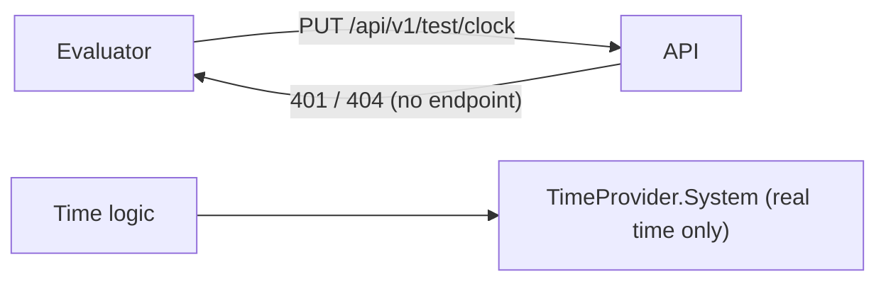
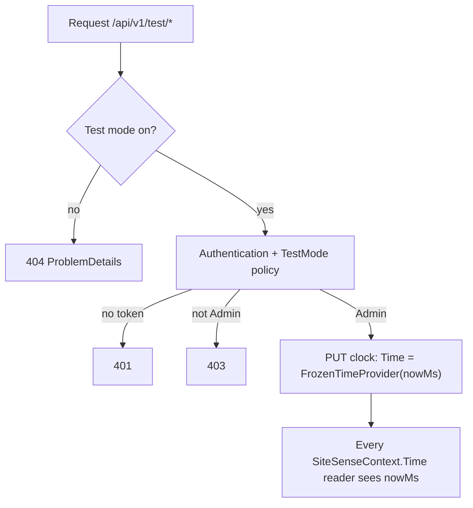

# SS-2 — Test mode and simulated clock

- Status: In review
- Issue: #41
- Plan PR: #TBD-plan   Implementation PRs: #TBD-impl

## Problem
An evaluator must check time logic (silent devices, retention, event timestamps) without waiting in real time.
Today the API has no way to set the current time, and no test-only endpoints. `SITESENSE_TEST_MODE`
is passed by compose but nothing reads it. `SiteSenseContext.Time` is always `TimeProvider.System`.

## Goal
- `SITESENSE_TEST_MODE` not `true` → every `/api/v1/test/*` path returns 404 for every caller, with or without a token.
- Test mode on → `/api/v1/test/*` needs the `TestMode` policy (Admin): 401 without token, 403 for other roles.
- `PUT /api/v1/test/clock` `{ "nowMs": <long> }` sets `SiteSenseContext.Time`, so every reader of the clock sees the new time.
- Out of scope: `POST /api/v1/test/drain` (SS-23) and `POST /api/v1/test/jobs/{jobName}/run` (SS-31). The 404 gate and the policy cover the whole `/api/v1/test` prefix, so they inherit it.

## Solution
Owner decision Q38: one global clock for the whole process, frozen at `nowMs` until the next `PUT`.

1. **Flag.** `Program.cs` reads `SITESENSE_TEST_MODE` once from configuration (environment variables are part of it) into a local bool, default `false`. A value that is not a bool (`1`, `yes`) fails at startup. Not a static: each test factory re-runs `Program.cs`. When on, a startup warning is logged. `AddSiteSenseAuth` takes the flag as a parameter.
2. **404 gate.** A small middleware after `UseStatusCodePages` and before `UseAuthentication`: when test mode is off and
   `Path.StartsWithSegments("/api/v1/test", OrdinalIgnoreCase)` (so `/api/v1/testing` is not matched), it sets 404 and stops. It must run before authentication: the fallback policy (Q80)
   would otherwise answer 401 to an anonymous caller on an unmapped path. `UseStatusCodePages` turns the 404 into ProblemDetails.
3. **Policy.** `SiteSensePolicies.TestMode` = authenticated + role Admin + test mode on (assertion on the flag, belt and braces
   next to the gate). Registered in `AuthSetup.AddSiteSenseAuth`.
4. **Clock.** `Helpers/FrozenTimeProvider.cs`: `TimeProvider` whose `GetUtcNow()` returns a fixed instant.
   Only `GetUtcNow` is frozen: timers, `GetTimestamp` and `Task.Delay(..., Time)` stay on real time (noted in Q38).
   DTO `TestClockRequest(long NowMs)` with `[Range]` on the bounds `DateTimeOffset.FromUnixTimeMilliseconds` accepts;
   missing or wrong type → 400 (`[ApiController]` + `RespectRequiredConstructorParameters`).
   `TestController` (`[ApiController]`, `api/v1/test`, `[Authorize(Policy = TestMode)]`, `ProducesResponseType` 204/400/401/403/404) action `PUT clock` sets `SiteSenseContext.Time = new FrozenTimeProvider(...)` and returns 204.
   Code that reads `SiteSenseContext.Time` on each call (the rule in `dotnet-coding`) sees the new time at once.
5. **OpenAPI:** the clock endpoint is in the schema even when off (accepted: the schema is a contract, the gate still answers 404).
6. **Not changed:** JWT lifetime checks keep real time (the handler's own clock). A simulated date in the past or
   future must not make the evaluator's real tokens invalid.

## Steps
| # | Step | Files | Done when | PR |
|---|---|---|---|---|
| 1 | `TestMode` constant + setting name; policy registered with the flag. | `Auth/SiteSensePolicies.cs`, `Auth/AuthSetup.cs` | Builds. | impl |
| 2 | 404 gate middleware before authentication. | `Program.cs` | Off → 404 anonymous and Admin. | impl |
| 3 | `FrozenTimeProvider`, `TestClockRequest` DTO, `TestController` `PUT clock` with validation and OpenAPI metadata. | `Helpers/FrozenTimeProvider.cs`, `Dtos/TestClockRequest.cs`, `Controllers/TestController.cs` | On + Admin → 204 and `SiteSenseContext.Time.GetUtcNow()` = `nowMs`. | impl |
| 4 | Tests (below). | `tests/SiteSense.Tests/Api/TestModeTests.cs` | All pass with the rest of the suite. | impl |
| 5 | Docs: Q38 in `ASSUMPTIONS.md`, security skill marks `TestMode` registered, `.http` entry, `AI_LOG.md`. | `ASSUMPTIONS.md`, `.claude/skills/sitesense-security/SKILL.md`, `backend/SiteSense.Api/SiteSense.Api.http`, `AI_LOG.md` | Docs match the code. | impl |

## Risks
| Risk | Impact | Mitigation |
|---|---|---|
| Test mode left on in production | An Admin of any tenant moves the clock for all tenants (accepted: global clock is the owner's choice, Q38) | Default `false` in `.env.example` and in code; startup warning when on. |
| Static `SiteSenseContext.Time` shared by test classes | A test leaves a frozen clock behind; tests outside the `Api` collection run in parallel | Clock tests stay in the `Api` collection and restore `Time` in `Dispose`. |
| Code that caches `SiteSenseContext.Time` in a field | Does not see the new clock | Rule already says read it on each call; noted in Q38. |
| `nowMs` out of `DateTimeOffset` range | 500 | Range check → 400. |

## Tests
`tests/SiteSense.Tests/Api/TestModeTests.cs`, collection `Api`:
- Off (default factory, flag pinned `false` in `ApiFactory`): `PUT /api/v1/test/clock` → 404 ProblemDetails anonymous and with Admin token; `/API/V1/TEST/clock`, `/api/v1/test/`, `POST /api/v1/test/drain` → 404; `/api/v1/testing` is not gated (401 anonymous).
- On (`TestModeApiFactory : ApiFactory` with `SITESENSE_TEST_MODE=true`, second class fixture): anonymous → 401; Safety and Viewer → 403; Admin → 204 and `SiteSenseContext.Time.GetUtcNow().ToUnixTimeMilliseconds()` equals `nowMs`.
- On: missing `nowMs`, empty body, out-of-range `nowMs` → 400.

## Open questions
| # | Question | Options (recommended first) | Decision |
|---|---|---|---|
| Q38 | How does the simulated clock behave? | Global, frozen until the next PUT / global, ticking from `nowMs` / per tenant | Global, frozen (owner, 2026-11-25) |
| — | Status when test mode is off and the caller has no token? | 404 for everyone / auth first (401) | 404 for everyone (owner, 2026-11-25) |

## Changelog
| Date | Change | Why (review comment or finding) |
|---|---|---|
| 2026-11-25 | First draft. | — |
| 2026-11-25 | Flag as local not static, segment match, `[Range]` DTO, on-factory subclass, flag pinned off in tests, startup warning, OpenAPI note, frozen only `GetUtcNow`. | Plan validation (Sonnet). Not taken: hiding the endpoint from OpenAPI when off. |
