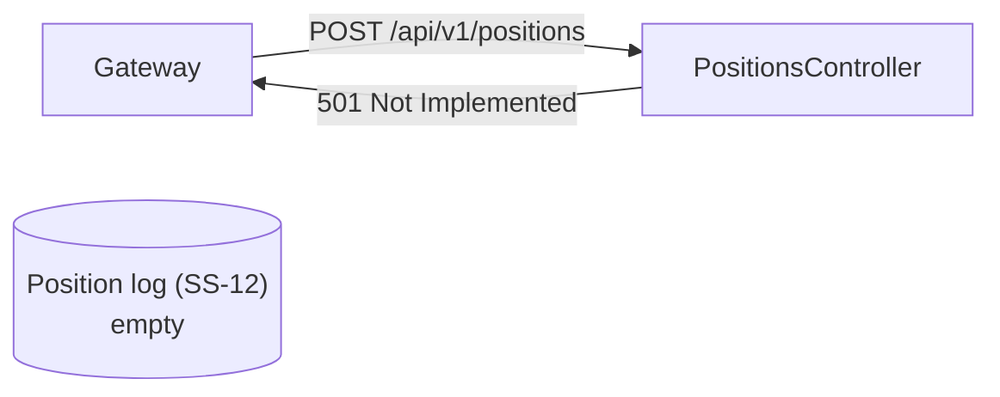
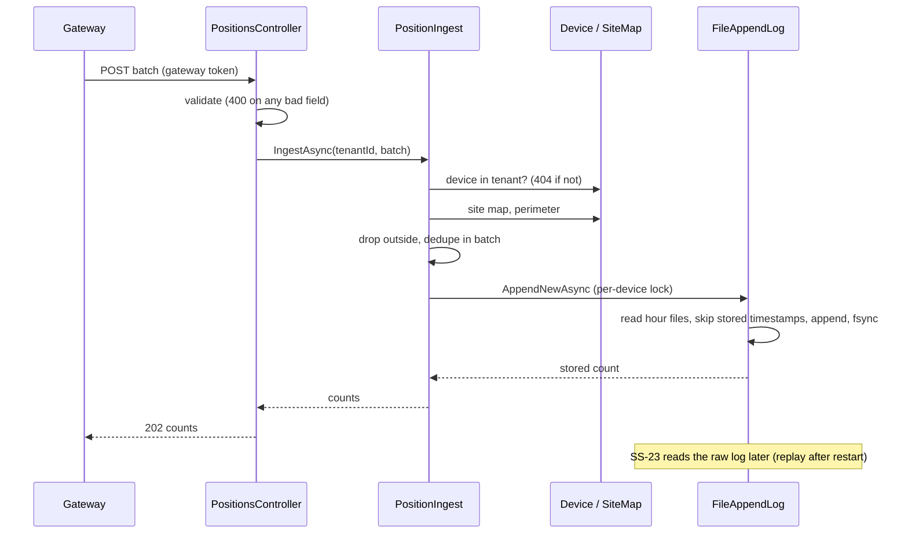

# SS-22 — Idempotent and durable batch ingest

- Status: Approved
- Issue: #100
- Plan PR: #101   Implementation PRs: impl 1 (store and geometry), impl 2 (endpoint)

## Problem

Gateways send GPS positions in batches to `POST /api/v1/positions`. Today the route exists only as a guard:
it checks the gateway token (SS-8) and answers `501`. No position is stored.

Gateways retry on timeouts, so the same batch can arrive twice or more. Batches can be large (up to 5,000
positions) and hold positions hours old. A position outside the site perimeter must never reach disk (PRV-02).
A position the API has accepted must survive a restart (NF-05).

Who notices: every later tracking story (SS-23 ordered processing and drain, filters, areas, alerts) and the
device simulator (SS-39) need stored positions to work on.



## Goal

`POST /api/v1/positions` validates the batch, keeps only positions of a device registered in the token's
tenant and inside that device's site perimeter, writes each new `(device, timestamp)` once to the raw
position log, fsyncs, then answers `202`.

Out of scope: ordered processing, `/test/drain`, filters, area assignment, events (SS-23…SS-25). The raw log
is the hand-off point: SS-23 reads it. No queue, no tracking logic here.

## Solution

Terms: a **batch** is `{ deviceId, positions: [{ timestampMs, lat, lon, accuracyM }] }` (metres, Unix epoch
milliseconds UTC). The **perimeter** is the one map area with `areaType = "perimeter"` (SS-15). The **raw
position log** is the SS-12 append log, `Position/` records, one JSON-lines file per tenant, device and UTC hour.

Flow, in order:

1. **Auth.** The existing `CanWritePositions` policy (SS-8): gateway client token only. Tenant from the token claim.
2. **Validate (400).** Malformed body, missing field, `positions` empty or over 5,000, `lat` outside [-90, 90],
   `lon` outside [-180, 180], `accuracyM` negative, `timestampMs` negative or past year 9999. The DTOs are
   positional records with non-nullable `long`/`double` and no defaults; `Program.cs` already sets
   `RespectRequiredConstructorParameters`, so a missing field is a `400`, never a silent `0`. NaN and Infinity
   cannot arrive (named float literals are off). `[MaxLength(5000)]` on the list, `[Range]` on each field,
   following the existing DTOs. A bad position rejects the whole batch (open question 8). Error messages name
   the field, never echo the rejected value (no coordinates in responses, Q62). A future timestamp is not
   rejected here; plausibility is the filters' job (SS-24).
3. **Device (404).** `Device.GetAsync(tenantId, deviceId)`. Missing, registered in another tenant, or an id the
   store rejects (for example `../x`) → `404`, nothing stored (Q60, open question 1).
4. **Perimeter (drop).** Load the device's site map once per batch. The perimeter is one polygon
   (`Coordinates` is `double[][][]`: ring 0 outer, the rest holes). Project the perimeter and each position to
   local metres with `LocalProjection.FromCentroid(perimeter vertices)` (SS-16, the same origin SS-17 uses), then
   call `PlanarGeometry.Locate` (even-odd, 1e-6 m boundary tolerance). `Inside` or `OnBoundary` → kept; `Outside` →
   dropped in memory, never written. Site with no map, or a map with no perimeter → every position is dropped (open question 4).
5. **Dedupe in the batch.** Same `timestampMs` twice in one batch → keep the first (open question 3).
6. **Append once (durable).** New log method `AppendNewAsync<T>`: the dedupe key is `TimestampMs`, which is
   enough because the log key is already the device. Under the existing per-device lock, for each touched hour
   file, build a `HashSet<long>` of the timestamps stored in it using the same reader as `ReadRangeAsync`
   (only newline-terminated, parsable lines count), append only the new records, fsync, return how many were
   written. A retry after a crash skips the records already written. A torn tail that does not parse counts as
   missing and is written again on its own line. A whole record cut just before its newline counts as stored: the
   append ends it with `\n` (even when nothing else is new), so it becomes readable once and is never duplicated. `FileAppendLog` is the only
   `IAppendLog` implementation (no test fakes to update).
7. **202.** Only after step 6 returns. Body with counts (open question 5).

"Accepted" means a `202` was sent. A batch cut between two hour files by a crash leaves part on disk with no
`202`: at-least-once, the retry completes it; a retry answers `stored: 0` for what was already written.

Logging (Q62): drops and duplicates at `Information` with `deviceId`, counts and the correlation id only.
Outside-perimeter positions are never logged with coordinates, at any level.

Example:

```http
POST /api/v1/positions
Authorization: Bearer <gateway token>

{ "deviceId": "dev-001", "positions": [
  { "timestampMs": 1793268000000, "lat": 45.5001234, "lon": 9.2004567, "accuracyM": 4.5 },
  { "timestampMs": 1793268000000, "lat": 45.5001234, "lon": 9.2004567, "accuracyM": 4.5 },
  { "timestampMs": 1793268001000, "lat": 46.0, "lon": 9.0, "accuracyM": 3.0 } ] }

202 { "received": 3, "stored": 1, "duplicates": 1, "outsidePerimeter": 1 }
```

Sent again: `202 { "received": 3, "stored": 0, "duplicates": 2, "outsidePerimeter": 1 }`.



Why the dedupe lives in the log, under its lock: the check and the write must be one step per device, or two
concurrent retries of one batch would both see "not stored" and both write. The log already holds one lock per
device log (Q83), so no second lock is added.

Graceful shutdown (NF-05): the `202` comes only after fsync, so an accepted batch is on disk before the gateway
hears "accepted". ASP.NET waits for in-flight requests on shutdown; a request cut by a kill gets no `202`, and the
gateway's retry is deduplicated.

## Steps

| # | Step | Files | Done when | PR |
|---|---|---|---|---|
| 1 | Shared point-in-polygon `PlanarGeometry.Locate(p, rings, boundaryTolerance)` → `PointLocation { Outside, OnBoundary, Inside }` (even-odd, holes; each caller decides what `OnBoundary` means; SS-17 reuses it) | `backend/SiteSense.Domain/Geometry/PlanarGeometry.cs`, `tests/SiteSense.Tests/Domain/PlanarGeometryTests.cs` | Tests listed under "Tests" pass | impl 1 |
| 2 | `AppendNewAsync` on the log: skip timestamps already stored (HashSet per hour file, same line reader as `ReadRangeAsync`), return written count | `backend/SiteSense.Api/Store/IAppendLog.cs`, `backend/SiteSense.Api/Store/FileAppendLog.cs`, `tests/SiteSense.Tests/Api/Store/FileAppendLogTests.cs` | Dedupe, torn-line and concurrency tests pass; `AppendAsync` behaviour unchanged | impl 1 |
| 3 | Crash test for retried batches | `tests/SiteSense.StoreCrashWriter/Program.cs` (new `unique` mode), `tests/SiteSense.Tests/Api/Store/StoreCrashTests.cs` | After seeded kills and resends, every acknowledged timestamp is read back exactly once | impl 1 |
| 4 | `Position.AppendNewAsync` model method, reusing the existing "every position belongs to the device" guard | `backend/SiteSense.Api/Models/Position.cs` | Compiles; used by step 5 | impl 2 |
| 5 | `PositionIngest` service: device check, perimeter drop, in-batch dedupe, append, counts, privacy-safe log line | `backend/SiteSense.Api/Services/PositionIngest.cs` (new; first file in `Services/`) | Unit-level behaviour covered by step 7 tests | impl 2 |
| 6 | Request/response DTOs with validation; controller body returns `202`; drop the "shortcut: guard only" comment | `backend/SiteSense.Api/Dtos/PositionBatchRequest.cs`, `backend/SiteSense.Api/Dtos/PositionBatchResponse.cs` (new), `backend/SiteSense.Api/Controllers/PositionsController.cs` | OpenAPI lists 202/400/401/403/404 | impl 2 |
| 7 | Integration tests; the two `501` asserts in `GatewayAuthTests.cs` (lines 29, 43) become `400` for an empty body; OpenAPI response codes asserted | `tests/SiteSense.Tests/Api/PositionsTests.cs` (new), `tests/SiteSense.Tests/Api/Auth/GatewayAuthTests.cs`, `tests/SiteSense.Tests/Api/OpenApiTests.cs` | Tests listed under "Tests" pass | impl 2 |
| 8 | Docs: decisions (Q12 marked Changed, superseded by Q60; new entries for open questions 2–8), limits, AI log, ADR note, `.http` entry | `ASSUMPTIONS.md`, `KNOWN_ISSUES.md`, `AI_LOG.md`, `docs/adr/0001-*.md` (dedupe note), `backend/SiteSense.Api/SiteSense.Api.http` (exists) | Each open question's decision recorded; no two ASSUMPTIONS entries disagree | impl 2 |

Two implementation PRs, stacked: impl 1 (store and geometry, no HTTP) on the plan branch, impl 2 (endpoint) on impl 1.

## Risks

| Risk | Impact | Mitigation |
|---|---|---|
| Dedupe reads every touched hour file on each batch | A busy device posting small batches re-reads up to 3,600 lines each time; slower ingest under JDB-09 load | `shortcut:` comment; the JDB-09 benchmark story adds an in-memory timestamp cache per hour file if needed. Listed in `KNOWN_ISSUES.md`. |
| Two concurrent identical batches | Double write | Dedupe and write under the one per-device lock; concurrency test |
| The device lock is held during reads and fsyncs | One slow batch delays the same device's next batch | Accepted: per device only; other devices are not blocked |
| `SiteMap.GetAsync` reads and parses the whole map on every batch | CPU per request at gateway rates | Listed in `KNOWN_ISSUES.md`; cache by map version if the benchmark needs it |
| Floating point at the perimeter boundary | Flaky "on the edge" tests | Tests use exactly representable coordinates (for example 9.0, 9.5) |
| Crash between two hour files of one batch | Part of the batch on disk, no `202` | The gateway retries; stored records are skipped; crash test |
| SS-17 (PR #96) also needs point-in-polygon, with boundary = not inside | Two helpers, or a merge conflict in `PlanarGeometry.cs` | One shared `Locate` that returns `OnBoundary` and lets each caller decide (open question 6); the SS-17 session is told to reuse it |
| Map changes between batches (new perimeter) | A position kept under the old perimeter stays stored | Accepted: the check uses the map current at ingest time |
| Large body | 5,000 positions ≈ 500 KB | Under the Kestrel default limit (30 MB); 5,000-position test |

## Tests

Domain (`PlanarGeometryTests`, exactly representable coordinates): `Locate` inside square → `Inside`; outside → `Outside`;
on an edge and on a vertex → `OnBoundary`; inside a hole → `Outside`; on a hole edge → `OnBoundary`; concave notch → `Outside`.

Store (`FileAppendLogTests`, `StoreCrashTests`):
- `AppendNewAsync_SameBatchTwice_StoresOnce` (returns n, then 0).
- `AppendNewAsync_BatchAcrossHours_SkipsOnlyStored`.
- `AppendNewAsync_AfterTornLine_RewritesTornRecord` (cut a file mid-line by hand, resend, record read back once).
- `AppendNewAsync_LastLineWithoutNewline_CountsAsStoredAndEndsIt` (file ends in a whole JSON object with no `\n`: returns 0, both records read back).
- `AppendNewAsync_HourBoundary_SplitsFiles` (…:59:59.999 and …:00:00.000).
- `AppendNewAsync_ConcurrentIdenticalBatches_StoresOnce` (parallel tasks, one device).
- Crash: child in `unique` mode sends overlapping batches; kills at seeded points; on restart it resends the last
  unacknowledged batch; every acknowledged timestamp is read back exactly once (crash before and after `202`).

API (`PositionsTests`, `WebApplicationFactory`, real JWT):
- `Post_ValidBatch_Returns202AndStores`.
- `Post_SameBatchTwice_StoresEachPositionOnce` (TRK-01).
- `Post_DuplicateTimestampInBatch_StoresFirst`.
- `Post_PositionOutsidePerimeter_NeverStored` (PRV-02; reads the log files directly, no coordinate leaks).
- `Post_UnknownDevice_Returns404` and `Post_OtherTenantDevice_Returns404AndStoresNothing` (tenant isolation).
- `Post_5000Positions_Returns202AndStoresAll`; `Post_5001Positions_Returns400`.
- `Post_InvalidField_Returns400` (theory: lat, lon, accuracyM, timestampMs out of range; each field missing,
  `deviceId` included; empty list). The response body never contains the rejected coordinate.
- `Post_MapWithoutPerimeterOrNoMap_StoresNothing`.
- `Post_AdminUserToken_Returns403`; no token → `401`.
- `OpenApi_Positions_ListsResponseCodes` (202/400/401/403/404).

## Open questions

| # | Question | Options (recommended first) | Decision |
|---|---|---|---|
| 1 | Unknown or foreign device: Q12 (`202`, drop and count) and Q60 (`404`, store nothing) disagree | **a) `404`, nothing stored (Q60, Accepted); Q12 marked Changed** · b) `202` with a dropped count (Q12) | a) `404`, nothing stored; Q12 marked Changed (user, 2026-11-26) |
| 2 | Where does dedupe happen? | **a) In the log (`AppendNewAsync`), under the existing per-device lock** · b) A second lock in the service · c) Keep duplicates on disk, dedupe on read | a) In the log, under the existing per-device lock (user) |
| 3 | Same device and timestamp, different coordinates (in one batch or across batches) | **a) First stored wins; later ones count as duplicates** · b) Last wins (needs a rewrite of an append-only file) | a) First stored wins, later ones are duplicates (user) |
| 4 | Device whose site has no map yet | **a) `202`, every position dropped as outside the perimeter (privacy first)** · b) `409` so the gateway retries later · c) Store without the check | a) `202`, all dropped (user) |
| 5 | `202` body | **a) `{ received, stored, duplicates, outsidePerimeter }`** · b) Empty body | a) Counts in the body (user) |
| 6 | Point-in-polygon helper vs SS-17 (PR #96) | **a) New `PolygonContainment.cs` in Domain, boundary = inside; `PlanarGeometry.cs` untouched** · b) Wait for SS-17 and add to `PlanarGeometry.cs` | One shared `PlanarGeometry.Locate` returning `OnBoundary`; perimeter keeps it, SS-17 treats it as outside (user: same concept, unify) |
| 7 | Hand-off to SS-23 | **a) The raw log only; SS-23 adds its queue and restart replay** · b) SS-22 also adds an in-memory channel now (no reader until SS-23) | a) Raw log only (user) |
| 8 | One structurally invalid position (for example `lat: 200`) in a batch (Q44, not yet in `ASSUMPTIONS.md`) | **a) `400` for the whole batch, nothing stored (the gateway has a bug to fix)** · b) Drop the bad position, count it, `202` for the rest | a) `400` for the whole batch (user) |

## Changelog

| Date | Change | Why (review comment or finding) |
|---|---|---|
| 2026-11-26 | First draft | — |
| 2026-11-26 | Torn-but-parsable last line, HashSet dedupe, DTO missing-field rule, no echo of rejected values, `501` test updates, OpenAPI test, Q12 cleanup, open question 8 (Q44) | Sonnet validation |
| 2026-11-26 | Decisions 1–8 recorded; open question 6 changed to one shared `PlanarGeometry.Locate` in local metres; status Approved | User review in chat |
| 2026-11-26 | A whole record without its newline counts as stored and gets its newline (no truncation, keeps Q83) | Found in impl 1: rewriting it would duplicate the record |
