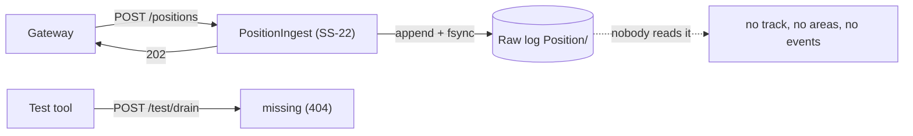
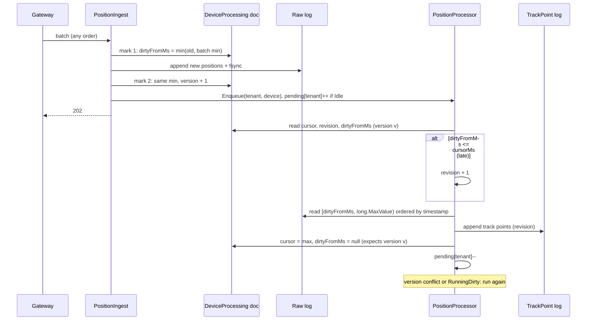

# SS-23 — Ordered processing and drain

- Status: Draft
- Issue: #118
- Plan PR: #120   Implementation PRs: #<n>

## Problem

SS-22 stores every accepted position in the raw position log (`Position/`, one file per device and UTC hour)
and answers `202`. Nothing reads that log yet: no position is ever *processed* (filter, area, events).

Gateways send positions out of order, and a device that was offline sends hours of old positions at once.
Processing must follow the time the position was taken, not the time it arrived. Test tools also need
`POST /api/v1/test/drain` to know when processing has caught up, so a check can read results right after.

Who notices: the filter (SS-24), area assignment (SS-25) and SignalR events (SS-35) all sit on top of this
pipeline; the evaluation calls `test/drain` before every check.

Terms: *raw position* = as received; *track point* = the processed position (later filtered, with its area);
*cursor* = the latest timestamp a device has processed; *late position* = one older than the cursor.

## Goal

- Each device's positions are processed in timestamp order, whatever the arrival order (TRK-02).
- A late position, even hours late, re-processes that device from its timestamp (per-device replay), with no duplicate outputs.
- `POST /api/v1/test/drain` answers `204` only when every position the caller's tenant sent so far is processed (C-7.2d).
- After a crash or restart, positions accepted with `202` but not processed are processed.

Out of scope: the filter (SS-24), areas and hysteresis (SS-25), events and `late` alerts (SS-35, EVT-03),
`GET /devices/{id}/track` (its own story). SS-23 processing is a **pass-through**: each raw position becomes
one track point unchanged. SS-24 replaces that one step.

## Solution

Three pieces:

1. **Work marker (durable).** One small document per device, `DeviceProcessing`
   (`<root>/<tenant>/DeviceProcessing/<deviceId>.json`): `cursorMs`, `revision`, `dirtyFromMs`.
   Ingest marks the doc **twice** (store version check, retried on conflict), each time
   `dirtyFromMs = min(dirtyFromMs, oldest timestamp in the batch)`:
   - *before* the raw append, so a crash leaves at worst a marker with nothing new behind it (harmless), never
     new positions without a marker;
   - *after* the append, always saving (so the version goes up even when the minimum is unchanged). A processor run
     that read the raw log before the append landed then fails its version check and runs again: no lost batch.
   Ingest returns `MarkerWritten = true` when at least one position is inside the perimeter; only then does the
   controller call `Enqueue`.
2. **Processor (in memory).** `PositionProcessor`, a singleton hosted service with **one** worker reading a
   `Channel` (about 100 positions/s: one consumer is enough and keeps each device in order for free).
   Per device it keeps a state `Idle | Queued | Running | RunningDirty` under one lock with the tenant counters:
   `Enqueue` on `Idle` → `Queued` (written to the channel, pending +1); on `Running` → `RunningDirty`; otherwise nothing.
   A run loops: reads the doc (version v); if `dirtyFromMs` is null, stops. Otherwise:
   - `cursorMs` null or `dirtyFromMs > cursorMs` (normal case): reads raw `[dirtyFromMs, long.MaxValue)` (upper bound exclusive) and appends track points with the current `revision`.
   - `dirtyFromMs <= cursorMs` (late): `revision + 1`, reads raw `[dirtyFromMs, long.MaxValue)` and appends every point again with the new revision (replay).
   - Saves `cursorMs = max(cursorMs, max timestamp read)`, `dirtyFromMs = null`, `revision` with version v.
     On a version conflict (ingest marked meanwhile) it loops again.
   At the end of the loop, `RunningDirty` → run again; `Running` → `Idle`, pending −1 (once per queued run).
   The processor reads `SiteSenseContext.Store/Log/Time` on every call (Q38 rule: never in a field), uses the host's
   stopping token, and `StopAsync` waits for the worker, so a test host can delete its store root after dispose.
3. **Drain.** `POST /api/v1/test/drain` waits until the caller's tenant pending count is 0. It answers `204`, or
   `500` ProblemDetails when a run of that tenant failed since the last drain (the failed count is reset by the drain),
   so a check never reads incomplete data as complete. A failed device keeps `dirtyFromMs` and is retried by its next
   batch or the next restart.
   **Restart:** in the awaited `StartAsync` (not `ExecuteAsync`), the processor lists the `DeviceProcessing` docs of
   every tenant in `SiteSenseContext.Tenants` and queues those with `dirtyFromMs` set. Hosted services start before
   the web server, so a drain right after a restart also waits for them.

**Logging.** Run errors and counts log `tenantId`, `deviceId` and counts only, never coordinates (PRV rules).

**Track points (Q06, Q16).** `TrackPoint(DeviceId, TimestampMs, Lat, Lon, AccuracyM, Revision)` in its own
append log `TrackPoint/`. The log stays append-only: a replay appends a newer revision, it never rewrites.
`TrackPoint.ReadAsync` keeps, per timestamp, the record with the highest revision. A crash in the middle of a run
re-writes the same `(timestamp, revision)` on the next run; the reader collapses them, so there are no duplicates.

**Future timestamps (Q39).** Accepted and processed by timestamp like any other. The clock never rejects input.

Example: cursor at 10:00, a batch with a 07:30 point arrives. `dirtyFromMs = 07:30 <= 10:00`, so revision 1 → 2,
the processor reads raw from 07:30 and appends track points 07:30…10:00 with revision 2. A track read returns
each timestamp once, from revision 2 where it exists, revision 1 before 07:30.

`POST /api/v1/test/drain` (Admin, test mode on): `204` when done, `500` ProblemDetails if a run failed. Cancelled with the request if the client gives up.

## Steps

| # | Step | Files | Done when | PR |
|---|---|---|---|---|
| 1 | `DeviceProcessing` document: `Id = deviceId`, `CursorMs` (long?), `Revision` (long), `DirtyFromMs` (long?); `GetAsync`, `ListAsync(tenant)`, `MarkDirtyAsync(tenant, device, fromMs)` with retry on `ConcurrencyException` | `backend/SiteSense.Api/Models/DeviceProcessing.cs` | Unit tests: create, min kept, concurrent marks keep the minimum | 1 |
| 2 | `TrackPoint` record (`ILogRecord`) with `AppendAsync` and `ReadAsync` (highest revision per timestamp) | `backend/SiteSense.Api/Models/TrackPoint.cs` | Unit test: two revisions and a repeated record read back as one point per timestamp | 1 |
| 3 | `PositionProcessor`: `BackgroundService` + singleton, one worker; `Enqueue(tenant, device)`, `DrainAsync(tenant, ct)` (returns false if a run failed), per-device state machine, per-tenant pending and failed counts, startup scan in `StartAsync`, `StopAsync` awaits the worker | `backend/SiteSense.Api/Services/PositionProcessor.cs`, `Program.cs` (one registration line) | Unit tests: order, late replay, duplicates, enqueue while running reruns, restart picks up a dirty doc, failed run makes drain fail | 1 |
| 4 | Ingest: `MarkDirtyAsync` before and after the append (only when some position is inside the perimeter); result gains `MarkerWritten` (not in the `202` body); controller calls `processor.Enqueue` when set, before `202` | `backend/SiteSense.Api/Services/PositionIngest.cs`, `backend/SiteSense.Api/Controllers/PositionsController.cs` | Existing `PositionsTests` pass unchanged | 2 |
| 5 | `POST /api/v1/test/drain` on `TestController`, `[ProducesResponseType]` 204/403/404/500 like the other actions | `backend/SiteSense.Api/Controllers/TestController.cs` | `204` after processing; `500` after a failed run; `404` with test mode off; `403` for non-Admin | 2 |
| 6 | `ApiFactory`: optional fixed store root that is not deleted on dispose; test-mode factory as in `TestModeTests`. API tests: out-of-order batch, late by 3 h, same batch sent twice, two tenants (drain of A ignores B), future timestamp under a frozen clock, restart (factory 1 disposed, a dirty `DeviceProcessing` doc and raw positions written into the root, then factory 2 started; its first drain waits for them) | `tests/SiteSense.Tests/Api/ApiFactory.cs`, `tests/SiteSense.Tests/Api/ProcessingTests.cs` | Tests pass; each reads the `TrackPoint` log after drain; factories run one after the other | 2 |
| 7 | Records: add Q06, Q39, Q100–Q103 to `ASSUMPTIONS.md`; update Q16 (`TrackPoint/` is pass-through with revisions until SS-24) and the SS-23 sentence of Q05; `KNOWN_ISSUES.md` (drain under constant load, replay cost, retried batches replay, failed device waits for its next batch); `AI_LOG.md` entry | `ASSUMPTIONS.md`, `KNOWN_ISSUES.md`, `AI_LOG.md` | Entries in the `ai-process` format | 2 |

PR 1 (model and processor) targets the plan branch; PR 2 (wiring, endpoint, API tests, records) targets PR 1.

## Risks

| Risk | Impact | Mitigation |
|---|---|---|
| Ingest and processor both write the same `DeviceProcessing` doc | Version conflicts | Both retry; ingest retries the min-update, the processor reloads and runs again. A conflict only costs one extra run. |
| Two more fsyncs per batch (the two marks) | Ingest latency | Small documents; NF load is about 100 positions/s in batches. Not measured here; the benchmark story checks the ingest target. |
| Replay re-writes every point after a late one | Track log grows with each late batch | Late batches are rare (an offline device sends its backlog, usually with nothing after it). Listed in `KNOWN_ISSUES.md`; retention (SS-32) removes old hours. |
| Drain waits for 0 pending, so constant load can delay it | Drain slow under a running simulator | Matches "every position received so far" (it waits for at least those). Comment in code: `shortcut:`; listed in `KNOWN_ISSUES.md`. |
| A retried batch (all duplicates) still marks the device dirty | A needless replay and revision + 1 | Harmless: same output, newer revision. Retries are rare (gateway timeouts). Listed in `KNOWN_ISSUES.md`. |
| Processor is in memory | Lost queue on crash | The marker doc is durable; the startup scan re-queues. Tested by the restart test. |
| A run throws (bad data, disk) | Device stuck dirty, drain never ends or lies | The run logs the error (no coordinates), leaves `dirtyFromMs` set, decrements pending and counts a failure; drain answers `500`; the next batch or restart retries. |
| Static `SiteSenseContext` vs a DI singleton across test hosts | A worker writes into another test's store | Read the context on every call; `StopAsync` awaits the worker; restart test disposes factory 1 before starting factory 2. |

## Tests

- `DeviceProcessingTests`: first mark creates the doc; older timestamp lowers `dirtyFromMs`, newer keeps it; 20 concurrent marks end with the minimum.
- `TrackPointTests`: highest revision wins per timestamp; a repeated `(timestamp, revision)` reads once; order by timestamp.
- `PositionProcessorTests`: out-of-order raw input → track in timestamp order; late point → revision + 1 and full replay from it; duplicate enqueue → one run; enqueue during a run → second run; a doc marked between the raw read and the save → version conflict → rerun; startup with a dirty doc → processed; drain waits for in-flight work; a throwing run → drain returns false.
- `ProcessingTests` (API): out-of-order batch; batch 3 h late after newer ones; same batch twice (track has each timestamp once); drain per tenant; restart on the same store root; future timestamp ahead of a frozen clock is processed.

## Open questions

| # | Question | Options (recommended first) | Decision |
|---|---|---|---|
| Q06 | Late positions vs processing: replay and duplicates | **a) Per-device replay from the oldest arrived point; outputs carry a revision, readers keep the newest per timestamp; events keyed by (type, device, area, eventTimeMs)** · b) Insert the late point only, no recompute of later points | a) (user) |
| Q39 | Positions with a timestamp ahead of the simulated clock | **a) Accept and process by timestamp** · b) Drop beyond now + tolerance · c) Store, process when the clock reaches them | a) (user) |
| Q100 | How processing finds accepted but unprocessed positions after a restart | **a) Durable per-device marker, written before and after the raw append** · b) Replay a lookback window on start · c) Full replay on start | a) (user) |
| Q101 | What SS-23 processing writes before SS-24/SS-25 | **a) Pass-through `TrackPoint` log** · b) No output, an empty hook | a) (user) |
| Q102 | Which positions `test/drain` waits for | **a) All tenants** · b) The caller's tenant only | b) (user) |
| Q103 | Form of the marker | **a) One `DeviceProcessing` document per device** · b) A per-device marker log | a) (user) |

## Changelog

| Date | Change | Why (review comment or finding) |
|---|---|---|
| 2026-11-27 | First draft | — |
| 2026-11-27 | Second mark after the append; per-device state machine with one worker; drain `500` on a failed run; startup scan in `StartAsync`; restart test with a fixed store root; Q05/Q16 updates; retried batches listed as a known issue | Sonnet validation: lost batch race, undefined enqueue during a run, error path, test host lifetime |
