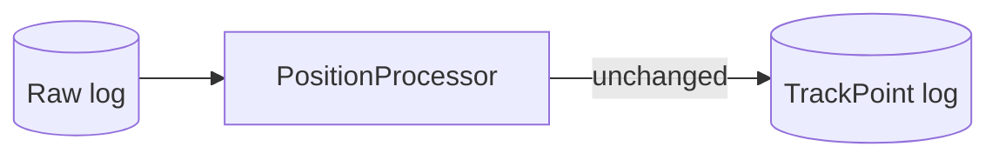
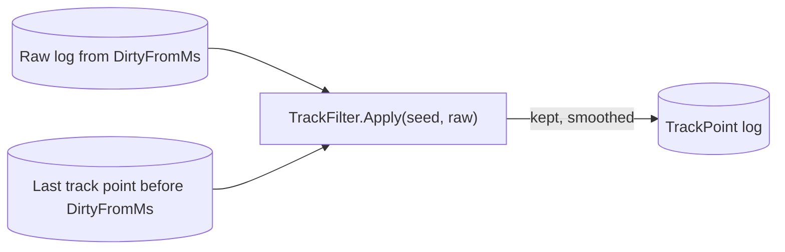

# SS-24 — Plausibility and noise filter

- Status: Approved
- Issue: #152
- Depends on: SS-23 (merged). Decision: Q26 in `ASSUMPTIONS.md`.

## Problem

SS-23 turns each raw position into one track point unchanged (pass-through). A GPS glitch (a point 2 km away for one second) or ordinary noise goes straight into the track, so Safety cannot trust it.

## Goal

- Jumps faster than a person can move are not in the track (TRK-03), using `accuracyM` and the time gap.
- Kept points are smoothed, weighted by accuracy.
- A false drop recovers: after K consistent drops the track follows the device again.
- A replay (late position) gives the same result as processing in order, except when the replay start falls inside a streak of drops (the streak counter restarts from the seed; accepted, rare).

Out of scope: areas and hysteresis (SS-25).

## Solution

1. New pure class `TrackFilter` (`backend/SiteSense.Api/Services/TrackFilter.cs`): `Apply(TrackPoint? seed, IReadOnlyList<Position> raw, long revision, TrackingOptions o)` returns the kept `TrackPoint`s. No I/O.
2. Rules, per position `p` against the last kept point `k` (the seed at first):
   - Gate: `dist(k, p) − (k.AccuracyM + p.AccuracyM) > VMaxMps · max(Δt, 0)` seconds → drop. Same timestamp: Δt = 0.
   - Drops are remembered. When `ResetAfter` (3) drops in a row are each within the gate of the previous drop, keep the last one as is and restart from it.
   - Kept point: lat/lon = average of `k` and `p` with weights `1/accuracyM²`; `AccuracyM` = `p.AccuracyM`. The first point (no seed) is kept as is.
   - Distance in metres: `new LocalProjection(k.Lon, k.Lat).ToLocal(p.Lon, p.Lat)` then `sqrt(x²+y²)` (no new geometry code).
   - Kept points carry the smoothed lat/lon, so `PositionUpdated` shows smoothed coordinates.
   - Accuracy is clamped to at least 1 m before gate and weights (no divide by zero). Kept `AccuracyM` = the new point's own value.
   - A position with the same timestamp as the last kept point is skipped silently (first wins, no tombstone).
3. `TrackingOptions` + `TrackingOptionsValidator` (`VMaxMps = 7`, `ResetAfter = 3`, both `> 0`) next to `StoreOptions`: `AddOptions<TrackingOptions>().BindConfiguration("Tracking").ValidateOnStart()`, `IOptions<TrackingOptions>` injected in `PositionProcessor`; defaults in `appsettings.json`.
4. `PositionProcessor.RunAsync`: replace the pass-through with the filter. Seed = the last track point with timestamp before `from` (`TrackPoint.ReadAsync(.., 0, from)` last). The cursor still advances to the last raw timestamp, dropped or not.
5. Dropped positions are written as tombstones: `TrackPoint` gets `bool Dropped = false`. Reason: after a replay a point kept in an older revision but dropped now must disappear, and the per-timestamp fold (highest revision wins) only works if the newer revision has a row. `TrackPoint.ReadAsync` returns the fold without tombstones; an internal variant keeps them.
6. `NewPositionsAsync` (SS-50 events) compares raw timestamps with the stored rows (tombstones included, revision up to the saved one; a fold across all revisions would republish a point kept under an older revision), so a dropped position is never published and is not republished after a replay. `PositionUpdated` is published for kept points only.
7. The filter never changes points before `from`; the seed is the last non-dropped point before `from`.

## Steps

1. `TrackingOptions` + config + DI.
2. `TrackFilter` + unit tests (jump dropped; noise smoothed; recovery after 3; same timestamp; first point; order-independent replay).
3. `Dropped` tombstone in `TrackPoint` + read variants; wire the filter into `PositionProcessor`; fix `NewPositionsAsync`.
4. Tests: integration through `POST /positions` + `test/drain` (a jump is absent from the track and not published); late position in the middle equals in-order; a point kept before the replay and dropped after it disappears; duplicate timestamp; accuracy 0.
5. Run the existing tests first and fix those that assumed pass-through (`PositionProcessorTests.cs`, `PositionEventsTests.cs:170`, `ProcessingTests.cs`).
6. Update the pass-through comments (`TrackPoint.cs`, `PositionProcessor.cs`), docs mentioning pass-through, `AI_LOG.md`.

## Risks

- Seed read adds one store read per run: acceptable (one run per device batch).
- A real teleport (device handed to a vehicle) is dropped for up to 3 points, then recovers.
