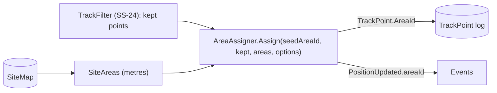

# SS-25 — Current area with hysteresis

- Status: Draft
- Issue: not opened yet
- Depends on: SS-24 (plausibility filter). Decisions: Q27, Q28, Q119 in `ASSUMPTIONS.md`.

## Problem

After SS-24 the track holds clean points but no area. A device walking along an area border produces points on both sides, so a naive "which area contains this point" flips every few seconds. Occupancy (SS-27), intrusion alarms (SS-28) and the track API (SS-26) would all see a flood of fake entries and exits.

## Goal

- Every kept track point has an `AreaId` (TRK-04).
- GPS noise near a border does not change the current area.
- A device that really moves into another area switches within a few points.
- A replay gives the same areas as an in-order run, except when the replay start falls inside a pending streak: the seed holds no streak, so the count restarts (same caveat as SS-24, accepted).

Out of scope: occupancy, alarms, the track endpoint (SS-26, SS-27, SS-28); re-assigning old points when the map changes (KNOWN_ISSUES).

## Solution

1. `SiteAreas` (`backend/SiteSense.Api/Services/SiteAreas.cs`): built from a `SiteMap`. Projects every area polygon to metres with `LocalProjection.FromCentroid` of the perimeter ring (same as `PositionIngest`). Keeps the perimeter id and the other areas in map order. Method `Candidate(lon, lat)` returns the id of the first non-perimeter area that contains the point, else the perimeter id (Q28, Q119); no map or no perimeter returns `null`.
2. `AreaAssigner` (`.../Services/AreaAssigner.cs`), pure: `Assign(string? seedAreaId, IReadOnlyList<TrackPoint> points, SiteAreas? areas, TrackingOptions o)` returns the points with `AreaId`, built with `p with { AreaId = ... }`. Every non-dropped point goes through it (the filter leaves `AreaId` null). Tombstones pass through untouched and do not count toward the streak. `areas == null` (no device, map or perimeter) leaves `AreaId` null.
   - `cur` starts as `seedAreaId`; an id missing from the map, or null (old rows), counts as no area: the first point takes its candidate.
   - Rule for a point with candidate `c` (Q27), margin `m = max(AccuracyM, AreaMarginM)`:
     1. `c == cur`: stay, streak reset.
     2. `cur` is a sub-area and the point is not outside `cur` by more than `m` (`Locate(cur, m) != Outside`): stay, streak reset. This stops border flips and overlap flips (point deep in `cur` but also in an earlier area).
     3. Otherwise switch when the point is inside `c` by at least `m` (`Locate(c, m) == Inside`, for the perimeter id: inside the perimeter by `m`), or when `AreaConfirmPoints` consecutive points have the same `c`.
     4. Otherwise stay and count: pending candidate and count; a different `c` restarts the count at 1.
   - Entering and leaving use the same rule, so they are symmetric.
3. `TrackingOptions`: add `AreaMarginM = 2` and `AreaConfirmPoints = 3`, both `> 0`, validated in `TrackingOptionsValidator`, defaults in `appsettings.example.json` under `Tracking`.
4. `TrackPoint`: new last parameter `string? AreaId = null` (old rows read as null).
5. `PositionProcessor.RunAsync`: when `raw.Count > 0`, load the device once (reused by `PublishAsync`) and the site map once (`SiteMap.GetAsync`); a missing device or map gives `areas = null`; a read error fails the run and the dirty marker retries it, build `SiteAreas`, run `AreaAssigner` on the filter output. The seed area is `seed?.AreaId`. `PositionUpdated` now carries `p.AreaId` (the DTO field already exists, it was null).

## Steps

1. Options + config + validator.
2. `TrackPoint.AreaId`.
3. `SiteAreas` + unit tests (inside sub-area, inside perimeter only, outside everything, overlap takes the first, no map).
4. `AreaAssigner` + unit tests (first point; noise on the border keeps the area; deep move switches at once; slow drift switches after N points; exit symmetric; seed area kept; replay equals in-order for a split outside a streak; unknown or null seed id; tombstones ignored; A to B to C restarts the count; a kept point just outside the perimeter takes the perimeter id; deep in `cur` but also in an earlier area stays).
5. Update the comments that say the area is null (`TenantEvent.cs`, `TrackPoint.cs`). Wire into `PositionProcessor`, publish `AreaId`.
6. API test through `POST /positions` + `test/drain`: a path with border noise yields one area per side, no flips; `PositionUpdated` carries the area.
7. Records: `ASSUMPTIONS.md` (Q27, Q28, Q119), `KNOWN_ISSUES.md` (map change does not re-assign old points; overlapping areas take the first), `AI_LOG.md`.

## Risks

- A map replaced by `PUT /map` leaves old points with the old area ids until a replay.
- A point that really jumps across a border by less than the margin waits up to N points to switch (a few seconds at typical rates).
- Overlapping areas are not validated by the import (not requested): first in map order wins (a device already in another area stays there).
- A map replaced between a run and a later replay mixes old seed ids with new assignments.
