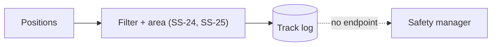
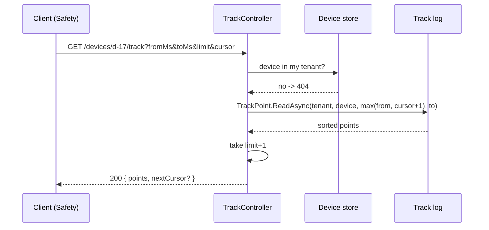

# SS-26 — Track query

- Status: Draft
- Issue: #167
- Plan PR: #<n>   Implementation PRs: #<n>
- Depends on: SS-25 (area per track point, merged). SS-11 (opaque cursor) is not needed: Q37 uses a simple cursor.

## Problem

The system stores a clean track per device (SS-24) with an area per point (SS-25), but nothing returns it. A safety manager cannot ask "where was device `d-17` between 10:00 and 11:00?".



## Goal

- `GET /api/v1/devices/{deviceId}/track` returns the filtered track of one device, sorted by time.
- Query: `fromMs`, `toMs` (Unix ms UTC, range `[fromMs, toMs)`), `limit`, `cursor` (Q37).
- Only Safety reads it (`CanSeeIndividuals`, decided in `sitesense-security`). Admin and Viewer get 403. A device of another tenant is a 404, identical to an unknown device.

Out of scope: the opaque shared cursor and secondary index (SS-11); a `siteId` filter; the demo client.

## Solution

A new `TrackController` at `api/v1/devices/{deviceId}/track` (no existing route uses this prefix). It checks that the device exists in the caller's tenant, then reads `[max(fromMs, cursor+1), toMs)` with the existing `TrackPoint.ReadAsync` (dropped points left out, replays resolved, sorted by `timestampMs`, one point per timestamp), and returns at most `limit` points. The tenant always comes from the token (`User.TenantId()`), never from the route.



Example response:

```json
{ "points": [ { "timestampMs": 1760000000000, "lat": 45.1, "lon": 9.2, "areaId": "work-1" } ],
  "nextCursor": "1760000000000" }
```

- `areaId` is `null` when the site has no map or the row predates SS-25.
- `nextCursor` is the `timestampMs` of the last returned point, as a string; omitted on the last page. Next page = points with `timestampMs > cursor`. Clients treat it as opaque, so SS-11 can change it later.
- Validation by `[Range]` on a query record in `Dtos/`: 400 for a negative time, `fromMs >= toMs`, `limit` outside 1..5000, a cursor that is not a number or lies outside `[fromMs, toMs)`.
- No coordinates in logs (privacy rule).

## Steps
| # | Step | Files | Done when | PR |
|---|---|---|---|---|
| 1 | `TrackController` + query and response DTOs, `ProducesResponseType` 200/400/401/403/404 | `backend/SiteSense.Api/Controllers/TrackController.cs`, `backend/SiteSense.Api/Dtos/TrackRequest.cs`, `backend/SiteSense.Api/Dtos/TrackResponse.cs` | Builds, shows in OpenAPI | impl |
| 2 | Integration tests (list below) and the endpoint in the OpenAPI test | `tests/SiteSense.Tests/Api/TrackTests.cs`, `tests/SiteSense.Tests/Api/OpenApiTests.cs` | `dotnet test` green | impl |
| 3 | Request in `.http`, endpoint in `docs/architecture.md` if it lists endpoints, AI_LOG entry | `backend/SiteSense.Api/SiteSense.Api.http`, `docs/architecture.md`, `AI_LOG.md` | Docs match the endpoint | impl |

## Risks
| Risk | Impact | Mitigation |
|---|---|---|
| `ReadRangeAsync` loads every hour file in the range | A wide range reads days of files | `fromMs` and `toMs` required (Q-B), later pages start at `cursor+1`; comment `shortcut:` in code, upgrade with SS-11 |
| A replay adds a point before a cursor the client holds (late data, Q06) | Paging during ingest can miss it | Accepted; the client re-reads the range |
| Client treats the cursor as a number | Breaks when SS-11 changes it | Documented as opaque, returned as a string |
| Coordinates leak through logs | Privacy breach | No coordinates in log lines; checked in review |

## Tests
- `Track_returns_points_in_range_sorted_with_area`
- `Track_range_is_half_open` (a point at `toMs` is left out)
- `Track_range_crossing_an_hour_file_boundary`
- `Track_pages_with_limit_and_cursor_without_gaps_or_repeats`
- `Track_last_page_has_no_nextCursor`
- `Track_safety_gets_200`, `Track_admin_gets_403`, `Track_viewer_gets_403`, `Track_unauthenticated_gets_401`
- `Track_other_tenant_device_gets_404_same_as_unknown`, `Track_invalid_device_id_gets_404`
- `Track_bad_input_gets_400` (negative time, `fromMs >= toMs`, missing time, limit out of range, bad cursor)
- `Track_hides_dropped_points`

## Open questions
| # | Question | Options (recommended first) | Decision |
|---|---|---|---|
| Q-B | `fromMs`/`toMs` missing? | Both required, 400 if missing (no full scans) / Optional: `fromMs` 0 and `toMs` max | |
| Q-C | `limit` default and max? | Default 1000, max 5000 (the ingest batch size) / Default 500, max 1000 | |

## Changelog
| Date | Change | Why |
|---|---|---|
| 2026-11-28 | First draft | Story SS-26 |
| 2026-11-28 | Safety only (Admin 403), half-open range, cursor+1 read, missing Plan PR line, tests and OpenAPI step | Sonnet validation |
