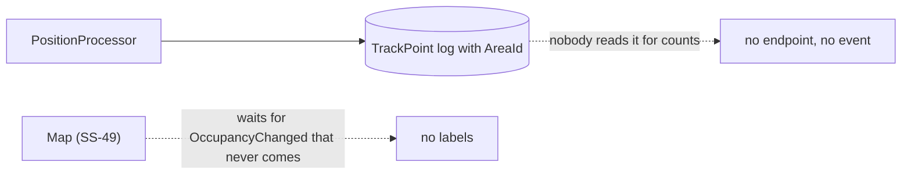
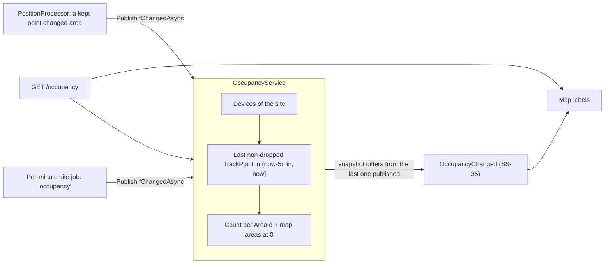

# SS-27 — Occupancy per area

- Status: Draft
- Issue: not created yet
- Plan PR: #<n>   Implementation PRs: #<n>
- Depends on: SS-25 (area on every track point, merged), SS-2 (test clock, merged), SS-35 (hub and event log, merged). Decisions: Q28, Q46 (this plan), Q124–Q126 (open questions below).

## Problem

Since SS-25 every kept track point carries an `AreaId`, but nobody counts people per area.
A Viewer cannot see how crowded each area is, there is no `GET /api/v1/sites/{siteId}/occupancy` (contract §7.3),
and nothing publishes `OccupancyChanged`. The map (SS-49) already has a code path that draws a count label on each
area, but it only fills when an `OccupancyChanged` event arrives, so a freshly opened map shows no counts at all.



## Goal

- `GET /api/v1/sites/{siteId}/occupancy` returns `{ atMs, areas: [{ areaId, count }] }` at the current (simulated) time.
- A device counts in an area when its last valid track point is in that area and is less than 5 minutes older than `atMs` (spec §7.3).
- `OccupancyChanged` is published, with the same payload, when the snapshot of a site changes.
- The map shows the count above each area on first load and keeps it live.

Out of scope: `ZoneAnomaly` and the occupancy time series for ML (SS-33), capacity alarms, history of counts.

## Solution

Occupancy is computed from the track log on demand, not stored: the last valid point of each device of the site, inside a 5-minute window.
One class does it, the endpoint, the processor and a per-minute job all call it.



How it works:

1. `OccupancyService` (`backend/SiteSense.Api/Services/OccupancyService.cs`, singleton, takes `IRealtimePublisher`; a service because the flow crosses three entities: device, track point, map). `AreaCount` is a record in the same file:
   - `ComputeAsync(tenantId, siteId, nowMs, ct)` returns `IReadOnlyList<AreaCount>` (`AreaId`, `Count`). Devices: `Device.GetAllAsync(tenantId, siteId)`. For each: `TrackPoint.ReadAsync(tenant, device, nowMs - 5 min + 1, nowMs + 1)` and take the last point (tombstones are already left out). "Less than 5 minutes" means `nowMs - ts < 300000`. Points after `nowMs` do not count (a late test clock).
   - Areas: every area of the current map, perimeter included, with count 0 when empty (Q46); order as in the map. A point whose `AreaId` is not in the map (map replaced after the point was written) is ignored. No map: empty list.
   - `PublishIfChangedAsync(tenantId, siteId, ct)`: computes at `SiteSenseContext.Time`, compares with the last snapshot published for `(tenant, site)` held in a `ConcurrentDictionary`, publishes `OccupancyChanged` with `{ areas: [{ areaId, count }] }` only if different. The first call after a restart always publishes (nothing remembered). A publish failure is logged and the snapshot is not remembered, so the next call retries. No coordinates, no device ids in the log (PRV).
2. `OccupancyController` (`Controllers/OccupancyController.cs`): `GET /api/v1/sites/{siteId}/occupancy`, policy `CanSeeAggregates` (Admin, Safety, Viewer; Viewer sees aggregates only, PRV-03). Unknown site or another tenant's site: 404. Response DTO `OccupancyResponse(long AtMs, IReadOnlyList<AreaCount> Areas)` in `Dtos/`.
3. `PositionProcessor`: inside the existing `try`, after `SaveAsync` succeeds (so a `ConcurrencyException` retry cannot publish twice), when the run had raw positions and the device is known, call `PublishIfChangedAsync` for the device's site once per run (not per point). It runs whenever the run decided points, not only when the area changed: a device that was silent for more than 5 minutes and resumes in the same area changes the count from 0 to 1 without any area change. The snapshot comparison removes duplicates. A failure is logged and skipped in its own `try/catch`, like `PublishAsync` (never fails the run).
4. `OccupancySiteJob : ISiteJob`, key `"occupancy"`, only a trigger (architecture skill). Registered in `Program.cs` as `AddKeyedTransient<ISiteJob, OccupancySiteJob>("occupancy")` next to the retention line, and scheduled every minute with `SiteJobRunner.Schedule` inside the existing `Hangfire:Storage != "InMemory"` block (a wall-clock run must not fire mid-test). It calls `PublishIfChangedAsync`, so a device that went silent drops out of the count within a minute and the push and the endpoint agree (SS-35 plan). `POST /test/jobs/occupancy/run` works through the existing runner.
5. UI (`frontend/src/realtime.ts`): in `sync()`, after `JoinSite`, fetch `api<OccupancyResponse>('GET', `/sites/${siteId}/occupancy`)` and replace `occupancy` with `new Map(areas.map(a => [a.areaId, a.count]))`, before the buffered events are applied. A 403/404 or network error is caught and ignored: `sync()` goes on. This runs on first connect and on every reconnect. `MapView.tsx` already draws a permanent centre label and the amber/red colours from `live.occupancy`: no change there except that areas now arrive with 0, so the label shows `0`.

The controller declares `ProducesResponseType` 200/401/403/404 like the others.

Example response (ids are the map's own; the perimeter has its map id, not the word "perimeter"):

```json
{ "atMs": 1793268000000, "areas": [ { "areaId": "perimeter", "count": 1 }, { "areaId": "work-1", "count": 3 }, { "areaId": "rest-1", "count": 0 } ] }
```

`OccupancyChanged` data is the same `areas` array (the envelope adds `seq`, `siteId`, `atMs`).

## Steps

| # | Step | Files | Done when | PR |
|---|---|---|---|---|
| 1 | `AreaCount`, `OccupancyService.ComputeAsync` | `Services/OccupancyService.cs`, `Dtos/OccupancyResponse.cs` | unit tests of the window and counts pass | impl |
| 2 | `GET /occupancy` endpoint | `Controllers/OccupancyController.cs` | endpoint tests pass, OpenAPI test still passes | impl |
| 3 | `PublishIfChangedAsync` + call from `PositionProcessor` (ctor takes the service); `AddSingleton<OccupancyService>()` before the processor in `Program.cs`; update the one `new PositionProcessor(...)` in tests | `Services/OccupancyService.cs`, `Services/PositionProcessor.cs`, `Program.cs`, `tests/.../Processing/PositionEventsTests.cs` | one event per change, none when unchanged | impl |
| 4 | `OccupancySiteJob`, key, schedule (see Solution 4) | `BackgroundJobs/OccupancySiteJob.cs`, `Program.cs` | job run drops a stale device and publishes once | impl |
| 5 | Map: seed occupancy from `GET /occupancy` on every sync | `frontend/src/realtime.ts` | opening the map shows counts without waiting for an event | impl |
| 6 | Docs | `ASSUMPTIONS.md` (Q46, Q124–Q126), `SiteSense.Api.http` (new request), `OpenApiTests` (assert the new path) | decisions recorded, request added | impl |

## Risks

| Risk | Impact | Mitigation |
|---|---|---|
| One log read per device on every call, plus `Device.GetAllAsync` lists every device of the tenant and filters in memory | Slow on a big site at 100 positions/s: the processor calls once per run | Only a 5-minute window is read; the snapshot comparison stops duplicate events, not the compute. Shortcut noted in code (`shortcut:` comment): add a cache of the last point per device if the benchmark (SS-13) shows it |
| UI race: a buffered event older than the fetched snapshot overwrites it | A label may be briefly stale until the next event or the next job minute | Fetch first, apply it, then the buffer; accepted (full snapshots self-correct) |
| Snapshot memory is lost at restart | One extra `OccupancyChanged` after restart | Harmless: the payload is a full snapshot, clients replace their state |
| A late position changes counts of the past | Live count stays right (last valid point wins); past counts are not stored | Accepted: no history in scope |
| Two writers (processor and job) race on the snapshot | A duplicate or skipped event | Compare-and-set per `(tenant, site)` under a lock; a skipped publish is corrected by the next minute |
| Processor constructor changes | One test file builds it by hand | Updated in step 3 |

## Tests

- `OccupancyServiceTests`: counts per area; point at 4 min 59 s counts, at 5 min 00 s does not; two points of one device count once (the last); empty areas and the perimeter listed at 0; point after `nowMs` ignored; unknown `AreaId` ignored; no map gives empty list; devices of another site and tenant not counted.
- `OccupancyEndpointTests`: Viewer, Safety, Admin get 200; no token 401; other tenant's site and unknown site 404; `atMs` follows `PUT /test/clock`.
- `PositionEventsTests` additions: import a map for `site-01` first (`MapFixtures.RealMap`) and set `SiteSenseContext.Time` to a frozen provider near `T0`, restored in `DisposeAsync` (as `SiteJobTests` does); a device entering an area publishes one `OccupancyChanged` with the right counts; a second point in the same area publishes none; a device back after 6 silent minutes in the same area publishes again; the Viewer audience receives it, no individual data in it.
- `OccupancySiteJobTests`: reuse the `SiteJobTests` fixture (`ApiFactory` already runs Hangfire InMemory); `PUT /test/clock` +6 minutes, `POST /test/jobs/occupancy/run` publishes a snapshot with 0; a second run publishes nothing.
- Test setup for the service unit tests: the temp-store pattern of `PositionEventsTests` (`FileDocumentStore`, `FileAppendLog`, `Device.CreateAsync`) and track points seeded with `TrackPoint.AppendAsync` with `AreaId` set. No new helper.
- Frontend: `npm run build` and `npm run lint`; browser check with the simulator: open the map, labels show counts at first load, move a device across a border, label updates.

## Open questions

| # | Question | Options (recommended first) | Decision |
|---|---|---|---|
| Q46 | Does the response list areas with count 0 and the perimeter? The contract is silent. | 1. All areas, 0 included, perimeter included (artifact default; the map label needs the 0 to clear). 2. Only areas with count > 0. | Open |
| Q124 | What does a device with no map or a point whose area is gone do? | 1. Not counted (recommended). 2. Count under the perimeter. | Open |
| Q125 | `OccupancyChanged` payload: full snapshot or only the changed areas? | 1. Full snapshot of the site, same as `GET /occupancy` (recommended: simple client, safe after a missed event). 2. Delta. | Open |
| Q126 | Is the per-minute job in scope here? | 1. Yes, so stale devices leave the count and the push agrees with the endpoint (recommended, SS-35 plan). 2. No: counts drop only when the next position arrives. | Open |

## Changelog

| Date | Change | Why |
|---|---|---|
| 2026-11-28 | First draft | SS-27 start |
