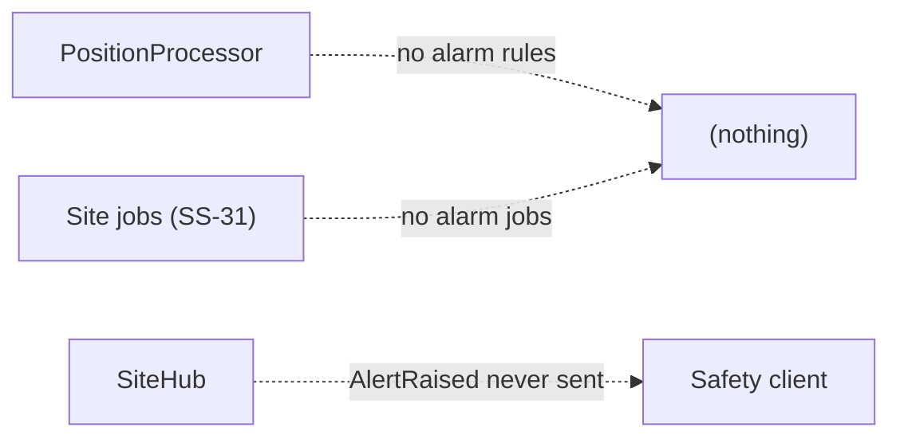
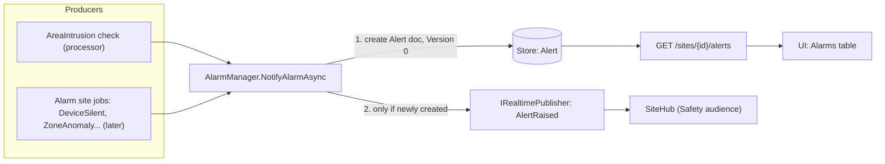
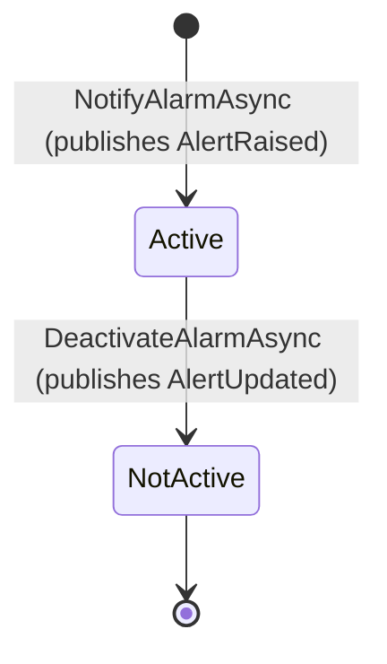

# SS-28 — Alarm core and `AreaIntrusion`

- Status: In review
- Issue: #155
- Plan PR: #<n>   Implementation PRs: #<n>, #<n>

## Problem

The hub can carry `AlertRaised` (SS-35, payload Q116) and the UI can show an alert list in memory (`realtime.ts`), but
nothing creates an alarm. There is no stored alarm, no `GET /sites/{siteId}/alerts` (API-04), no page to read past
alarms, and no rule that tells the story authors where "raise an alarm" must go. Four alarm stories are coming
(`AreaIntrusion` SS-28, `DeviceSilent` SS-30, `ZoneAnomaly` SS-33, `SuddenImmobility`). Without one entry point each
would save, de-duplicate and publish on its own, and they would drift (JOB-02, EVT-03, RTM-03).

## Goal

1. **Alarm core**: one `AlarmManager.NotifyAlarmAsync(...)`. Every alarm, from a job or from processing, goes through it.
   It saves the alarm once, then publishes `AlertRaised`. Calling it twice for the same alarm saves and publishes nothing the second time.
2. **`GET /api/v1/sites/{siteId}/alerts`** with filters and a cursor (contract section 6, API-04).
3. **UI**: sidebar entry "Alarms" opening a table of the site's alarms.
4. **SS-28 `AreaIntrusion`** (EVT-02): one alarm per entry of a device into a `restricted` or `hazard` area, on top of the core.

Each alarm has a state, `Active` or `NotActive` (state machine below).

Out of scope: `DeviceSilent` (SS-30), `ZoneAnomaly` (SS-33), `SuddenImmobility`; alarm retention; live updates on the Alarms page (the map already shows them live).

## Solution

Each alarm kind is its own small unit. Periodic kinds are `ISiteJob`s (existing SS-31 mechanism, keyed by job name);
`AreaIntrusion` runs inside position processing (decided in SS-35, "How events will be produced"). All of them
only *decide* an alarm and hand it to the manager. The manager owns the order *create (Version 0) → publish*.

**The `Alert` document.** Fields: `Id`, `TenantId`, `Version`, `SiteId`, `Type`, `EventTimeMs`, `DeviceId?`, `AreaId?`, `Late`, `State`, `EndTimeMs?` (device and area are null when not relevant, as in the contract). `Type` uses exactly the contract strings `AreaIntrusion`, `ZoneAnomaly`, `SuddenImmobility`, `DeviceSilent`. A static `Alert.CreateAsync` returns null when the id exists (same pattern as `Device.CreateAsync`: `Version = 0`, `ConcurrencyException` means duplicate).

**Alarm id.** Built only from the alarm's inputs: `SHA-256(type|siteId|deviceId|areaId|eventTimeMs)` as **lowercase** hex (the store escapes uppercase letters with `!`, which it then rejects; device ids may not pass the name check either). A retry, a replay of a late batch, or a second job run builds the same id, the create is rejected, and nothing is published (JOB-02, EVT-03).

**State machine.** Each alarm has a `State`: `Active` or `NotActive`. It is created `Active`. The only transition is `Active → NotActive`, done by the **producer** when the cause ends (never by a user, for now). There is no way back: a new cause is a new alarm with a new id.

`AlarmManager.DeactivateAlarmAsync(tenantId, alertId, endTimeMs)` loads the alert, and if it is `Active` saves it as `NotActive` with `EndTimeMs` (versioned save), then publishes `AlertUpdated` `{ alertId, state, endTimeMs }`. Already `NotActive`, or unknown id: nothing saved, nothing published (idempotent). `AlertUpdated` is a new event type with the same audience as `AlertRaised` (`CanSeeIndividuals`). More states (acknowledged, closed by a user) are out of scope.

**Late flag.** The producer passes `late`. The manager stores it and never changes it.

**Order and failure.** Save first, then publish (RTM-03). The payload is a new `AlertRaisedData` record next to `PositionUpdatedData` in `Realtime/TenantEvent.cs`, with the Q116 fields `alertId, type, eventTimeMs, deviceId, areaId, late`. A crash between the two loses the live event but keeps the alarm, which the table still shows. Same at-most-once rule as Q115.

**`AreaIntrusion`.** Inside `PositionProcessor.RunAsync`, **before** `DeviceProcessing.SaveAsync` and over the `fresh` points only (not the whole `raw` list, so a replay does not re-check old points). It must throw on failure: the dirty marker then stays and the run retries, which is safe because the alarm id is stable. (After the save, a crash would move the cursor and lose the alarm for good.)

1. Load `SiteMap.GetAsync(tenantId, device.SiteId)`. No map: skip, no alarm.
2. Take the `restricted` and `hazard` areas, projected with the same helper as `SiteMap.BuildRouteGraph` (centroid of the perimeter, `LocalProjection`). That projection and the area filter are moved into one shared helper; `BuildRouteGraph` uses it too.
3. A point is "in" area A when `PlanarGeometry.Locate` gives `Inside` or `OnBoundary` (touching a hazard edge counts as an entry). The tolerance is a constant in the detector.
4. An entry is a point in A whose previous track point is not in A. The previous point comes from the revision-folded `TrackPoint.ReadAsync` over a bounded lookback before the run's first point (constant, 10 minutes). No previous point in the window counts as "outside", so a first point inside is an entry.
5. One entry = one alarm: `eventTimeMs` = the entry point's timestamp, `late` = the run is a replay (`from <= cursor`).
6. An exit is a point not in A whose previous point is in A. The detector finds the device's `Active` `AreaIntrusion` alarms for A (`Alert.ListActiveAsync`, filtered in memory) and calls `DeactivateAlarmAsync` with the exit point's timestamp. Ends of an alarm found in a replay are handled the same way and are idempotent.

No new per-device state. A late point that splits a stay inside an area can create a second alarm for the later entry (new entry time = new id). This is accepted and goes to `KNOWN_ISSUES.md`.

**API.** `GET /api/v1/sites/{siteId}/alerts?fromMs=&toMs=&type=&limit=&cursor=`, policy `CanSeeIndividuals` (same as the `AlertRaised` audience, Q36: `Safety` yes, `Viewer` `403`; `Admin` follows the policy). Items as the contract inside `{ "items": [...], "nextCursor": ... }`: `alertId, type, eventTimeMs, deviceId, areaId, late, state, endTimeMs` (the last two are additions to the contract; filter `state=Active|NotActive` added too). Sorted **newest first** by `eventTimeMs`, then `alertId`; the cursor encodes both. `limit` default 100, max 500; `nextCursor` is `null` on the last page. Unknown site or other tenant's site: `404` (ProblemDetails).

**Tenant-wide alarms (decided after review).** Alarms are not tied to one site on screen: the page shows every alarm of the tenant and filters by site in the browser. So, besides the per-site endpoint (it stays, it is in the contract):
- `GET /api/v1/alerts?fromMs=&toMs=&type=&state=&limit=&cursor=`, same policy, same page shape, every site of the tenant; each item also carries `siteId`.
- A new hub method `JoinTenant` joins the connection to one group per passed audience policy (`tenant:{tenantId}:all:audience:{policy}`). `SignalRSender` sends `AlertRaised` and `AlertUpdated` to that group as well as to the site group. Other event types are unchanged. A connection that joined both a site and the tenant gets an alarm twice; the client ignores an alarm it already has (same `seq`, already handled by `take`).

**UI.** Sidebar entry "Alarms" (route `/alarms`), shown to users who pass `can.seeIndividuals`. The page has two tabs, **Active** (default) and **History** (`NotActive`), a site filter (`All sites` by default, applied in the browser) and a table: time, site, type, device, area, severity badge, late, state badge (green `Active`; History shows `Not active` and the end time). Severity is fixed per type: `AreaIntrusion` High, `DeviceSilent` and `ZoneAnomaly` Medium, `SuddenImmobility` Critical (Low is the fallback); badges grey, yellow, orange, red for Low, Medium, High, Critical. Newest first, as the API returns them. It is **live**: it loads the first page from `GET /alerts`, then follows the hub with `JoinTenant`. `AlertRaised` adds a row on top, `AlertUpdated` changes the state of the row with that `alertId`. `realtime.ts` learns `AlertUpdated` and keeps a state per alert.

## Steps

Stacked PRs: plan PR, then PR 1 (core + endpoint + UI) on the plan branch, then PR 2 (SS-28) on PR 1.

| # | Step | Files | Done when | PR |
|---|---|---|---|---|
| 1 | `Alert` store document (with `State`, `EndTimeMs`), type constants, lowercase-hex id, `CreateAsync`, `ListActiveAsync`; `AlertRaisedData`, `AlertUpdatedData`, `EventTypes.AlertUpdated` + audience | `backend/SiteSense.Api/Alarms/Alert.cs`, `Realtime/TenantEvent.cs`, `Realtime/EventAudience.cs` | Unit test: same inputs give same id; second `CreateAsync` returns null; `AlertUpdated` audience is `CanSeeIndividuals` | 1 |
| 2 | `AlarmManager` (singleton, takes `IRealtimePublisher`): `NotifyAlarmAsync`, `DeactivateAlarmAsync` + registration | `backend/SiteSense.Api/Alarms/AlarmManager.cs`, `Program.cs` (DI block) | Tests: two notifies give one stored alert and one `AlertRaised`; deactivate gives `NotActive` and one `AlertUpdated`, a second deactivate gives nothing; publish error logged, not thrown | 1 |
| 3 | `GET /sites/{siteId}/alerts` with filters, cursor, tenant isolation | `Controllers/AlertsController.cs`, `Dtos/AlertListResponse.cs` | Tests in `tests/SiteSense.Tests/Api/Alarms/`: filters, paging, `404` other tenant, `403` for `Viewer`; `OpenApiTests` still passes | 1 |
| 4 | Sidebar entry and Alarms page | `frontend/src/components/AppSidebar.tsx`, `frontend/src/App.tsx`, `frontend/src/pages/AlarmsPage.tsx`, `frontend/src/realtime.ts`, `frontend/src/api.ts` | In the browser: entry visible for `Safety`, hidden for `Viewer`; table lists the site's alarms with state; a new alarm and a state change show without reload | 1 |
| 4b | Tenant-wide alarms: `GET /alerts`, `siteId` in items, `JoinTenant` + tenant group in `SignalRSender`; UI tabs, severity, site filter | `Controllers/AlertsController.cs`, `Dtos/AlertListResponse.cs`, `Realtime/SiteHub.cs`, `Realtime/SignalRSender.cs`, `frontend/src/realtime.ts`, `frontend/src/pages/AlarmsPage.tsx` | Tests: tenant endpoint lists alarms of two sites and not another tenant's; a `JoinTenant` client receives `AlertRaised` of any site, a Viewer connection none; browser: both sites' alarms show, site filter works | 1 |
| 5 | Move the area projection and the restricted/hazard filter out of `BuildRouteGraph` into a shared helper | `Models/Map/SiteMap.cs`, new helper next to it | Existing route-graph tests still pass, no behaviour change | 2 |
| 6 | Intrusion detector, called from the processor before the save | `Services/PositionProcessor.cs`, `Alarms/AreaIntrusionDetector.cs` | Tests: walk in, out, in = 2 alarms, the first `NotActive` after the exit; replay of the same batch = 0 new; late batch marked `late`; no map = no alarm; failure keeps the dirty marker | 2 |
| 7 | Simulator check "enter hazard area", `docs/architecture.md` line, `ASSUMPTIONS.md`, `KNOWN_ISSUES.md`, `AI_LOG.md` | `simulator/`, `docs/architecture.md`, root `.md` files | End-to-end: a simulated device enters the area, the alarm appears in the table and as `AlertRaised` | 2 |

## Risks

| Risk | Impact | Mitigation |
|---|---|---|
| The map changes after a point was processed | A replay may find a different area than the first run | Alarm id includes `areaId`, so a replay under a new map can add an alarm; accepted, noted in `KNOWN_ISSUES.md` |
| `ListAsync<Alert>` reads every alert of the tenant | Slow with many alarms | Filter in memory now; `shortcut:` comment; per-site/day documents if it matters |
| Processing runs the detector for every point | Slower processing | One map load per run, one `Locate` per point per restricted/hazard area; measured in the existing benchmark |
| Crash between save and publish | Live event lost | At most once, same as Q115; the table still shows the alarm |

## Tests

- `Alert` id: stable, differs per input.
- `AlarmManager`: dedupe, publish only after save, publish error logged and not thrown.
- Alerts endpoint: filters (`fromMs`, `toMs`, `type`), cursor round trip, tenant isolation, role (`Safety` yes, `Viewer` no).
- `AreaIntrusionDetector`: entry, exit and re-entry, first point inside, boundary point, replay, late batch.
- Browser: sidebar entry per role, table content, site switch.

## Open questions

| # | Question | Options (recommended first) | Decision |
|---|---|---|---|
| 1 | Where does `AreaIntrusion` run? | (a) In the processor, push, alarm within seconds (SS-35 plan). (b) A per-minute `ISiteJob` scanning the last minute of track points: matches "one job per alarm" literally, but the alarm arrives up to 1 min late | (a) chosen: in the processor |
| 2 | Alarms page scope | (a) Site selector, one site at a time (the endpoint is per site). (b) All sites, N requests merged in the browser | (a) chosen: one site at a time |
| 3 | Page updates | (a) Load on open plus a Refresh button. (b) Also subscribe to `AlertRaised` | (b) chosen: live on `AlertRaised` and `AlertUpdated` |
| 4 | Create the GitHub issue for SS-28 now? | (a) Yes, before the plan PR. (b) Later | (a) chosen: issue #155 |

## Changelog

| Date | Change | Why |
|---|---|---|
| 2026-11-28 | First draft | New story |
| 2026-11-28 | Added `SiteId`/nullable fields, lowercase hex id, `AlertRaisedData`, detector before save over `fresh` only, map/projection helper, lookback window, boundary rule, cursor and order, test folder, OpenAPI and docs steps | Sonnet validation findings |
| 2026-11-28 | Decisions on open questions 1-4; alarm state machine (`Active`/`NotActive`, producer-driven, `AlertUpdated` event), live Alarms page | User |
| 2026-11-28 | Tenant-wide alarms (`GET /alerts`, `JoinTenant`), Active/History tabs, severity badge, site filter in the UI | User |
