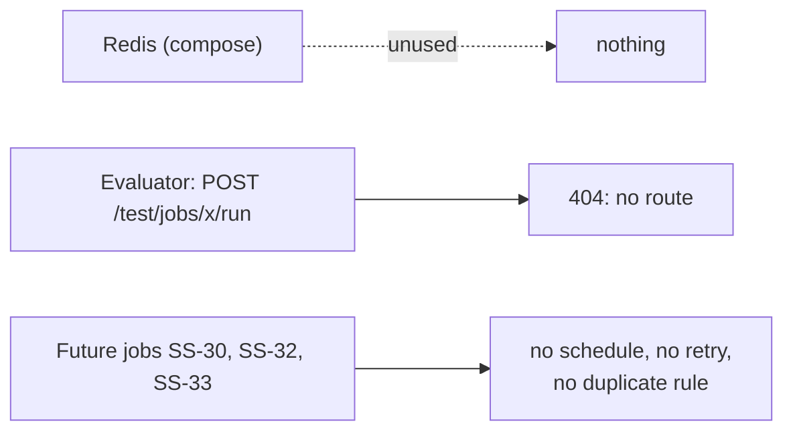
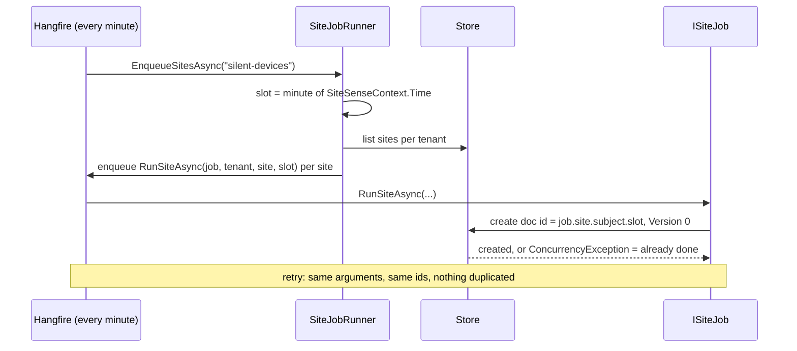
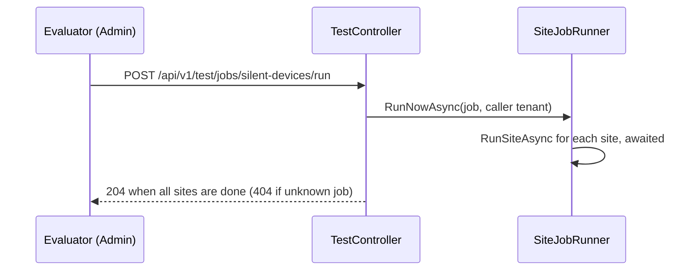

# SS-31 — Hangfire and idempotent jobs

- Status: In review
- Issue: #92
- Plan PR: #97   Implementation PRs: #<n>

## Problem
SiteSense must run periodic checks: silent devices (SS-30), position retention (SS-32) and crowding anomalies (SS-33).
Today there is no job runner at all. Redis runs in compose (SS-1) but nothing uses it.
Without a shared mechanism each of those stories would invent its own schedule, its own retry and its own way to avoid duplicates.
A job that fails half-way and is retried could raise the same alert twice (JOB-02).
The evaluation script also needs `POST /api/v1/test/jobs/{jobName}/run`, which answers only when the run is over (C-7.2c).

## Goal
- Hangfire runs in the API process (Q01) with Redis storage (Q08).
- Any job registered as a *site job* runs every minute for every site of every tenant, and can also be run on demand from the test endpoint.
- A retry of a run never produces a second alert or event: the rule and its test are in place for SS-30, SS-32, SS-33.
- The README explains the Hangfire storage choice.

Out of scope: the real jobs (SS-30 silent devices, SS-32 retention, SS-33 anomaly detection), alerts, events and SignalR. SS-11 (postponed). The Hangfire dashboard (see open question 1).

## Solution

Terms:
- **Site job**: one check that runs for one site, for example "silent devices of site `north-yard`". It implements `ISiteJob`.
- **Slot**: the minute a run belongs to, in Unix ms, taken from `SiteSenseContext.Time` (the simulated clock in test mode, Q38) and rounded down to the minute. Example: clock at `1793268045123` → slot `1793268000000`.

How it works:
1. **Every minute** one Hangfire recurring job per job name (`Cron.Minutely()`, UTC) calls `SiteJobRunner.EnqueueSitesAsync(jobName)`. It computes the slot once, lists the sites of each tenant and enqueues one Hangfire background job per site: `RunSiteAsync(jobName, tenantId, siteId, slotMs)`. A failure in one site is retried alone and does not block the others.
2. **The slot is a job argument**. Hangfire stores the arguments in Redis, so a retry (Hangfire's default automatic retry) runs with the same slot, even minutes later.
3. **Idempotency rule (JOB-02)**: everything a site job writes (alerts, stored events) gets an id built only from its inputs, joined with `_` because store ids allow only `[A-Za-z0-9_-]{1,128}`, for example `silent-devices_north-yard_dev-17_1793268000000`. It is created with `Version = 0`. A second create of the same id gets `ConcurrencyException` from the store, which the job treats as "already done". This is the pattern `Site.CreateAsync` already uses (Q43): no new store code.
   - The same holds when a retried dispatcher enqueues one site twice and two workers run the same slot at once: the store's per-document lock lets one create win.
   - The id names the thing that must happen once. The slot is the default part; a job whose fact spans many minutes (a device silent for 20 minutes) uses that fact instead, for example the last-seen time, so it is not raised again every minute. Each job story (SS-30, SS-32, SS-33) picks its id.
   - Sending to SignalR is not part of this story: events are stored first and sent from the stored log (realtime story), so a crash between create and send loses no event.
4. **On demand (C-7.2c)**: `POST /api/v1/test/jobs/{jobName}/run` (test mode, `TestMode` policy = Admin, like `PUT /test/clock`) runs `RunSiteAsync` inline for each site of the caller's tenant, with the slot of the current clock, and answers `204` when every site is done. An unknown or not yet implemented `jobName` answers `404` ProblemDetails. Two calls at the same frozen clock use the same slot, so the second one creates nothing new.
5. **Registration**: a site job is a keyed DI service (`AddKeyedTransient<ISiteJob, SilentDevicesJob>("silent-devices")`) plus one schedule line in `Program.cs` (`SiteJobRunner.Schedule("silent-devices")`). No job is registered by this story: the names `anomaly-detection`, `silent-devices`, `retention` arrive with SS-33, SS-30, SS-32. The mechanism is proved by a probe job that lives in the test project (open question 2).

Config:
- `Hangfire:Storage`: `Redis` (default) or `InMemory`. Only the test host sets `InMemory`: `AddHangfire` config actions cannot be swapped after registration, and CI has no Redis (Q72).
- `ConnectionStrings:Redis` (compose: `redis:6379`; template: `localhost:6379`, no password). With `Redis` storage, missing or empty fails at startup (NF-04), like `Store:RootPath`. Options: key prefix `sitesense:`, `abortConnect=false` so a slow Redis start does not crash the API.
- Schedules are registered after `Build()` through `IRecurringJobManager` from `app.Services`, never the static `RecurringJob`. Job methods take a `CancellationToken`; Hangfire passes its shutdown token, callers pass `CancellationToken.None`.
- `/health` stays liveness only (Q71): it does not check Redis.

Packages (central versions in `Directory.Packages.props`, Q65):

| Package | Version | Licence | Why |
|---|---|---|---|
| `Hangfire.Core`, `Hangfire.AspNetCore` | 1.8.25 | LGPL-3.0 | Hangfire is required by the spec. |
| `Hangfire.Redis.StackExchange` | 1.12.0 | LGPL-3.0 | Redis storage (Q08); netstandard2.0, runs on .NET 10. |
| `Hangfire.InMemory` | 1.0.0 | LGPL-3.0 | Storage for the test host only (`Hangfire:Storage=InMemory`), since CI has no Redis (Q72). Referenced by the API project because `Program.cs` picks the storage. |

## Steps
| # | Step | Files | Done when | PR |
|---|---|---|---|---|
| 1 | Add the packages | `Directory.Packages.props`, `backend/SiteSense.Api/SiteSense.Api.csproj` | `dotnet build` passes | impl |
| 2 | `ISiteJob` and `SiteJobRunner` (`Schedule`, `EnqueueSitesAsync`, `RunSiteAsync`, `RunNowAsync`, slot rounding) | `backend/SiteSense.Api/BackgroundJobs/ISiteJob.cs`, `backend/SiteSense.Api/BackgroundJobs/SiteJobRunner.cs` | builds; no `DateTime.Now`, time only from `SiteSenseContext.Time` | impl |
| 3 | Wire Hangfire: storage from `Hangfire:Storage` (Redis from `ConnectionStrings:Redis`, fail fast when empty; or InMemory), `AddHangfireServer`, runner registration, schedule section after `Build()` with no lines yet | `backend/SiteSense.Api/Program.cs` | app starts in compose; no dashboard mapped | impl |
| 4 | Test endpoint `POST jobs/{jobName}/run` | `backend/SiteSense.Api/Controllers/TestController.cs` | 204 / 404 / 403 / 404-when-off covered by tests | impl |
| 5 | Config: compose env `ConnectionStrings__Redis`, template key, Redis port for local runs (open question 7) | `docker-compose.yml`, `backend/SiteSense.Api/appsettings.example.json` | `docker compose up` healthy; `dotnet run` starts with compose Redis | impl |
| 6 | Test host: `Hangfire:Storage=InMemory`, test probe site job | `tests/SiteSense.Tests/Api/ApiFactory.cs`, `tests/SiteSense.Tests/Api/Jobs/ProbeSiteJob.cs` | existing tests still pass | impl |
| 7 | Tests (list below) | `tests/SiteSense.Tests/Api/Jobs/SiteJobTests.cs`, `tests/SiteSense.Tests/Api/TestModeTests.cs` | all pass | impl |
| 8 | Docs: README storage paragraph + run notes, architecture skill background-jobs rule (slot, idempotent ids, keyed job + schedule line), ASSUMPTIONS (decided questions), KNOWN_ISSUES, AI_LOG (both required at story end) | `README.md`, `.claude/skills/sitesense-architecture/SKILL.md`, `ASSUMPTIONS.md`, `KNOWN_ISSUES.md`, `AI_LOG.md` | each rule in one place, linked from the others | impl |

## Risks
| Risk | Impact | Mitigation |
|---|---|---|
| `JobStorage.Current` is a process-wide static set by every test host | Parallel test hosts share one storage | Job tests run in the `Api` collection; tests that do not touch jobs ignore the storage. |
| An id built from long site and device ids exceeds 128 chars or contains `_` | Store rejects it, or two ids collide | Each job story checks its id; a test uses realistic ids. Hashing the parts is the upgrade if needed. |
| Hangfire server polls Redis in every test host | Slow or flaky tests | Tests use InMemory storage; job runs in tests go through `RunNowAsync` / `RunSiteAsync` directly, never wait on the Hangfire worker. |
| Recurring job fires on real time while the clock is frozen | Two real minutes give the same slot | Intended: same slot, same ids, no duplicates. Test runs use the endpoint, not the timer. |
| The static `SiteSenseContext` is shared by tests | Flaky tests | Job tests join the `Api` collection like `TestModeTests`. |
| LGPL licence of Hangfire packages | Licence question at review | Used as unmodified NuGet libraries; noted in the PR "Dependencies". |
| Admin of tenant A triggers a run | Could touch tenant B | `RunNowAsync` only gets the caller's tenant (open question 4). |

## Tests
- `EnqueueSitesAsync_TwoTenantsThreeSites_EnqueuesOneJobPerSiteWithSameSlot`
- `Schedule_JobName_RegistersMinutelyRecurringJob` (cron `* * * * *`)
- `Slot_ClockMidMinute_RoundsDownToMinute`
- `RunSiteAsync_SameSlotTwice_CreatesOneDocument` (the JOB-02 retry proof, probe job)
- `RunSiteAsync_SameSlotConcurrent_CreatesOneDocument` (`Task.WhenAll`: a double-enqueued site)
- `Startup_RedisStorageWithoutConnectionString_Fails`
- `RunJob_TestModeAdmin_Returns204AfterRunFinished` (probe document exists when the response arrives)
- `RunJob_UnknownJob_Returns404ProblemDetails`
- `RunJob_TwiceSameClock_NoDuplicate`; `RunJob_ClockMovedOneMinute_NewSlot`
- `RunJob_OnlyCallerTenantSites`
- `RunJob_NonAdmin_Returns403`; `RunJob_TestModeOff_Returns404` (added to the existing theory)
- Manual: `docker compose up`, API healthy, Hangfire keys appear in Redis (`redis-cli keys 'hangfire:*'`).

## Open questions
| # | Question | Options (recommended first) | Decision |
|---|---|---|---|
| 1 | Q52: is the Hangfire dashboard exposed? | **A. Not exposed** (not required; one less surface to secure). B. Only in test mode, Admin. | |
| 2 | Which job proves the mechanism? | **A. A probe job in the test project only**: production lists no fake job name, the test endpoint answers 404 until SS-30. B. A small production job (e.g. `heartbeat`) that writes a document per site per minute. | |
| 3 | How are runs fanned out per site? | **A. One recurring job per job name that enqueues one background job per site** (new or deleted sites need no sync). B. One recurring job per job and site, added and removed with the site. | |
| 4 | Which sites does the test endpoint run? | **A. The caller's tenant only** (tenant isolation). B. Every tenant. | |
| 5 | What does the test endpoint answer? | **A. `204`**, like `PUT /test/clock`. B. `200` with the number of sites run. | |
| 6 | Hangfire storage in tests | **A. `Hangfire.InMemory`, picked by `Hangfire:Storage=InMemory` in the test host.** B. No Hangfire in tests (server off, schedule untested). | |
| 7 | Redis for `dotnet run` on the host | **A. Publish Redis on `127.0.0.1:6379` in compose**, template `localhost:6379`. B. Keep Redis internal; local runs use in-memory storage (two code paths). | |

## Changelog
| Date | Change | Why (review comment or finding) |
|---|---|---|
| 2026-11-26 | First draft | — |
| 2026-11-26 | Storage chosen from config (not swapped in tests), `IRecurringJobManager` after `Build()`, ids joined with `_` (store id regex), concurrent-run test, episode ids and event sending noted, fewer doc files | Sonnet validation |
