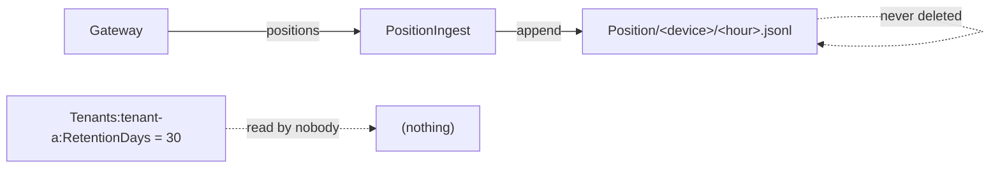
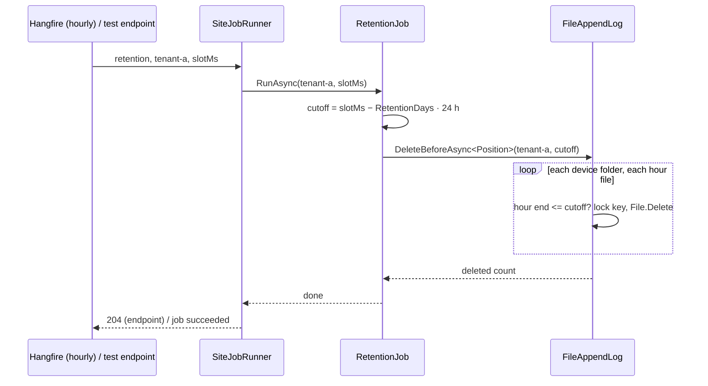

# SS-32 — Position retention

- Status: In review
- Issue: #116
- Plan PR: #119   Implementation PRs: (next)

## Problem
Every position a device sends is stored forever. The position log (SS-12) writes one file per device
per UTC hour, under `<store>/<tenant>/Position/<deviceId>/yyyy-MM-ddTHH.jsonl`, and nothing ever
deletes those files. Each tenant has a `RetentionDays` setting (SS-43), but nothing reads it.
Who notices: the tenant, whose workers' movement data is kept longer than allowed (PRV-04), and the
operator, whose disk grows without limit. The test endpoint `POST /api/v1/test/jobs/retention/run`
answers `404`, because no `retention` job exists (JOB-04).

## Goal
An hourly Hangfire job `retention` deletes, for each tenant, every position log hour file whose whole
hour ended at or before `now − RetentionDays` days, on the simulated clock (SS-2). The test endpoint runs it
for the caller's tenant and answers `204` when it has finished. A retry or a crash mid-run is safe.

Out of scope: the filtered track log `TrackPoint` (Q16) does not exist yet; the story that adds it adds
one line to the retention job (see step 3). Dropping too-old positions at ingest (Q95). Removing empty
device folders.

## Solution
Three small pieces:

1. **Store**: `IAppendLog.DeleteBeforeAsync<T>(tenantId, beforeMs, ct)` checks the tenant id
   (`StorePaths.CheckName`), then enumerates the key folders under `<root>/FileName(tenant)/<T name>/`
   (missing folder: nothing to do). For each folder it takes the same lock `AppendCoreAsync` takes
   (`_locks` keyed by that exact folder path, so append and delete on one device never interleave) and
   deletes each hour file whose hour ends at or before `beforeMs` (`hourStart + 1 h <= beforeMs`). Each
   delete is one `File.Delete`, so a file is either whole or gone. Files whose name is not an hour are
   left alone. Returns how many files it deleted.
2. **Tenant job**: retention is per tenant, not per site (Q96). A new `ITenantJob`
   (`RunAsync(tenantId, slotMs, ct)`) sits next to `ISiteJob`. `SiteJobRunner` learns two things:
   `RunNowAsync` runs a keyed `ITenantJob` once for the caller's tenant (site jobs unchanged; a name is
   registered as one kind only), and a `ScheduleTenantJob(manager, jobName, cron)` whose recurring job
   `EnqueueTenantsAsync` enqueues `RunTenantAsync(jobName, tenantId, slotMs)` for each key of
   `SiteSenseContext.Tenants`, with plain arguments like `EnqueueSitesAsync`.
3. **Retention job**: `RetentionJob : ITenantJob`, keyed `"retention"`. It reads
   `SiteSenseContext.Tenants[tenantId].RetentionDays` (a tenant missing from configuration: log a warning,
   delete nothing). Cutoff = `slotMs − RetentionDays × 86 400 000` (UTC, Q48). Calls `DeleteBeforeAsync<Position>` and logs the
   count. Scheduled `Cron.Hourly()` (Q96).

Example: clock `2026-03-31T10:20Z`, `RetentionDays = 30` → cutoff `2026-03-01T10:20Z`.
`2026-03-01T09.jsonl` (ends 10:00) is deleted; `2026-03-01T10.jsonl` (ends 11:00) is kept.

Why it is idempotent and crash-safe: the job only deletes, and only files that are fully expired.
A second run with the same slot finds nothing to delete. A crash between two deletes leaves whole
files only; the next run deletes the rest. A late position for an expired hour, appended after its
file was deleted, recreates the file; the next run deletes it (Q95).

## Steps
| # | Step | Files | Done when | PR |
|---|---|---|---|---|
| 1 | Add `DeleteBeforeAsync<T>` to `IAppendLog` and `FileAppendLog` (lock per key dir, hour parse like `ReadRangeAsync`, `File.Delete`, ignore `FileNotFoundException`). | `backend/SiteSense.Api/Store/IAppendLog.cs`, `backend/SiteSense.Api/Store/FileAppendLog.cs` | Builds; store tests of step 5 pass. | impl |
| 2 | Add `ITenantJob`; in `SiteJobRunner` add `ScheduleTenantJob`, `EnqueueTenantsAsync`, `RunTenantAsync`, and make `RunNowAsync` try the keyed `ITenantJob` first. | `backend/SiteSense.Api/BackgroundJobs/ITenantJob.cs`, `backend/SiteSense.Api/BackgroundJobs/SiteJobRunner.cs` | Existing `SiteJobTests` pass unchanged. | impl |
| 3 | Add `RetentionJob` (cutoff, delete `Position`, log `Retention for {TenantId}: {Deleted} hour files deleted before {CutoffMs}`). Comment: the `TrackPoint` story adds its line here. | `backend/SiteSense.Api/BackgroundJobs/RetentionJob.cs` | Builds. | impl |
| 4 | Register `AddKeyedTransient<ITenantJob, RetentionJob>("retention")`; add `SiteJobRunner.ScheduleTenantJob(manager, "retention", Cron.Hourly())`, skipped when `Hangfire:Storage` is `InMemory` (test host: an hourly run on the real wall-clock hour must not delete test data mid-test). Update the comments at the site-job registration and the commented `Schedule` line (they name SS-32 as a site job) and the `TestController.RunJob` comment ("every site"). | `backend/SiteSense.Api/Program.cs`, `backend/SiteSense.Api/Controllers/TestController.cs` | `POST /api/v1/test/jobs/retention/run` answers `204`. | impl |
| 5 | Tests (see Tests), added to the existing test files. Add a `purge` branch to `CrashWriter.Main` (`args[1] == "purge"`, `args[2]` = cutoff ms): it calls `DeleteBeforeAsync<Position>` for `tenant-a` and prints each deleted count. | `tests/SiteSense.Tests/Api/Store/FileAppendLogTests.cs`, `tests/SiteSense.Tests/Api/Store/AppendLogCrashTests.cs`, `tests/SiteSense.StoreCrashWriter/CrashWriter.cs`, `tests/SiteSense.Tests/Api/Jobs/RetentionJobTests.cs` | All tests pass. | impl |
| 6 | Docs: in `KNOWN_ISSUES.md` drop `retention` from the "no periodic job" line (keep the other two names) and replace the "No retention yet" line with: no `TrackPoint` retention until that log exists; empty device folders stay; the `_locks` entry of a deleted device stays. `AI_LOG.md` entry. `README.md` only if it lists jobs. | `KNOWN_ISSUES.md`, `AI_LOG.md`, `README.md` | Docs match the code. | impl |

## Risks
| Risk | Impact | Mitigation |
|---|---|---|
| A delete races an append to the same hour file. | A late, already-expired position is lost or kept one hour longer. | Delete under the key's append lock; the position was expired anyway (Q95). |
| Off-by-one at the cutoff deletes a file that still holds recent positions. | Data loss inside the retention window. | Delete only when the whole hour ends at or before the cutoff; boundary tests both sides. |
| Simulated clock jumps forward in tests. | Many files deleted at once. | Intended: the job follows the clock (SS-2). Tests set the clock explicitly. |
| Tenant job reaches another tenant's files. | Tenant isolation breach. | Path built from the tenant id only (`StorePaths.CheckName`); test that the other tenant's files stay. |

## Tests
`FileAppendLogTests`:
- `DeleteBefore_HourEndedBeforeCutoff_DeletesFile`
- `DeleteBefore_HourEndsAfterCutoff_KeepsFile` (cutoff inside the hour)
- `DeleteBefore_CutoffOnHourBoundary_DeletesOnlyEndedHour` (cutoff exactly 10:00: 09 deleted, 10 kept)
- `DeleteBefore_ConcurrentAppendSameDevice_NoTornFile` (appends to a recent hour while deleting: every appended record reads back)
- `DeleteBefore_OtherTenantAndOtherType_Untouched`
- `DeleteBefore_RunTwice_SecondDeletesNothing`
- `DeleteBefore_NonHourFileName_Ignored`

`AppendLogCrashTests`:
- `DeleteBefore_KilledMidRun_KeepsRecentAndRerunFinishes`: the test seeds 50 devices × 48 hour files
  (24 expired, 24 recent, one record each) in a temp store, then starts the child (`purge` mode, cutoff
  as argument) and kills it after a delay from a fixed seed, 5 times. After each kill: every remaining file parses,
  every recent file is intact; a final in-process run leaves no expired file.

`RetentionJobTests` (through the API, test mode):
- `RunRetention_DeletesExpiredPositions_KeepsRecent`: register a device, ingest positions at
  `now − 31 d` and `now − 1 d` (ingest has no age limit, checked), set the clock, `POST /api/v1/test/jobs/retention/run` → `204`; the old
  ones are gone from the log, the recent ones read back.
- `RunRetention_Twice_SameResult` (idempotent).
- `RunRetention_OnlyCallersTenant`: tenant-b's expired files stay after tenant-a runs it.
- `RunJob_UnknownName_Still404` and the existing `SiteJobTests` (site jobs unchanged).

## Open questions
| # | Question | Options (recommended first) | Decision |
|---|---|---|---|
| Q14 | Where does `RetentionDays` live? | Tenant configuration (SS-43) | Accepted earlier (SS-43). |
| Q48 | Site `timeZone` for day boundaries? | Rolling UTC · site-local midnight | Owner: rolling UTC. |
| Q95 | Late position already older than the cutoff? | Store, next run deletes · drop at ingest | Owner: store, next run deletes. |
| Q96 | Schedule and job shape? | Hourly tenant job · daily · per-site job | Owner: hourly tenant job. |

## Changelog
| Date | Change | Why (review comment or finding) |
|---|---|---|
| 2026-11-27 | First version. | — |
| 2026-11-27 | Renumbered Q93, Q94 to Q95, Q96 (Q93 taken on main by SS-39). | Merge conflict with main. |
| 2026-11-27 | Exact lock and folder enumeration, where `RetentionDays` is read, Program.cs and comment updates, no schedule on the test host, crash test seeding, boundary and concurrency tests. | Sonnet validation. |
