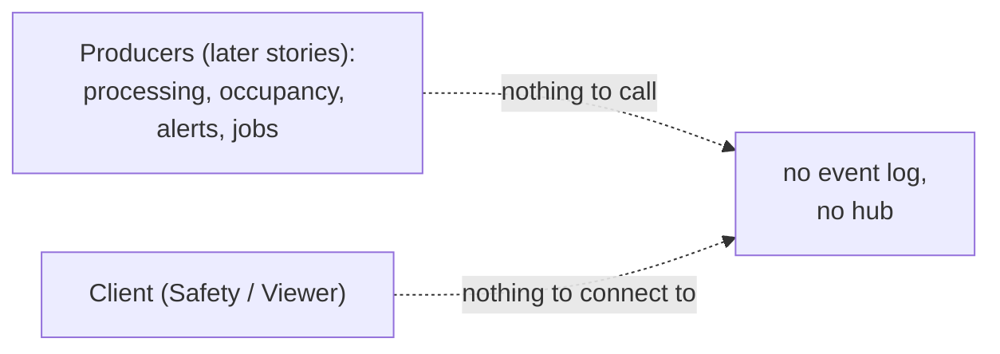
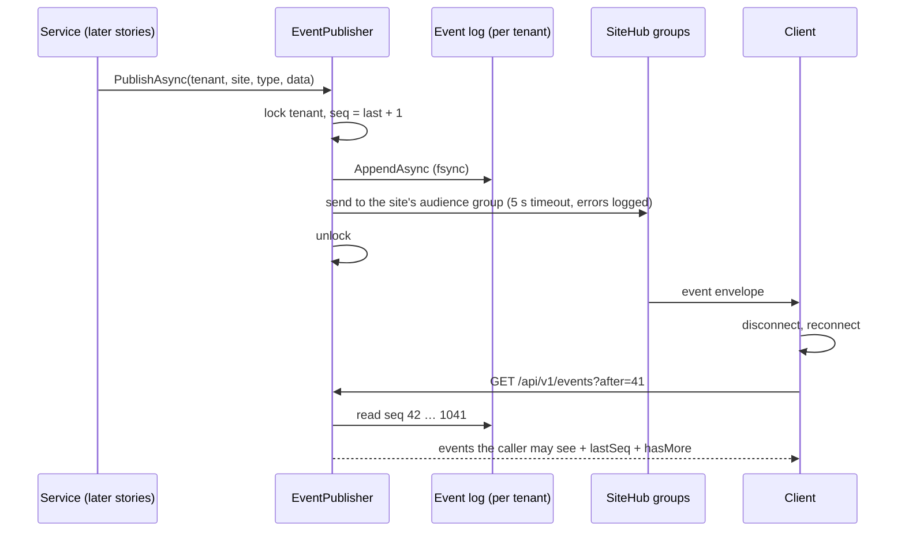

# SS-35 + SS-36 — Real-time hub and event log with catch-up

- Status: Draft
- Issues: SS-35 #126, SS-36 #127
- Plan PR: #128   Implementation PRs: #134 (event log and catch-up, SS-36), #TBD (hub and publisher, SS-35)

## Problem

Users must see what happens on a site while it happens: where Safety's devices are, how many people are in
each area, which alerts fire. Today the API has no real-time channel at all. There is no SignalR hub, no
event is stored, and a client that loses its connection has no way to get back what it missed.

Who notices: the Safety and Viewer screens and the demo client (they have nothing to listen to), and every
story that produces events: processing (SS-23), occupancy (SS-27), intrusion (SS-28), silent devices (SS-30),
crowd anomaly (SS-33).



Terms (see `../../.claude/skills/sitesense-context/SKILL.md`):
- *Event*: a notification saved with its sequence number. Three types: `PositionUpdated`, `OccupancyChanged`,
  `AlertRaised` (RTM-02).
- *Seq*: a number per tenant that grows by one for each event (RTM-05).
- *Audience*: the named policy a caller must pass to receive an event type (security skill, SignalR section).

## Goal

- Any service can call one method to publish an event. The event is saved with the next seq of its tenant,
  and only then sent over SignalR (RTM-03).
- A user connects to the hub, joins a site of its own tenant, and receives only the event types its policies allow
  it to see (RTM-01, RTM-02, Q36, Q63).
- `GET /api/v1/events?after={seq}` returns the saved events after `seq`, with the same audience filter (RTM-05, Q35).

Out of scope: who produces events. `PositionUpdated` is wired into the processor once SS-23 is on `main`;
`OccupancyChanged` with SS-27, `AlertRaised` with SS-28/SS-30/SS-33. The browser UI and the nginx WebSocket
proxy (with the UI stories), correlation id in the log scope (SS-4), retention of the event log.

### How events will be produced (decided, recorded here for SS-27/SS-28/SS-30/SS-33)

| Event | When | By |
|---|---|---|
| `PositionUpdated` | Each position accepted after the filters | Position processing (push) |
| `AlertRaised` `AreaIntrusion` | Entry into a `restricted` or `hazard` area | Position processing (push) |
| `OccupancyChanged` | A device changes area, **and** the per-minute site job finds a device older than 5 min dropped from the count; sent only when the snapshot changed | Processing (push) + site job |
| `AlertRaised` `DeviceSilent`, `ZoneAnomaly` | Per-minute site job (JOB-01) | Site job |

A stale device on the Safety map keeps its last position and timestamp; the client shows it as stale, and
`DeviceSilent` is the alarm. Occupancy follows the 5-minute rule, so the push and `GET /occupancy` always agree.

## Solution

One class, `EventPublisher` in `backend/SiteSense.Api/Realtime/`, owns the order *seq → save → send*.
Services call it through `IRealtimePublisher`. Only `Realtime/` touches `IHubContext` (architecture skill).



### Event envelope (same JSON on the hub and in `GET /events`)

```json
{ "seq": 42, "type": "OccupancyChanged", "siteId": "site-1", "atMs": 1767225600000,
  "data": { "siteId": "site-1", "atMs": 1767225600000, "areas": [{ "areaId": "a1", "count": 3 }] } }
```

- `atMs`: when the event was published, from `SiteSenseContext.Time` (the simulated clock in test mode).
- `data`: the type's payload, decided by the producing story. `OccupancyChanged` = the full site snapshot, same
  shape as `GET /occupancy` (decided). `PositionUpdated` = one event per filtered position, no throttling (Q34).
- `PublishAsync<TData>(tenantId, siteId, type, TData data, ct)` turns `data` into a `JsonElement` with
  `JsonSerializer.SerializeToElement(data, StorePaths.Json)` (never from a disposed `JsonDocument`).
- `StorePaths.Json` and the SignalR JSON protocol both use camelCase web defaults, so the two envelopes match.
  A test compares them.
- The hub method name is the event type, so a client writes `connection.on("OccupancyChanged", …)`.

### Event log and seq

- Stored with the existing `IAppendLog` (`SiteSenseContext.Log`, a `FileAppendLog`), log key `events`, one log
  per tenant.
- Record `TenantEvent(long Seq, string Type, string SiteId, long AtMs, JsonElement Data) : ILogRecord`.
  `TimestampMs => Seq * 100` with `[JsonIgnore]` (Q105). `FileAppendLog` buckets files by the hour of
  `TimestampMs`, so each file holds 36,000 seqs (about 10 MB) and "after 41" reads only the files from seq 42 on,
  in seq order. Shortcut, noted in code: file names hold seq ranges, not dates. The factor keeps a catch-up or
  a restart reading one bounded file, not a 3.6 M-record one.
- The publisher appends with `AppendAsync` under its own tenant lock. The in-memory counter makes each seq
  unique, so the O(file) duplicate check of `AppendNewAsync` is not needed.
- The last seq of a tenant is kept in memory. On the first publish or read for a tenant after start, it is
  loaded with a new `IAppendLog.ReadLastAsync<T>(tenantId, key)`:
  - newest file by name; if it has no record, the file before it, and so on; `null` if none;
  - an unterminated tail that parses as a whole record **counts** as the last record. `AppendCoreAsync` ends
    such a tail with `\n` on the next append, so it becomes readable; skipping it would reuse its seq.
  - a tail that does not parse is ignored, as in reads today (the next append ends it and it stays unreadable).
- Crash cases:
  - Crash before any byte of the record reaches disk: the seq was never sent; the next publish reuses it. Nobody saw it.
  - Crash with a whole record but no newline: `ReadLastAsync` counts it, the next seq follows it.
  - Crash after the append, before the send: the event is in the log; a client gets it through `GET /events`.
- One process (Q01), so the in-memory counter and a per-tenant `SemaphoreSlim` are enough (JDB-04).
- The send happens inside the tenant lock, so connected clients receive events in seq order. It gets its own
  5-second `CancellationToken`. Any exception, `OperationCanceledException` included, is logged at `Warning`
  (type and seq, no payload) and swallowed: the event is saved, catch-up covers it.

### Audience (one map, used by hub and catch-up)

Who sees what goes through the named policies, never role strings in code (IDN-03, Q108):

| Type | Policy (audience) | Passes today |
|---|---|---|
| `PositionUpdated` | `CanSeeIndividuals` | Safety |
| `AlertRaised` | `CanSeeIndividuals` | Safety (Q36) |
| `OccupancyChanged` | `CanSeeAggregates` | Admin, Safety, Viewer |

- `EventAudience` (pure, no auth calls): `PolicyFor(type)`, `Policies` (the two above),
  `CanSee(type, passedPolicies)`.
- The caller's passed policies are computed once per request or per `JoinSite` with
  `IAuthorizationService.AuthorizeAsync(user, policy)` for each of the two policies.
- The audience is derived from the type, not stored per event. A Viewer sees gaps in seq; that is expected.
- A token without any user role (a gateway with `positions:write` only) fails `CanSeeAggregates`: `403` on the
  hub negotiate and on `GET /events`.

### Hub

- `SiteHub`, mapped at `/api/v1/realtime` (Q106): under `/api` so the UI's existing nginx `/api` proxy covers it.
- `[Authorize(Policy = CanSeeAggregates)]`. Tenant and policies come from the token only.
- `JoinSite(siteId)`: if `FileDocumentStore.IsValidName(siteId)` is false **or** `Site.GetAsync` returns null,
  throw `HubException("Site not found")`: the same answer for an invalid name, an unknown site and a site of
  another tenant (IDN-02). Then add the connection to `tenant:{tenantId}:site:{siteId}:audience:{policy}` for each
  audience policy it passes (Q63 changed by Q108: one group per policy, not per role). A valid name has no `:`, so a group name cannot be forged.
- `LeaveSite(siteId)` removes the connection from the same groups.
- A connection stays in a site's groups if the site is deleted later; it just receives nothing more. Accepted.
- `MapHub<SiteHub>("/api/v1/realtime", o => o.CloseOnAuthenticationExpiration = true)`.
- Token: browsers cannot send headers on WebSockets. `JwtBearerEvents.OnMessageReceived` sets `ctx.Token` from
  the `access_token` query value **only** when `Request.Path.StartsWithSegments("/api/v1/realtime",
  StringComparison.OrdinalIgnoreCase)` and there is no `Authorization` header. Nowhere else.
- No request logging of query strings exists today; if one is added, it must redact `access_token`.
- Group send: one group per event, the one of the type's policy: `Clients.Group(name).SendAsync(type, envelope, ct)`.
  A Safety connection is in both groups and gets each event once.

### Catch-up endpoint

`GET /api/v1/events?after={seq}` on a new `EventsController`, policy `CanSeeAggregates`.
- `after` optional, default `0`, must be `>= 0` (else `400` ProblemDetails).
- Reads seqs `after+1` to `after+1000` (`ReadRangeAsync` with `fromMs = (after+1)*100`, `toMs = (after+1001)*100`),
  keeps those the caller's passed policies may see.
- Returns `200 { "items": [envelope…], "lastSeq": n, "hasMore": bool }`. `lastSeq` is the last seq the window
  covered (at most the tenant's current last seq), so a Viewer whose window held only Safety events still
  advances. `hasMore` is `lastSeq < current last seq`. The client calls again with `after = lastSeq` while
  `hasMore`.
- All sites of the tenant: the seq is per tenant; the client filters by `siteId`.

## Steps

| # | Step | Files | Done when | PR |
|---|---|---|---|---|
| 1 | `ReadLastAsync<T>(tenantId, key, ct)` on `IAppendLog` + `FileAppendLog` (rules in "Event log and seq"). Shortcut comment: reads the whole newest file | `backend/SiteSense.Api/Store/IAppendLog.cs`, `backend/SiteSense.Api/Store/FileAppendLog.cs` | Unit tests: empty → null; two files → last record of the newest; newest file holds only a torn line → last of the previous file; unterminated whole tail → that record; unparseable tail → record before it | 1 |
| 2 | `TenantEvent` record (`[JsonIgnore] TimestampMs => Seq * 100`) and `EventTypes` constants | `backend/SiteSense.Api/Realtime/TenantEvent.cs` | Round-trip test: serialize with `StorePaths.Json`, deserialize, same values; no `timestampMs` in the JSON | 1 |
| 3 | `EventAudience`: type → policy map; `PolicyFor(type)`, `Policies`, `CanSee(type, passedPolicies)` | `backend/SiteSense.Api/Realtime/EventAudience.cs` | Unit test per type × passed policies; architecture test `Backend_DoesNotCheckRolesInCode` passes unchanged | 1 |
| 4 | `IRealtimePublisher` + `EventPublisher.PublishAsync`: per-tenant `SemaphoreSlim`, seq load via `ReadLastAsync`, `AppendAsync`, then `IEventSender.SendAsync` with a 5 s token, errors logged and swallowed. `NullEventSender` until PR 2 | `backend/SiteSense.Api/Realtime/IRealtimePublisher.cs`, `backend/SiteSense.Api/Realtime/EventPublisher.cs`, `backend/SiteSense.Api/Realtime/IEventSender.cs` | Tests in `EventPublisherTests` below | 1 |
| 5 | `EventPublisher.ReadAfterAsync(tenantId, after, passedPolicies, ct)` → items, lastSeq, hasMore (window of 1,000 seqs) | `backend/SiteSense.Api/Realtime/EventPublisher.cs` | Tests in `EventPublisherTests` below | 1 |
| 6 | DI: `EventPublisher` singleton, `IRealtimePublisher` → it, `IEventSender` → `NullEventSender`. The log is `SiteSenseContext.Log` (not in DI) | `backend/SiteSense.Api/Program.cs` | Builds, existing tests pass | 1 |
| 7 | `EventsController` `GET /api/v1/events?after=` with `[ProducesResponseType]` 200/400/401/403 | `backend/SiteSense.Api/Controllers/EventsController.cs` | `EventsTests` below pass | 1 |
| 8 | Policy table row for `/events` from Proposed to decided; SignalR section: groups per audience policy and the type → policy table; ASSUMPTIONS Q34, Q35, Q105, Q106, Q107, Q108, and Q63 set to Changed | `.claude/skills/sitesense-security/SKILL.md`, `ASSUMPTIONS.md` | Rows present | 1 |
| 9 | Test package `Microsoft.AspNetCore.SignalR.Client` (exact version matching 10.0.14, central management, test project only) and helper `HubClient.ConnectAsync(factory, token)` (recipe below) | `Directory.Packages.props`, `tests/SiteSense.Tests/SiteSense.Tests.csproj`, `tests/SiteSense.Tests/Api/Realtime/HubClient.cs` | One test connects as Safety and calls `JoinSite` on an existing site | 2 |
| 10 | `OnMessageReceived`: query token only on the hub path, only without an `Authorization` header | `backend/SiteSense.Api/Auth/AuthSetup.cs` | Query token works on the hub; same token as `?access_token=` on `GET /api/v1/sites/{id}` → `401` | 2 |
| 11 | `SiteHub` (`JoinSite`, `LeaveSite`), `AddSignalR`, `MapHub` with `CloseOnAuthenticationExpiration` | `backend/SiteSense.Api/Realtime/SiteHub.cs`, `backend/SiteSense.Api/Program.cs` | Join tests in `SiteHubTests` pass | 2 |
| 12 | `SignalRSender : IEventSender` (group names, audience), replaces `NullEventSender` in DI | `backend/SiteSense.Api/Realtime/SignalRSender.cs`, `backend/SiteSense.Api/Program.cs` | Receive tests in `SiteHubTests` pass | 2 |
| 13 | ADR: event log keyed by seq, send inside the tenant lock, audience by type | `docs/adr/0002-realtime-event-log.md` | ADR in PR 2 | 2 |

### SignalR test recipe (step 9)

```csharp
var connection = new HubConnectionBuilder()
    .WithUrl(new Uri(factory.Server.BaseAddress, "/api/v1/realtime"), o =>
    {
        o.HttpMessageHandlerFactory = _ => factory.Server.CreateHandler();
        o.Transports = HttpTransportType.LongPolling; // TestServer has no real sockets
        o.AccessTokenProvider = () => Task.FromResult<string?>(token);
    })
    .Build();
await connection.StartAsync();
```

`AccessTokenProvider` sends `Authorization: Bearer` on long polling, so the query path is tested separately
in step 10 with a plain `HttpClient` call to `/api/v1/realtime/negotiate?negotiateVersion=1&access_token=…`.

## Risks

| Risk | Impact | Mitigation |
|---|---|---|
| Send inside the tenant lock is slow with many clients | Publishing waits on SignalR | `SendAsync` to a group only queues per connection; 5 s cap. Measured with the JDB-09 benchmark once SS-23 produces `PositionUpdated`. Move the send out of the lock (ordered channel) only if it shows. |
| 100 `PositionUpdated` per second double the writes (raw log + event log) | Disk load | One fsync per publish call; a `PublishManyAsync` for a processed batch is added only if the benchmark asks. Listed in `KNOWN_ISSUES.md` if it stays. |
| Event log grows without end | Disk use | Listed in `KNOWN_ISSUES.md`; SS-32 can add an `events` sweep. |
| SS-46 (UI cookie login) merges first | Its scheme selector sends a query-token hub call to the cookie handler | Step 10 also forwards to JWT when the hub path carries `access_token`; whichever PR merges second adds that line. |
| Seq used as `TimestampMs` surprises a reader | Confusion | Shortcut comment in `TenantEvent`, ADR step 13. |
| `ReadLastAsync` reads a whole file at first use | Slow first publish per tenant | Files are at most 36,000 records; once per tenant per process. |

## Tests

- `FileAppendLogTests`: `ReadLast_*` (step 1).
- `TenantEventTests`, `EventAudienceTests` (steps 2–3).
- `EventPublisherTests` (unit, temp store root):
  - seq 1, 2, 3 per tenant; two tenants independent;
  - 50 parallel publishes give seq 1..50, no gap, no repeat;
  - a new publisher on the same root continues from the last seq;
  - a whole record without its final newline written by hand → next publish gets the seq after it, and the log
    has each seq once;
  - the record is readable inside `SendAsync` (fake sender reads the log);
  - a sender that throws, and one that never completes (5 s token, test uses a short override) → publish returns,
    the event is in the log, the next seq follows;
  - `ReadAfterAsync`: window of 1,000; Viewer window holding only Safety events → empty items, `lastSeq` advanced,
    `hasMore` right.
- `EventsTests` (API): Viewer gets only `OccupancyChanged`; Safety gets all three; tenant-b never sees tenant-a
  events; `after` filters; `after=-1` → `400`; no token → `401`; gateway token → `403`.
- `SiteHubTests` (API, recipe above): Safety joins and receives all three types; Viewer receives only
  `OccupancyChanged`; envelope on the hub equals the item from `GET /events`; join of another tenant's site, an
  unknown site and `"a:b"` → same `HubException`; no token → `401` on negotiate; gateway token → `403` on
  negotiate; a client joined to site-1 gets nothing for site-2; after `LeaveSite` nothing more arrives.

## Open questions

| # | Question | Options (recommended first) | Decision |
|---|---|---|---|
| Q34 | Is every `PositionUpdated` saved with a seq, and throttled? | **a) Saved with a seq, one per filtered position, no throttle** · b) Throttle per device | a) (user) |
| Q35 | Does `GET /events` filter by role? | **a) Yes, same audience map as the hub** · b) No filter | a) (user) |
| Q108 | How is the audience checked without role strings in code (IDN-03)? | **a) Per event type a named policy (`CanSeeIndividuals`, `CanSeeAggregates`), checked with `IAuthorizationService`; hub groups per policy** · b) Read the role claims in `Realtime/` and exempt the file from the architecture test | a) (user) |
| Q105 | How is the event log keyed so "after seq" is cheap? | **a) `IAppendLog` with `TimestampMs = seq × 100` (36,000 seqs per file)** · b) Keyed by publish time, full scan and sort by seq on each catch-up · c) A new seq-indexed log type | a) (user) |
| Q106 | Hub path | **a) `/api/v1/realtime`** (covered by the UI's `/api` proxy) · b) `/hubs/site` | a) (user) |
| Q107 | When is `OccupancyChanged` sent? | **a) On area change (push) and from the per-minute job when the 5-minute rule drops a device, only if the snapshot changed** · b) Job only · c) Push only | a) (user) |

## Changelog

| Date | Change | Why (review comment or finding) |
|---|---|---|
| 2026-11-27 | First draft | |
| 2026-11-27 | `AppendAsync` under the tenant lock; `ReadLastAsync` counts a whole unterminated tail and falls back to older files; seq × 100 buckets; union of user roles; JSON element and `[JsonIgnore]` rules; 5 s send timeout; SignalR test recipe; query token only on the hub path without a header; invalid site name = not found; `/events` returns `lastSeq` and `hasMore`; steps split | Sonnet validation: seq reuse after a torn record, O(file) appends, multi-role tokens, JSON round-trip, send timeout, test recipe, query-token scope, paging with role filter |
| 2026-11-27 | Q35, Q105 and Q106 decided: a) | User review in chat |
| 2026-11-27 | Audience by named policy, hub groups per policy (Q108, changes Q63) | Implementation of step 3 hit the IDN-03 architecture test; user chose policies |
