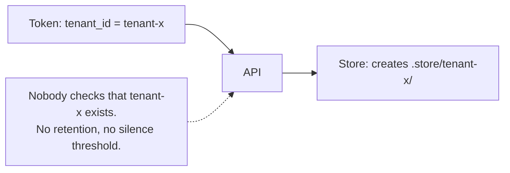
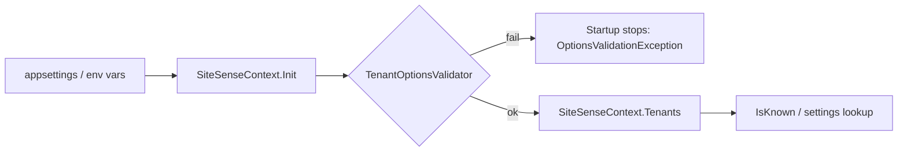

# SS-43 — Tenants from configuration

- Status: Draft
- Issue: #44
- Plan PR: —   Implementation PRs: —
- Requirement IDs: NF-04, PRV-04, TRK-06

## Problem

The API does not know which tenants exist. A tenant is a customer company; every document and
every position belongs to one (see [sitesense-context](../../.claude/skills/sitesense-context/SKILL.md)).
Today any `tenantId` string reaches the store, and the store creates a folder for it. Two
per-tenant settings that later stories need have no home:

- `RetentionDays`: positions older than this are deleted (PRV-04, retention job).
- `SilentAfterMinutes`: a device on site that sends no position for longer than this raises a
  `DeviceSilent` alert (TRK-06).



## Goal

- `tenant-a` and `tenant-b` are configured, each with `RetentionDays` and `SilentAfterMinutes`.
- The configuration is validated at startup (NF-04): a bad value stops the app with a clear error,
  like `Store:RootPath` does.
- Code can ask "is this tenant known?" and "what are its settings?".
- A token with an unknown `tenant_id` gets **403** (needs SS-6, see Steps 6–7).
- The tenant's data folder is created on first use: the SS-9 store already does this on the
  first save (test `Save_TwoTenants_UsesOneDirectoryPerTenant`). Nothing new to build.

Out of scope: a tenant endpoint or a tenant document (Q14), the retention job (JOB-04), the
silent-device job (TRK-06).

## Solution

Config section `Tenants`, keyed by tenant id (Q14: configuration only):

```json
"Tenants": {
  "tenant-a": { "RetentionDays": 30, "SilentAfterMinutes": 10 },
  "tenant-b": { "RetentionDays": 30, "SilentAfterMinutes": 10 }
}
```

`SiteSenseContext.Init` binds it to `Dictionary<string, TenantSettings>`, validates it, and
exposes it as `SiteSenseContext.Tenants` (`IReadOnlyDictionary<string, TenantSettings>`), next
to `Store` and `Time` (Q67). "Is known" is `Tenants.ContainsKey(id)`; settings are
`Tenants.TryGetValue(id, out var s)`. Lookup is ordinal (case-sensitive), as ids are in the
store (Q76). No registry interface: a read-only dictionary already is the lookup.



Validation rules (all failures reported together):

| Rule | Error example |
|---|---|
| At least one tenant | `Tenants: at least one tenant is required.` |
| Id is a valid store name (same rule as `FileDocumentStore`) | `Tenants: 'Bad Id' is not a valid tenant id.` |
| `RetentionDays` ≥ 1 | `Tenants:tenant-a:RetentionDays must be at least 1.` |
| `SilentAfterMinutes` ≥ 1 | `Tenants:tenant-a:SilentAfterMinutes must be at least 1.` |

Where the values come from:

| Run | Source |
|---|---|
| `dotnet run` | `appsettings.example.json` → copied to `appsettings.json` |
| Docker | env vars in `docker-compose.yml` (`Tenants__tenant-a__RetentionDays: 30`, …), like `Store__RootPath` |
| Tests | `ApiFactory` `UseSetting("Tenants:tenant-a:RetentionDays", …)` |

## Steps

| # | Step | Done when |
|---|---|---|
| 1 | `backend/SiteSense.Api/Tenants/TenantOptions.cs`: `TenantSettings` (two `int` props), `TenantOptions.Section = "Tenants"`, `TenantOptionsValidator` (rules above). Make the store's name regex reusable (`FileDocumentStore.IsValidName`, `public static`) instead of copying it. | Builds. |
| 2 | `SiteSenseContext.Init`: bind and validate `Tenants` **before** the store is created; assign `SiteSenseContext.Tenants` only after validation succeeds. | App starts with the template config; fails with a bad one, and no store folder is created. |
| 3 | Config: `appsettings.example.json`; `docker-compose.yml` (4 env vars); `ApiFactory` sets both tenants with `UseSetting` (without it every API test fails, since `appsettings.json` is not in git). | Existing API tests pass; compose config has both tenants. |
| 4 | Tests: `TenantOptionsValidatorTests` — `Validate_NoTenants_Fails`, `Validate_InvalidId_Fails`, `Validate_ZeroRetentionDays_Fails`, `Validate_ZeroSilentAfterMinutes_Fails`, `Validate_TwoValidTenants_Succeeds`. `TenantStartupTests` — `Startup_ValidConfig_BindsBothTenants`, `Startup_ZeroRetentionDays_Throws` (`ApiFactory().WithWebHostBuilder(b => b.UseSetting(...))`, `Assert.ThrowsAny<Exception>` on `CreateClient()`, message contains `RetentionDays`). | Tests pass. |
| 5 | Docs: in [dotnet-coding](../../.claude/skills/dotnet-coding/SKILL.md) §options, add `TenantOptions` to the `SiteSenseContext.Init` exception; README config notes if they list keys; Q14 + defaults + Docker source in `ASSUMPTIONS.md`; AI_LOG entry. | Done. |
| 6 | After SS-6 has code: merge `story/SS-6-jwt-tenant` (merge commit) into the second implementation PR's branch. | Branch builds. |
| 7 | Unknown-tenant check: an authenticated request whose `User.TenantId()` is not in `Tenants` gets 403 ProblemDetails, placed with the SS-6 auth wiring (authorization requirement or middleware after authentication, whichever SS-6 uses). Add the row "token with a tenant not in configuration → `403`" to the Fixed rules table in [sitesense-security](../../.claude/skills/sitesense-security/SKILL.md). Test: `Request_UnknownTenant_Returns403`. | Test passes. |

PRs: implementation PR 1 = steps 1–5 (no auth needed). Implementation PR 2 = steps 6–7, stacked on
PR 1 and on SS-6, opened once SS-6 has code.

## Risks

- Config keys are case-insensitive in .NET, tenant ids are not: an env var `Tenants__TENANT-A__…`
  merges into `tenant-a`, and the dictionary keeps the first spelling it saw. Acceptable: an
  override is meant to change the same tenant; the lookup stays ordinal on the stored spelling.
- Steps 6–7 depend on SS-6; until it has code the 403 criterion stays open.
- `SiteSenseContext.Tenants` is static (Q67). Test hosts that use other tenant settings would overwrite each other; all hosts use the same two tenants, and the failing-config test throws before assignment.

## Tests

Unit: validator rules. Integration: host startup fails on bad config; after SS-6, unknown
`tenant_id` → 403. Existing store test covers the per-tenant folder.

## Open questions

| # | Question | Options | Recommended | Decision |
|---|---|---|---|---|
| Q14 | How is a tenant created? | Config only; config + tenant document | Config only | Config only (owner) |
| — | Default values | 30 days / 10 min for both; different per tenant | 30 / 10 for both | 30 / 10 (owner) |
| Q-new (number at merge, other stories add Q ids too) | Where Docker gets the tenants (no `appsettings.json` in the image) | Env vars in compose; a committed `tenants.json` | Env vars, same as `Store__RootPath` | — |

## Changelog
| Date | Change | Why (review comment or finding) |
|---|---|---|
| 2026-11-25 | First version | — |
| 2026-11-25 | Validate before store, assign last; test names; skill rows; split 403 into PR 2 | Sonnet plan review |
