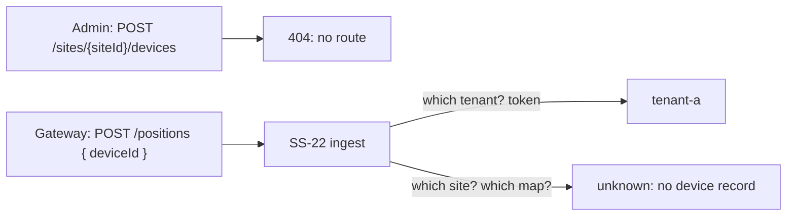
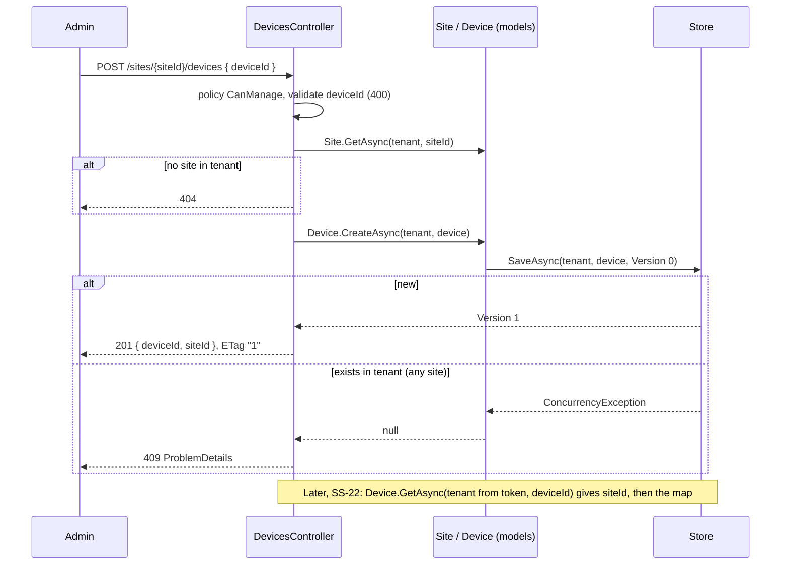

# SS-44 — Device registration

- Status: Approved
- Issue: #85
- Plan PR: #86   Implementation PRs: #89
- Requirement IDs: API-01, PRV-01, IDN-02, C-7.3a

## Problem

A device is a pseudonymous GPS tag worn by a worker (glossary: [context](../../.claude/skills/sitesense-context/SKILL.md)).
A gateway sends position batches as `{ "deviceId": "dev-001", "positions": [...] }`: no site, and the tenant comes
from the gateway's token (Q59). Today the API has no record of which devices exist, nor which site each one is on.
So the batch ingest (SS-22) cannot tell a real device from a typo, cannot reject another tenant's device (Q60),
and does not know which site map to use. An Admin who calls `POST /api/v1/sites/{siteId}/devices` gets 404:
the route does not exist.



## Goal

- `POST /api/v1/sites/{siteId}/devices` with `{ "deviceId" }` → `201 { "deviceId", "siteId" }`, Admin only (`CanManage`).
- The device document holds only `deviceId`, tenant and `siteId`, nothing else (PRV-01).
- `deviceId` is unique inside the tenant, across all its sites (Q13), because devices do not send a `siteId`. Already registered (same or other site) → `409`.
- `GET /api/v1/sites/{siteId}/devices/{deviceId}` → `200 { "deviceId", "siteId" }` + `ETag`, Admin only (`CanManage`, Q85).
- Site or device of another tenant, unknown site, or a device registered on another site → `404`.
- Invalid `deviceId` → `400` `ValidationProblemDetails`, nothing stored.

Out of scope: delete or move a device, list of devices, the batch ingest itself (SS-22).

## Solution

One `Device` document per device in the caller's tenant folder, id = `deviceId`, so the store path is
`<tenant>/Device/<deviceId>.json`. That path makes the id unique per tenant for free, and the lookup SS-22 needs
is `Device.GetAsync(tenantId from token, deviceId from body)`, which yields the `siteId` and so the map.
The tenant comes from the token (`User.TenantId()`), never from the body. Same pattern as SS-14 `Site`.

- Create: check the site exists in the tenant (`Site.GetAsync`, else 404). Save the device with version 0.
  The store throws `ConcurrencyException` when the id exists, under its per-document lock, so parallel creates
  give one 201 and the rest 409. `Device.CreateAsync` turns that into `null`; the controller answers 409.
- Get: `Device.GetAsync(tenant, deviceId)`; null, or `SiteId` different from the URL → 404.
- No PUT: a device has no field to change (moving sites is out of scope).

Example: `POST /api/v1/sites/site-01/devices` with `{ "deviceId": "dev-001" }` →
`201`, `Location: /api/v1/sites/site-01/devices/dev-001`, `ETag: "1"`, body `{ "deviceId": "dev-001", "siteId": "site-01" }`.

Stored document (all of it):

```json
{ "id": "dev-001", "tenantId": "tenant-a", "version": 1, "siteId": "site-01" }
```



Validation at the boundary: `deviceId` required, a valid store name (`FileDocumentStore.IsValidName`:
`[A-Za-z0-9_-]{1,128}`). `Device.GetAsync` returns null for an invalid id, so a bad URL is 404, not 500.
A repeat of the same POST is a 409 and changes nothing (recipe step 8).

## Steps

| # | Step | Files | Done when | PR |
|---|---|---|---|---|
| 1 | Entity `Device : IDocument` (`Id`, `TenantId`, `Version`, `SiteId`, nothing else); static `CreateAsync` (null when it exists) and `GetAsync(tenantId, deviceId)` (null on invalid id). | `backend/SiteSense.Api/Models/Device.cs` | Builds. | #89 |
| 2 | DTOs: `DeviceRequest(DeviceId)` with `[Required]` + valid-name check; `DeviceResponse(DeviceId, SiteId)`. | `backend/SiteSense.Api/Dtos/DeviceRequest.cs`, `DeviceResponse.cs` | Builds. | #89 |
| 3 | `DevicesController`, route `api/v1/sites/{siteId}/devices`: `Create` (POST, `CanManage`, 201/400/403/404/409, ETag, `CreatedAtAction(nameof(Get), new { siteId, deviceId = device.Id })`) and `Get` (GET `{deviceId}`, `CanManage` per Q85, 200 + ETag / 404). 404 and 409 are ProblemDetails (`Problem(statusCode: ...)`, as in `SitesController`). `[ProducesResponseType]` for every status. | `backend/SiteSense.Api/Controllers/DevicesController.cs` | Builds; both paths in `/openapi/v1.json`. | #89 |
| 4 | Tests (below), plus both devices paths in `OpenApiTests`; expose `public string StoreRoot` on `ApiFactory` for the PRV-01 raw-file test. | `tests/SiteSense.Tests/Api/DevicesTests.cs`, `tests/SiteSense.Tests/Api/OpenApiTests.cs`, `tests/SiteSense.Tests/Api/ApiFactory.cs` | All pass. | #89 |
| 5 | `.http`: register and read a device, with the file's `{{host}}` and `{{token}}` variables. | `backend/SiteSense.Api/SiteSense.Api.http` | Entries present. | #89 |
| 6 | Docs: Q13 and Q85 in `ASSUMPTIONS.md`; GET row in the security skill endpoint table; POST response `201 { deviceId, siteId }` and a GET row in the context skill API table; AI_LOG entry; create `KNOWN_ISSUES.md` at the root (ai-process §8; not on `main` yet) with: no delete or move of a device. README and `docs/` list no endpoints, so no sync needed. | `ASSUMPTIONS.md`, `.claude/skills/sitesense-security/SKILL.md`, `.claude/skills/sitesense-context/SKILL.md`, `AI_LOG.md`, `KNOWN_ISSUES.md` (new) | Entries present. | #89 |

## Risks

| Risk | Impact | Mitigation |
|---|---|---|
| Parallel registrations of one `deviceId` | Two 201, or a device on two sites | Store version check under its per-document lock; a test runs parallel POSTs of one id on two sites: exactly one 201, rest 409. |
| `dev-1` and `DEV-1` on a case-insensitive disk | Treated as one device | Already handled by the store's file-name encoding (Q76); a test registers both and gets two 201. |
| A personal field slips into the device | PRV-01 broken | The entity has only `Id`, `TenantId`, `Version`, `SiteId`; the request DTO has only `deviceId`; a test reads the raw stored JSON and asserts exactly those four keys. |
| SS-22 needs the lookup | Ingest blocked | `Device.GetAsync(tenantId, deviceId)` is the public lookup, no `siteId` needed. |
| SS-12 runs in parallel | File conflicts | SS-44 touches no position or log files; shared files are only `ASSUMPTIONS.md`, `AI_LOG.md`, `.http` (append-only). |

## Tests

`tests/SiteSense.Tests/Api/DevicesTests.cs`, `[Collection("Api")]` + `IClassFixture<ApiFactory>`, same as `SitesTests`.
Each test creates its own site (from `data/site.json`) in each tenant it uses, and its own ids. "Nothing stored" = GET gives 404.
Tokens as in `PolicyTests`: `TestTokens.Create(tenant, [role])`, gateway = `TestTokens.Create(tenant, scope: "positions:write")`.
409 and one 404 assert `application/problem+json`. Crash recovery and store-level concurrency are covered by the generic
`StoreCrashTests` and `FileDocumentStoreTests` (`Device` adds no storage code); no Device-specific crash test.

- `Register_Admin_Returns201WithBodyLocationAndETag`
- `Register_StoresOnlyIdTenantVersionAndSite` (PRV-01: raw file `<StoreRoot>/tenant-a/Device/<id>.json`, lowercase id, has exactly those keys)
- `Register_SameDeviceSameSite_Returns409Problem`
- `Register_SameDeviceOtherSiteSameTenant_Returns409Problem` (Q13)
- `Register_ParallelSameDeviceTwoSites_OneCreatedRestConflict`
- `Register_SameDeviceOtherTenant_Returns201` (each tenant has its own ids)
- `Register_IdsDifferingOnlyInCase_BothCreated`
- `Register_UnknownSite_Returns404`, `Register_OtherTenantSite_Returns404` (site in tenant-a, POST with a tenant-b token), `Register_InvalidSiteIdInUrl_Returns404` (`a.b`); nothing stored
- `Register_NonAdmin_Returns403` (theory: Safety, Viewer, gateway)
- `Register_InvalidDeviceId_Returns400Problem` (theory: missing, null, empty, `..`, `a.b`, 129 chars); nothing stored
- `Get_OwnDevice_Returns200WithBodyAndETag`
- `Get_DeviceOfOtherSite_Returns404`, `Get_OtherTenantDevice_Returns404`
- `Get_UnknownOrInvalidId_Returns404` (theory: unknown, `..`, `a.b`, 129 chars)
- `Get_NonAdmin_Returns403` (theory: Safety, Viewer, gateway; Q85)

## Open questions

| # | Question | Options (recommended first) | Decision |
|---|---|---|---|
| Q13 | Is the `deviceId` unique per tenant, per site, or globally? | Per tenant; per site; global | Per tenant (owner). Why: devices do not send a `siteId`. The gateway batch format is fixed (`{ deviceId, positions }`) and the gateway token carries only the tenant, so the server can find the site only from `tenant + deviceId`; per site would make a batch ambiguous. Global would leak other tenants' ids through 409 |
| —  | Same `deviceId` registered again in the tenant? | 409 always; 201 if same site else 409; 201 and move | 409 always (owner), like sites (Q43) |
| —  | Is there a GET? | POST + GET; POST only | POST + GET (owner) |
| Q85 | Who may read a device (`GET /sites/{siteId}/devices/{deviceId}`)? Not in the API contract; added on owner request. | `CanManage` (Admin: the role that manages devices, existing policy); `CanSeeIndividuals` (Safety only). All roles is excluded: PRV-03, Viewer never sees device ids | `CanManage` (owner): the role that registers devices reads them back; cheap to widen later |

## Changelog

| Date | Change | Why (review comment or finding) |
|---|---|---|
| 2026-11-26 | First draft | — |
| 2026-11-26 | `StoreRoot` accessor, `KNOWN_ISSUES.md` is new, context skill row, ProblemDetails and route values, crash-test note, per-tenant test sites, Q85 options fixed to existing policies | Sonnet review |
| 2026-11-26 | Q85 decided: GET is `CanManage` | Owner, in chat |
| 2026-11-26 | Q13: reason stated explicitly (devices do not send a `siteId`) | Owner, in chat |
