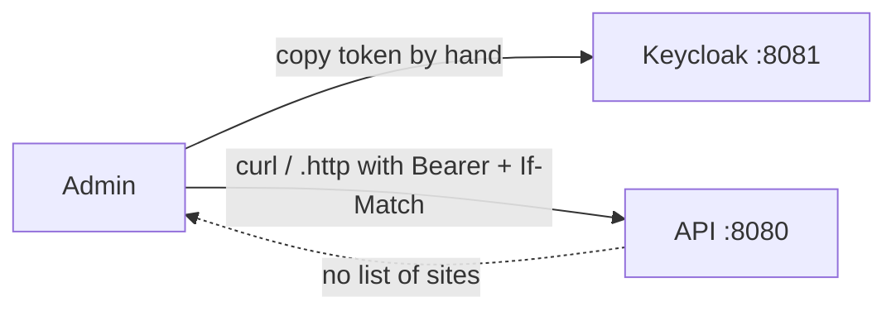
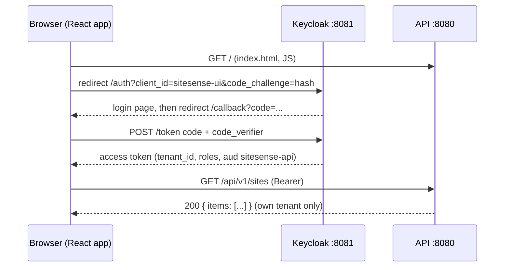

# SS-46 — Minimal admin UI (sites, map, devices)

- Status: In review
- Issue: #98
- Plan PR: #99   Implementation PRs: #<n>, #<n>

## Problem

Today an Admin can manage sites, maps and devices only through raw HTTP calls
(`backend/SiteSense.Api/SiteSense.Api.http`, Scalar, curl). Each call needs a token copied by hand
from Keycloak, and an `If-Match` header copied from a previous response.
A reviewer who runs `docker compose up` has no page to open and no quick way to see the data.
Two gaps make even a small page impossible:

- there is no endpoint that lists the sites of a tenant (only `GET /api/v1/sites/{siteId}`);
- Keycloak has no client a browser app can log in with: `sitesense-verify` uses the password flow
  (verification only), and the gateways use client credentials.



## Goal

`docker compose up`, open `http://localhost:8080/`, log in as `admin-a`, and:
list, create and edit sites; upload a map GeoJSON and see each validation error; list, register and
delete the devices of a site. A user of `tenant-b` sees only `tenant-b` data.

Out of scope: the real-time demo client (§5.10, needs the SignalR hub), the Leaflet map (API-06 bonus),
Safety and Viewer screens, the test clock panel, cursor paging (SS-11, issue #43).

## Solution

A small React single-page app in `frontend/`, built with Vite, styled with shadcn/ui (Tailwind).
The API Dockerfile builds it and copies the files to `wwwroot/`; the API serves them on the same
origin (`localhost:8080`), so there is no CORS and no extra container.

Login uses a new public Keycloak client `sitesense-ui` with the Authorization Code flow and **PKCE**
(the browser keeps a random secret, sends only its hash to Keycloak, and proves it when it swaps the
one-time code for a token; the password is typed only on the Keycloak page). The `oidc-client-ts`
library runs this flow; the app sends the access token as `Authorization: Bearer` to the API.
The API needs no auth change: the client has the same mappers (`tenant_id`, `roles`, audience
`sitesense-api`) as `sitesense-verify`, so tokens look the same.



Screens (Admin only; another role sees "Admin role required" and a logout button):

| Screen | Calls |
|---|---|
| Sites list + "New site" form (§6.1 fields) | `GET /api/v1/sites`, `POST /api/v1/sites` |
| Site detail: edit settings | `GET /api/v1/sites/{id}` (ETag), `PUT /api/v1/sites/{id}` with `If-Match` |
| Site detail: map upload (`.geojson` file) | `PUT /api/v1/sites/{id}/map`; 200 shows `mapVersion`, 422 shows a table of `elementId` / `reason` |
| Site detail: devices | `GET .../devices`, `POST .../devices`, `GET .../devices/{deviceId}` (ETag) then `DELETE` with `If-Match` |

Every error answer (ProblemDetails) is shown as `title` + `detail` in a toast; 412 says
"changed by someone else, reload".

New endpoint, same rules as the device list (Admin, own tenant, sorted by id, no paging yet — SS-11):

```http
GET /api/v1/sites
200 { "items": [ { "siteId": "site-01", "name": "Stabilimento nord", ... } ] }
```

## Steps

| # | Step | Files | Done when | PR |
|---|---|---|---|---|
| 1 | `Site.GetAllAsync(tenantId, ct)` (mirror `Device.GetAllAsync`, `Models/Device.cs:32`); `GET /api/v1/sites` with policy `CanManage`, sorted ordinal by id in the controller, `[ProducesResponseType]` 200/403; `SiteListResponse(Items)` | `Models/Site.cs`, `Controllers/SitesController.cs`, `Dtos/SiteResponse.cs` | build passes; OpenAPI shows the endpoint | A |
| 2 | Tests: own tenant only, sorted; Viewer/Safety get 403; empty tenant gets `[]` | `tests/SiteSense.Tests/Api/SitesTests.cs` | tests pass | A |
| 3 | Keycloak client `sitesense-ui`: `publicClient:true`, `standardFlowEnabled:true`, `directAccessGrantsEnabled:false`, attributes `pkce.code.challenge.method: S256` and `post.logout.redirect.uris: http://localhost:8080/*##http://localhost:5173/*`, `redirectUris` and `webOrigins` for `http://localhost:8080` and `http://localhost:5173`; mappers copied from `sitesense-verify` plus `sub` with `id.token.claim:true`; a `scopeMappings` entry giving it `Admin`, `Safety`, `Viewer` (the realm has `fullScopeAllowed:false`, without it `roles` is empty) | `docker/keycloak/sitesense-realm.json` | login in the browser completes (id_token issued); access token has `tenant_id`, `roles`, `aud=sitesense-api` | B |
| 4 | Serve static files: `UseDefaultFiles` + `UseStaticFiles` after `UseStatusCodePages`, before `UseAuthentication`; `MapFallbackToFile("{*path:regex(^(?!api/|health|openapi|scalar).*$)}", "index.html").AllowAnonymous()` (the app has a deny-by-default fallback policy). `wwwroot/` is gitignored; a missing `wwwroot` only logs a warning | `Program.cs`, `.gitignore` | `GET /api/v1/nope` still 404 ProblemDetails; health, OpenAPI, Scalar unchanged | B |
| 5 | Scaffold `frontend/`: Vite + React + TypeScript + Tailwind + shadcn/ui (button, input, card, table, dialog, sonner); Vite `server.proxy` sends `/api` to `http://localhost:8080`, so `npm run dev` needs no CORS in the API | `frontend/*` | `npm run build` writes `frontend/dist` | B |
| 6 | Auth: `oidc-client-ts` (authority `http://localhost:8081/realms/sitesense`, client `sitesense-ui`, scope `openid`, `automaticSilentRenew:false`), callback route, logout; a 401 from the API sends the user to login again; Admin role check on the `roles` claim | `frontend/src/auth.ts`, `App.tsx` | login and logout work in the browser | B |
| 7 | API helper: fetch with Bearer, ETag read, `If-Match` send, ProblemDetails to toast | `frontend/src/api.ts` | used by every screen | B |
| 8 | Screens from the table above | `frontend/src/pages/*` | every call in the table works | C |
| 9 | Dockerfile: stage `ui` on a pinned `node:22.x-alpine` copies `frontend/package*.json`, runs `npm ci`, then copies the rest and runs `npm run build`; final stage `COPY --from=ui /ui/dist /app/wwwroot` (read-only for `$APP_UID` is fine). `.dockerignore` excludes `**/node_modules`, `frontend/dist`, `frontend/.vite` | `backend/SiteSense.Api/Dockerfile`, `.dockerignore` | `docker compose up --build` serves the UI on 8080 | C |
| 10 | Docs: README (open the UI, `npm run dev`); architecture skill (`frontend/` holds the admin UI and later the demo client; built into the API `wwwroot`; static-file middleware in `Program.cs`); security skill (endpoint table row `GET /api/v1/sites` = `CanManage`, client `sitesense-ui` in identities); ASSUMPTIONS Q86–Q89 (the four decisions below); AI_LOG; KNOWN_ISSUES (realm edits need a Keycloak container recreate; no silent token renew) | docs, `.claude/skills/*` | a reviewer can follow the README alone | C |

PRs: **A** backend list (steps 1–2), **B** auth + static serving + scaffold (3–7), **C** screens + Docker + docs (8–10).

## Risks

| Risk | Impact | Mitigation |
|---|---|---|
| Existing Keycloak container keeps the old realm (import skips it) | `sitesense-ui` missing, login fails | KNOWN_ISSUES + README: `docker compose up --force-recreate keycloak` once |
| SPA fallback answers unknown API paths with HTML | API errors look like 200 | regex fallback excludes `api/`, `health`, `openapi`, `scalar`; test in step 4 |
| Missing `scopeMappings` or `webOrigins` | empty `roles` (403 everywhere) or CORS failure on the token call | both in step 3, checked by a real browser login |
| Token in browser storage | XSS could read it | `oidc-client-ts` session storage, no third-party scripts, short token life; demo scope |
| Host `node_modules` sent to Docker | wrong-platform binaries, slow build | `.dockerignore` in step 9 |
| `frontend/` was reserved for the demo client | structure drift | architecture skill updated in step 10 |

## Tests

- `SitesTests`: `List_ReturnsOnlyOwnTenantSites_SortedById`, `List_AsViewerOrSafety_Returns403`, `List_EmptyTenant_ReturnsEmpty`.
- `StaticFilesTests`: `/api/v1/nope` returns 404 ProblemDetails (not HTML). `GET /` returns HTML with a stub `index.html` in a temp web root (`UseWebRoot`), since the test host has no built `wwwroot`.
- Browser check (verify subagent): login `admin-a`, create the site from `data/`, upload the `data/` map (200), upload a broken map (422 table), register and delete a device, log in as `admin-b` and see none of the `tenant-a` sites, log in as `viewer-a` and see "Admin role required", logout returns to the app. Screenshots in the PR.
- No frontend unit tests (demo UI; the logic is in the API).

## Open questions

| # | Question | Options (recommended first) | Decision |
|---|---|---|---|
| 1 | Login flow | Auth Code + PKCE, new client `sitesense-ui` / reuse password flow | PKCE (user, 2026-11-26) |
| 2 | Hosting | Served by the API from `wwwroot` / separate nginx container | API `wwwroot` (user, 2026-11-26) |
| 3 | Missing list endpoints | Add `GET /api/v1/sites` (device list exists) / ids typed by hand | Add list (user, 2026-11-26) |
| 4 | First version scope | Sites, map, devices / plus test clock | Sites, map, devices (user, 2026-11-26) |

## Changelog

| Date | Change | Why (review comment or finding) |
|---|---|---|
| 2026-11-26 | First draft | User asked for a minimal React + shadcn admin UI |
| 2026-11-26 | Keycloak client details (scopeMappings, webOrigins, logout URIs, id_token `sub`), regex SPA fallback with AllowAnonymous, test with stub web root, Vite proxy, `.dockerignore`, pinned node, skill updates | Sonnet validation findings 1–15 |
