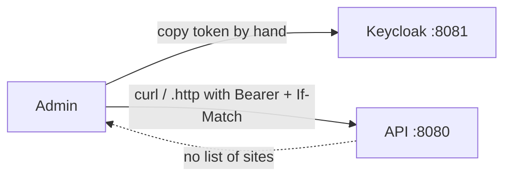
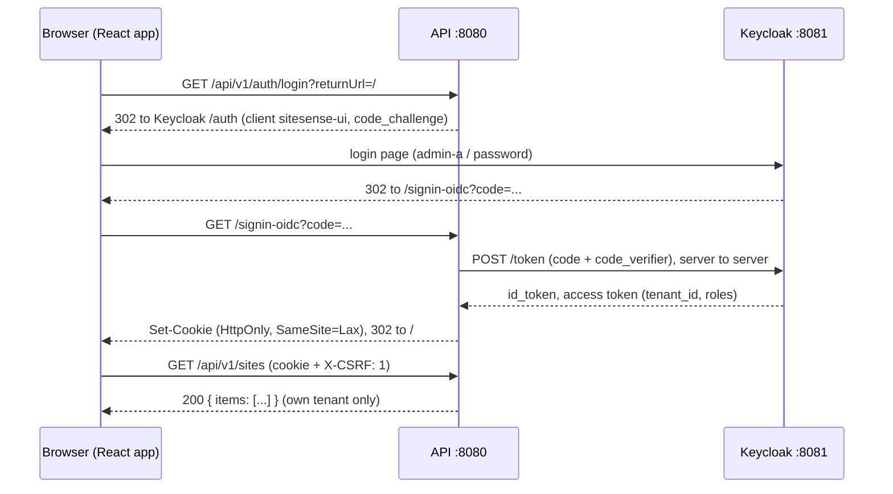
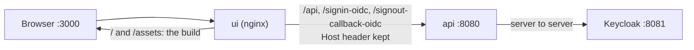

# SS-46 — Minimal admin UI (sites, map, devices)

- Status: Approved
- Issue: #98
- Plan PR: #99   Implementation PRs: BE #102, FE #104

## Problem

Today an Admin can manage sites, maps and devices only through raw HTTP calls
(`backend/SiteSense.Api/SiteSense.Api.http`, Scalar, curl). Each call needs a token copied by hand
from Keycloak, and an `If-Match` header copied from a previous response.
A reviewer who runs `docker compose up` has no page to open and no quick way to see the data.
Two gaps make even a small page impossible:

- there is no endpoint that lists the sites of a tenant (only `GET /api/v1/sites/{siteId}`);
- the API accepts only Bearer tokens, and Keycloak has no client for a browser login:
  `sitesense-verify` uses the password flow (verification only), the gateways use client credentials.



## Goal

`docker compose up`, open `http://localhost:3000/`, log in as `admin-a`, and:
list, create and edit sites; upload a map GeoJSON and see each validation error; list, register and
delete the devices of a site. A user of `tenant-b` sees only `tenant-b` data.
The web app talks **only to the API**: it never calls Keycloak and never holds a token.

Out of scope: the real-time demo client (needs the SignalR hub), the Leaflet map (API-06 bonus),
Safety and Viewer screens, the test clock panel, cursor paging (SS-11, issue #43).

## Solution

### Login: Backend for Frontend (BFF)

The API does the login for the browser, the common pattern for browser apps
(IETF draft *OAuth 2.0 for Browser-Based Applications*, "BFF").

1. The UI navigates to `GET /api/v1/auth/login?returnUrl=/`. The API answers with a redirect to the
   Keycloak login page.
2. After login, Keycloak sends the browser back to the API (`/signin-oidc`) with a one-time code.
3. The API swaps the code for tokens, server to server, with **PKCE** (the API keeps a random secret,
   sent Keycloak only its hash, and proves it now; a stolen code is useless). Client `sitesense-ui`
   is public: no client secret in the repository.
4. The API signs the user in with an encrypted `HttpOnly` cookie and redirects to `returnUrl`.
   JavaScript cannot read the cookie or the tokens.
5. The UI calls `/api/*` with the cookie and a fixed header `X-CSRF: 1`. Another site can make the
   browser send the cookie, but not a custom header, so the API rejects cookie calls without it.
6. Every endpoint accepts **either** the cookie (UI) **or** a Bearer token (gateways, verification
   script, tests). A policy scheme picks JWT when an `Authorization: Bearer` header is present, the
   cookie otherwise. The authorization policies do not change.



The cookie user gets its claims from the id_token: `sub`, `preferred_username`, `tenant_id`, `roles`.
The same `tenant_id` check as for Bearer tokens runs on login (exactly one valid value).

### Separate UI container

A `ui` container (nginx, `http://localhost:3000`) serves the FE build and reverse-proxies `/api`,
`/signin-oidc` and `/signout-callback-oidc` to the API. The browser sees one origin, so the BFF
cookie works with no CORS. The API serves no static files and stays an API only.



### Screens (FE)

Admin only; another role sees "Admin role required" and a logout button.

| Screen | Calls |
|---|---|
| Header: user name, logout | `GET /api/v1/me` (401 means "show Login"), `GET /api/v1/auth/logout` |
| Sites list + "New site" form (site JSON fields) | `GET /api/v1/sites`, `POST /api/v1/sites` |
| Site detail: edit settings | `GET /api/v1/sites/{id}` (ETag), `PUT /api/v1/sites/{id}` with `If-Match` |
| Site detail: map upload (`.geojson` file) | `PUT /api/v1/sites/{id}/map`; 200 shows `mapVersion`, 422 shows a table of `elementId` / `reason` |
| Site detail: devices | `GET .../devices`, `POST .../devices`, `GET .../devices/{deviceId}` (ETag) then `DELETE` with `If-Match` |

Every ProblemDetails answer shows `title` + `detail` in a toast; 412 says "changed by someone else, reload".

New endpoint, same rules as the device list (Admin, own tenant, sorted by id, no paging yet — SS-11):

```http
GET /api/v1/sites
200 { "items": [ { "siteId": "site-01", "name": "Stabilimento nord", ... } ] }
```

## Steps

### PR BE (stacked on the plan branch)

| # | Step | Files | Done when |
|---|---|---|---|
| 1 | `Site.GetAllAsync(tenantId, ct)` (mirror `Device.GetAllAsync`); `GET /api/v1/sites`, policy `CanManage`, sorted ordinal by id, `[ProducesResponseType]` 200/403; `SiteListResponse(Items)` | `Models/Site.cs`, `Controllers/SitesController.cs`, `Dtos/SiteResponse.cs` | build passes; OpenAPI shows it |
| 2 | Keycloak client `sitesense-ui`: `publicClient:true`, `standardFlowEnabled:true`, `directAccessGrantsEnabled:false`, attribute `pkce.code.challenge.method: S256`, `redirectUris` `http://localhost:3000/signin-oidc` and `http://localhost:5173/signin-oidc`, attribute `post.logout.redirect.uris` `http://localhost:3000/*##http://localhost:5173/*`; mappers `sub`, `preferred_username`, `tenant_id`, `roles` with `id.token.claim:true`; a `scopeMappings` entry giving it `Admin`, `Safety`, `Viewer` (the realm has `fullScopeAllowed:false`) | `docker/keycloak/sitesense-realm.json` | browser login completes and the id_token has `tenant_id` and `roles` |
| 3 | Package `Microsoft.AspNetCore.Authentication.OpenIdConnect` 10.0.14. `AuthSetup`: policy scheme `Smart` as default (Bearer header → JWT, else cookie); cookie scheme `HttpOnly`, `SameSite=Lax`, 1 h sliding, `OnRedirectToLogin` → 401 and `OnRedirectToAccessDenied` → 403 (never a redirect for API calls); OIDC scheme: `MetadataAddress`/`Authority` as JWT, client `Auth:UiClientId` (default `sitesense-ui`), `ResponseType=code`, `UsePkce=true`, `SaveTokens=true` (id_token for logout), `MapInboundClaims=false`, same name/role claim types, scopes `openid profile`, correlation and nonce cookies `SameSite=Lax` + `SecurePolicy=SameAsRequest` (plain HTTP in compose, Q74); `OnTokenValidated` runs the same `tenant_id` check as JWT (shared helper) | `Directory.Packages.props`, `SiteSense.Api.csproj`, `Auth/AuthSetup.cs`, `Auth/AuthOptions.cs` | Bearer tests still pass; API call without auth is 401, not 302 |
| 4 | CSRF middleware after `UseAuthentication`: a request authenticated by the cookie (no `Authorization` header) to `/api` with no `X-CSRF: 1` header → 403 ProblemDetails. `GET /api/v1/auth/*` is exempt (browser navigation) | `Program.cs` | test passes |
| 5 | `AuthController`: `GET /api/v1/auth/login?returnUrl=` (anonymous; `returnUrl` must be a local URL, else `/`) → OIDC challenge; `GET /api/v1/auth/logout` → sign out of cookie and OIDC (Keycloak end-session, back to `/`) | `Controllers/AuthController.cs` | 302 to Keycloak with `code_challenge`; open redirect refused |
| 6 | ~~Static files and SPA fallback in the API~~ — dropped: the UI runs in its own container (Q112 changed) | — | — |
| 7 | Tests (see Tests) | `tests/SiteSense.Tests/Api/SitesTests.cs`, `Api/Auth/BffTests.cs`, `Api/StaticFilesTests.cs`, `ApiFactory.cs` | all tests pass |
| 8 | Docs: security skill (endpoint rows `GET /api/v1/sites` = `CanManage`, `/api/v1/auth/*` anonymous; client `sitesense-ui`; cookie + CSRF rule), architecture skill (`frontend/` holds the admin UI and later the demo client; its own `ui` container), ASSUMPTIONS Q109–Q113, KNOWN_ISSUES (realm edits need a Keycloak recreate; Data Protection keys in memory, so an API restart logs users out), `SiteSense.Api.http` (sites list) | docs, `.claude/skills/*` | reviewer can follow them |

### PR FE (stacked on PR BE)

| # | Step | Files | Done when |
|---|---|---|---|
| 9 | Scaffold `frontend/`: Vite + React + TypeScript + Tailwind + shadcn/ui (button, input, label, card, table, dialog, sonner); Vite `server.proxy` sends `/api`, `/signin-oidc`, `/signout-callback-oidc` to `http://localhost:8080` (Host kept, so the redirect URI is `:5173`) | `frontend/*` | `npm run build` writes `frontend/dist` |
| 10 | API helper: `fetch` same-origin with `X-CSRF: 1`, ETag read, `If-Match` send, ProblemDetails to toast, 401 → "Login" state | `frontend/src/api.ts` | used by every screen |
| 11 | Session: `GET /api/v1/me` on start; Login button navigates to `/api/v1/auth/login?returnUrl=<current path>`; Logout navigates to `/api/v1/auth/logout`; Admin check on `roles` | `frontend/src/App.tsx`, `frontend/src/session.tsx` | login and logout work in the browser |
| 12 | Screens from the table above | `frontend/src/pages/*` | every call in the table works |
| 13 | `frontend/Dockerfile` (pinned `node:22.21.1-alpine` build, pinned `nginx:1.29.3-alpine` runtime), `frontend/nginx.conf` (SPA `try_files`, proxy of `/api`, `/signin-oidc`, `/signout-callback-oidc` to `http://api:8080` with `Host` kept, `client_max_body_size 20m`), compose service `ui` on `3000:3000` after `api` is healthy | `frontend/Dockerfile`, `frontend/nginx.conf`, `frontend/.dockerignore`, `docker-compose.yml` | `docker compose up --build` serves the UI on 3000 |
| 14 | Docs: README (open the UI on :3000, `npm run dev`), AI_LOG entry | `README.md`, `AI_LOG.md` | reviewer can follow the README alone |

## Risks

| Risk | Impact | Mitigation |
|---|---|---|
| Existing Keycloak container keeps the old realm (import skips it) | `sitesense-ui` missing, login fails | KNOWN_ISSUES + README: `docker compose up --force-recreate keycloak` once |
| Cookie calls from another site (CSRF) | an attacker page changes data as the Admin | `SameSite=Lax` + mandatory `X-CSRF: 1` header on cookie calls (step 4) |
| OIDC correlation cookie dropped on plain HTTP (`SameSite=None` needs `Secure`) | login fails with "Correlation failed" | correlation and nonce cookies set to `Lax` + `SameAsRequest` (step 3) |
| Cookie auth changes the default scheme for every endpoint | gateway or verify script breaks | Bearer still selected by header; all existing Bearer tests must pass |
| API 401 becomes a 302 to Keycloak | `fetch` follows a redirect into HTML | cookie events return 401/403; challenge only in `AuthController` |
| nginx forwards a different `Host` | OIDC redirect URI not in the realm, login fails | `proxy_set_header Host $http_host`; realm lists :3000 and :5173 |
| Open redirect via `returnUrl` | phishing link via our domain | only local URLs accepted |
| Data Protection keys in memory | API restart logs users out | accepted for a demo; KNOWN_ISSUES |

## Tests

- `SitesTests`: `List_ReturnsOnlyOwnTenantSites_SortedById`, `List_AsViewerOrSafety_Returns403`, `List_EmptyTenant_ReturnsEmpty`.
- `BffTests` (cookie built in the test with the cookie scheme's `TicketDataFormat`, no Keycloak):
  `Login_RedirectsToAuthorizeEndpointWithPkce` (static OIDC configuration in `ApiFactory`),
  `Login_ExternalReturnUrl_FallsBackToRoot`, `Cookie_WithCsrfHeader_IsAuthenticated`,
  `Cookie_WithoutCsrfHeader_Returns403`, `NoCredentials_Returns401NotRedirect`,
  `Cookie_OtherTenant_Returns404` (isolation holds for cookie users too).
- HTTP checks on the `ui` container: `/` and `/sites/x` return the app, `/assets/*.js` returns JavaScript, `/api/v1/me` returns 401, `/api/v1/auth/login` redirects to Keycloak and Keycloak accepts the `:3000` redirect URI.
- Browser check: login `admin-a` on Keycloak and back, create the site from `data/`, upload the `data/` map (200), upload a broken map (422 table), register and delete a device, log in as `admin-b` and see none of the `tenant-a` sites, `viewer-a` sees "Admin role required", logout returns to the app. Screenshots in the FE PR.
- No frontend unit tests (demo UI; the logic is in the API).

## Open questions

| # | Question | Options (recommended first) | Decision |
|---|---|---|---|
| 1 | Who talks to Keycloak | API as BFF (redirect, tokens stay in the API, cookie to the UI) / SPA with PKCE / API password proxy | BFF (user, 2026-11-26) |
| 2 | BFF client type | Public client + PKCE, no secret in the repo / confidential client with a secret | Public + PKCE (user, 2026-11-26) |
| 3 | Hosting | Separate nginx container that proxies the API (one origin) / served by the API from `wwwroot` / nginx + CORS | Separate nginx + proxy (user review, 2026-11-26; was API `wwwroot`) |
| 4 | Missing list endpoints | Add `GET /api/v1/sites` (device list exists) / ids typed by hand | Add list (user, 2026-11-26) |
| 5 | First version scope | Sites, map, devices / plus test clock | Sites, map, devices (user, 2026-11-26) |

## Changelog

| Date | Change | Why (review comment or finding) |
|---|---|---|
| 2026-11-26 | First draft | User asked for a minimal React + shadcn admin UI |
| 2026-11-26 | Keycloak client details, regex SPA fallback with AllowAnonymous, stub web root test, Vite proxy, `.dockerignore`, pinned node, skill updates | Sonnet validation findings 1–15 |
| 2026-11-26 | Login moved to the API (BFF, cookie + CSRF header, public client with PKCE); stack is plan → BE → FE; status Approved | User review: "the web app looks only at the API" |
| 2026-11-26 | Only the `openid` scope is requested | Browser check: Keycloak refused the unknown `profile` scope (500 on login) |
| 2026-11-26 | UI moved out of the API into its own nginx container on :3000; API static files and SPA fallback dropped | User review: keep the UI separate from the C# project |
