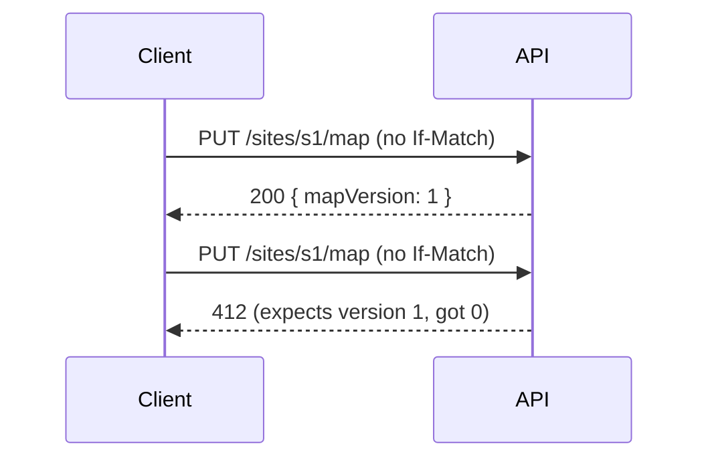
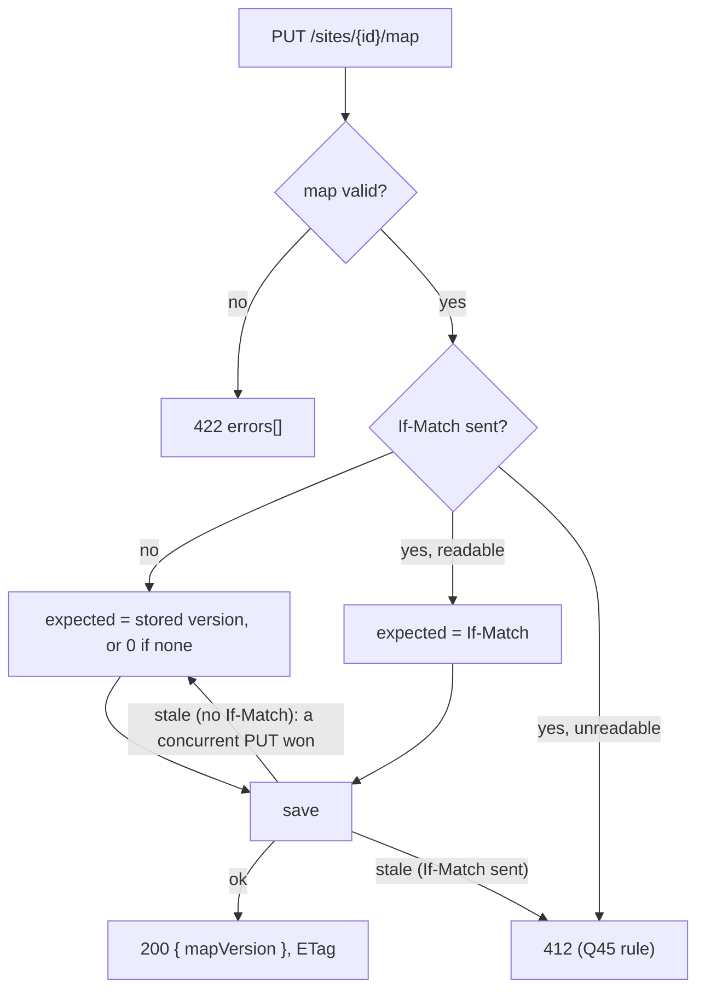

# SS-47 — Map PUT replaces, `mapFile` removed from the site

- Status: Approved
- Issue: #110
- Plan PR: #111   Implementation PR: #112

## Problem

1. **A map cannot be uploaded twice.** `PUT /api/v1/sites/{siteId}/map` creates the map when no
   `If-Match` is sent (version 0). A second upload without `If-Match` is `412`, and no endpoint returns
   the current map version, so a client cannot know what to send. The contract (`PUT` → `200 { mapVersion }`)
   says nothing about `If-Match`: a verification run that uploads a map twice would fail.
2. **`mapFile` is dead data.** The site JSON format has `"mapFile": "map.geojson"`: the name of the map
   file next to the site file on disk (`data/site.json` + `data/map.geojson`). The API gets the map from
   `PUT /map` and stores it in its own `SiteMap` document; nothing reads `Site.MapFile`. Yet
   `POST /api/v1/sites` requires it, and the admin UI asks the user to type a file name that sends no file.



## Goal

`PUT /map` is a plain create-or-replace of the site's single map: without `If-Match` it always stores
the new map; with `If-Match` it checks the version first (`412` if stale). The site has no `mapFile`;
a site JSON that still carries it is accepted and the field ignored.

Out of scope: a `GET` for the map, map history, any change to what a new map version does to positions (Q17).

## Solution

The map stays a separate document, 1:1 with the site (id = `siteId`): it is large, has its own
version (`mapVersion`), and arrives after the site. `PUT` is the HTTP verb for "create or replace what
is at this URL", which is exactly this.



- `SiteMap.ImportAsync(..., long? expectedVersion, ...)`: the map is validated **once**; `null` means
  "latest": read the stored version (0 if none), save, and on `ConcurrencyException` read again and retry
  (3 attempts in total), then throw `MapUploadConflictException`. Last write wins: that is what "no If-Match" means.
- The controller maps it: no header → `null`; readable header → that number; header present but unreadable
  (`abc`, `*`) → `412` ProblemDetails at once (today it became version 0 and passed on a first upload).
  A stale `If-Match` throws `ConcurrencyException` → `412` (Program.cs mapping, unchanged). Only the
  "no header" path retries; `MapUploadConflictException` → `409` ProblemDetails "Concurrent map uploads, try again".
- This is an exception to Q45 ("`If-Match` required on every change"): Q45 is amended for the map only.
- `mapFile`: removed from `Site`, `SiteRequest`, `SiteResponse`. ASP.NET Core (`AddJsonOptions` in `Program.cs:15`
  sets no `UnmappedMemberHandling`) and the store (`StorePaths.Json`, `JsonSerializerDefaults.Web`) skip
  unknown JSON fields, so old stored sites and requests with `mapFile` keep working.
  `data/site.json` keeps `mapFile`: it is the site file format and documents which map goes with it.

```http
PUT /api/v1/sites/site-01/map          (map exists, version 1, no If-Match)
200 { "mapVersion": 2 }   ETag: "2"
```

## Steps

| # | Step | Files | Done when | PR |
|---|---|---|---|---|
| 1 | `SiteMap.ImportAsync` takes `long? expectedVersion` (null = latest, validate once, retry the save 3 times, then `MapUploadConflictException`); `MapController.Put`: header absent → null, unreadable → 412, else the number; `MapUploadConflictException` → 409; `[ProducesResponseType]` 409 | `Models/Map/SiteMap.cs`, `Controllers/MapController.cs` | build passes | impl |
| 2 | Remove `MapFile` from `Site`, `SiteRequest` (and `ToSite`), `SiteResponse` | `Models/Site.cs`, `Dtos/SiteRequest.cs`, `Dtos/SiteResponse.cs` | build passes | impl |
| 3 | Tests (see Tests); fix existing tests that set or assert `mapFile` | `tests/SiteSense.Tests/Api/Maps/MapEndpointTests.cs`, `tests/SiteSense.Tests/Api/SitesTests.cs` | all tests pass | impl |
| 4 | `.http`: map PUT without If-Match; site bodies without `mapFile` | `backend/SiteSense.Api/SiteSense.Api.http` | file matches the API | impl |
| 5 | Docs: ASSUMPTIONS Q45 (map PUT exception, Status Changed), Q82 (drop `mapFile` from the required fields, Status Changed) and new Q91 (map PUT semantics), Q92 (`mapFile` accepted and ignored); context skill (site JSON row: `mapFile` is ignored by the API); `data/README.md` lines 7 and 59 (`mapFile` names the map file, the API ignores it); `docs/architecture.md:76` (ETag row: map PUT without If-Match = latest); security skill unchanged | `ASSUMPTIONS.md`, `.claude/skills/sitesense-context/SKILL.md`, `data/README.md`, `docs/architecture.md` | docs match the code | impl |

## Risks

| Risk | Impact | Mitigation |
|---|---|---|
| Two uploads without If-Match at the same time | one may overwrite the other | accepted (last write wins, no If-Match); retry avoids a spurious 412 |
| A client relied on the 412 to avoid overwriting | silent overwrite | it can still send `If-Match`; documented in Q91 |
| A response consumer reads `mapFile` from `GET /sites/{id}` | field missing | only the SS-46 UI shows it; a missing field shows empty, nothing breaks; SS-46 FE drops the field (merged after this) |

## Tests

- `MapEndpointTests`: `Put_FirstMapWithoutIfMatch_Returns200Version1`, `Put_SecondMapWithoutIfMatch_Returns200AndNextVersion`,
  `Put_CurrentIfMatch_Returns200`, `Put_StaleIfMatch_Returns412` (incl. `"0"` on an existing map),
  `Put_UnreadableIfMatch_Returns412` (`abc`, `*`, also on a first upload), `Put_InvalidMapWithoutIfMatch_Returns422AndKeepsVersion`,
  `Put_ParallelUploadsWithoutIfMatch_AllSucceedWithDistinctVersions`.
- `SitesTests`: `Create_WithoutMapFile_Returns201`, `Create_WithMapFile_IsAcceptedAndIgnored` (response has no `mapFile`),
  `Get_StoredSiteWithMapFile_StillLoads` (a site document written with `mapFile` reads back).
- Existing tests: `SitesTests.cs:347` (asserts `mapFile`) and `MapEndpointTests.cs:33` (seeds `MapFile`) change; others keep passing.
- Existing tests that send `mapFile` keep passing.

## Open questions

| # | Question | Options (recommended first) | Decision |
|---|---|---|---|
| 1 | Map import verb | Keep `PUT` (contract §7.3) / POST + PUT / POST only | Keep PUT (user, 2026-11-26) |
| 2 | `If-Match` on map PUT | Optional, checked when sent / none | Optional (user, 2026-11-26) |
| 3 | `mapFile` | Remove from the model, ignore if sent / keep but optional | Remove (user, 2026-11-26) |

## Changelog

| Date | Change | Why (review comment or finding) |
|---|---|---|
| 2026-11-26 | First version | SS-46 UI review: second map upload gave 412; `mapFile` has no use |
| 2026-11-26 | Retry inside `ImportAsync` (validate once), unreadable If-Match → 412, 409 only on the no-header path, Q45 and architecture.md amended, more tests | Sonnet plan validation |
