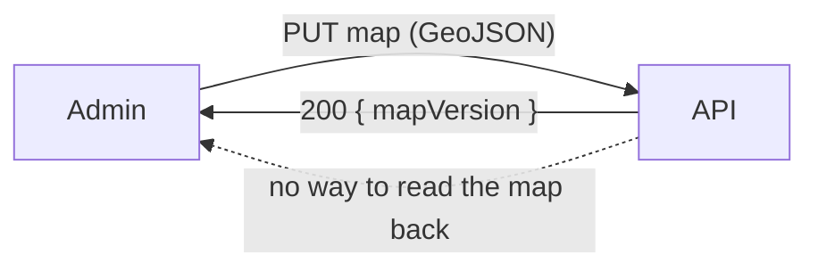
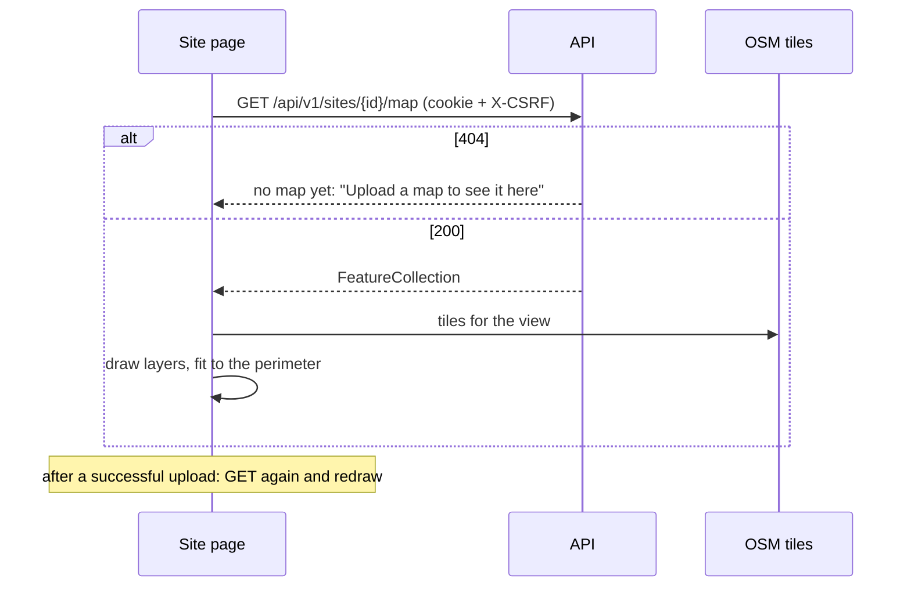

# SS-48 — Site map view with Leaflet

- Status: Approved
- Issue: #121
- Plan PR: #122   Implementation PR: #<n>

## Problem

An Admin can upload a site map (`PUT /api/v1/sites/{siteId}/map`), but cannot see it: the UI shows only
"Map version N" or the list of errors. There is no endpoint that returns the stored map, so no client can
draw it. A wrong perimeter, an area of the wrong type or a path in the wrong place goes unnoticed.



## Goal

The site page shows the uploaded map on a real map (Leaflet on OpenStreetMap tiles): the perimeter
highlighted, the areas coloured by type, the paths, the assembly points and the entrances, each with a
popup. A new upload refreshes the view.

Out of scope: device dots and positions (Admin never sees individual positions, Q09; there is no
position-read endpoint yet: they come with the track and occupancy stories, for Safety), routes,
occupancy colours, editing the map in the browser.

## Solution

### API: read the map back

`GET /api/v1/sites/{siteId}/map` rebuilds an RFC 7946 `FeatureCollection` from the stored `SiteMap`
document: the same `kind` and properties the import takes (§ map format), coordinates WGS84 `[lon, lat]`
as received. It sends `ETag: "<mapVersion>"`, the value a client sends back as `If-Match` on the next PUT
(Q91). `404` when the site or its map does not exist, also for a site of another tenant (IDN-02).

```http
GET /api/v1/sites/site-01/map
200  ETag: "2"
{ "type": "FeatureCollection", "features": [
  { "type": "Feature", "geometry": { "type": "Polygon", "coordinates": [[[15.07, 37.52], ...]] },
    "properties": { "kind": "area", "id": "perimeter", "name": "Cittadella", "areaType": "perimeter" } },
  { "type": "Feature", "geometry": { "type": "Point", "coordinates": [15.071, 37.525] },
    "properties": { "kind": "assemblyPoint", "id": "ap-1", "name": "Piazzale", "capacity": 200 } } ] }
```

The map is the site layout, not personal data: who may read it is open question 1.

### UI: Leaflet on the site page



- `leaflet` + `react-leaflet` (the React bindings; no other map library). OSM tiles
  `https://tile.openstreetmap.org/{z}/{x}/{y}.png` with the attribution "© OpenStreetMap contributors",
  recorded in `DATA_SOURCES.md` (ODbL; tile usage policy: light, interactive use).
- One `GeoJSON` layer per kind, styled by properties:

| Element | Style | Popup |
|---|---|---|
| `perimeter` area | thick dark outline, no fill | name |
| `work` / `rest` / `parking` areas | light fill: blue / green / grey | name, type, capacity |
| `restricted` / `hazard` areas | orange / red fill, dashed red outline | name, type |
| paths | line; `paved` solid, `unpaved` dashed; `steps` darker | id, surface, steps, slope, width |
| assembly points | green circle marker | name, capacity |
| entrances | blue circle marker | name |

- A small legend in the map corner. The map card sits on the site page above the upload card;
  the view fits the perimeter bounds. Circle markers (`L.circleMarker`) avoid Leaflet's default icon
  images, so no image assets are bundled.

## Steps

| # | Step | Files | Done when | PR |
|---|---|---|---|---|
| 1 | `SiteMap.ToGeoJson()` builds a `JsonObject` with the exact import keys (`kind`, `id`, `name`, `areaType`, `capacity`, `surface`, `steps`, `slopePercent`, `widthM`; kinds `area`, `path`, `assemblyPoint`, `entrance`), so no naming policy rewrites them; all polygon rings kept (holes); `capacity` left out when null, never `null` | `Models/Map/SiteMap.cs` | build passes | impl |
| 2 | `MapController`: move `[Authorize(Policy = CanManage)]` from the class to `Put` (class-level and method-level policies add up, so a class policy would keep Safety and Viewer out of the GET); `Get` with the policy from open question 1; `404` when `Site.GetAsync` or `SiteMap.GetAsync` is null (same check as PUT, so another tenant's site is a 404); `ETag: "<map.Version>"`; `Content-Type: application/geo+json`; `[ProducesResponseType]` 200/404 | `Controllers/MapController.cs` | OpenAPI shows it | impl |
| 3 | Tests (see Tests), next to the PUT tests, reusing `MapUrl`, `PutMap`, `VersionOf`, `MapFixtures.BaseMap` / `RealMap`; seed after `CreateClient()` (the host resets the static store) | `tests/SiteSense.Tests/Api/Maps/MapEndpointTests.cs` | tests pass | impl |
| 4 | `npm install leaflet react-leaflet@^5` (React 19) and `@types/leaflet`; import `leaflet/dist/leaflet.css` in `main.tsx` | `frontend/package.json`, `frontend/src/main.tsx` | build passes | impl |
| 5 | `MapView` (props `siteId`, `reloadKey`): loads `GET .../map`; on `ApiError` 404 shows "Upload a map to see it here" with no toast; `<MapContainer>` with fixed height (props are immutable, so a child `FitBounds` uses `useMap().fitBounds()` on the perimeter); one `<GeoJSON key={etag}>` (the key forces a redraw after an upload) with `style`, `pointToLayer` (`L.circleMarker`) and `onEachFeature` (popups) per the style table; legend. `MapCard` in `SitePage.tsx` owns the upload: after a 200 it bumps `reloadKey`; `MapView` sits in the same card above the upload form | `frontend/src/pages/MapView.tsx`, `frontend/src/pages/SitePage.tsx` | map visible in the browser | impl |
| 6 | Docs: `DATA_SOURCES.md` new `## OpenStreetMap tiles` entry (Source, Used at runtime, License ODbL, Attribution, tile usage policy incl. a Referer is sent — no `Referrer-Policy: no-referrer`), plus a Leaflet (BSD-2) line; security skill endpoint row `GET /api/v1/sites/{siteId}/map` next to the PUT row; ASSUMPTIONS Q114 (who reads the map); `.http` (GET map); README one line; KNOWN_ISSUES (public OSM tile server for dev only) | docs, `.claude/skills/sitesense-security/SKILL.md` | docs match the code | impl |

## Risks

| Risk | Impact | Mitigation |
|---|---|---|
| No internet in the browser | tiles do not load | the map elements still draw on a blank background |
| Heavy OSM tile use | tile server blocks the app | admin page only, interactive use, attribution shown; a self-hosted tile server is a production concern (KNOWN_ISSUES) |
| Leaflet CSS missing or the container has no height | grey or empty map | CSS imported in `main.tsx`, fixed map height |
| GeoJSON rebuilt with different property names | the UI misreads it | round-trip test against the import format |

## Tests

- `MapEndpointTests`: `Get_AfterPut_ReturnsSameElements` (ids, kinds, coordinates and properties, `BaseMap`),
  `Get_RealMap_RoundTrip` (holes, areas without `capacity` stay without it), `Get_ReturnsEtagWithMapVersion`,
  `Get_NoMap_Returns404`, `Get_UnknownSite_Returns404`, `Get_OtherTenantSite_Returns404`,
  `Get_AsSafetyOrViewer_Returns200` (if open question 1 is "all roles"), `Put_ViewerRole_Returns403` kept.
- Browser check: upload `data/map.geojson`, the map shows the campus with the perimeter, coloured areas, paths and
  points; a popup opens on click; the legend is visible; a second upload refreshes it; a site without a map shows the
  empty state. Screenshot in the PR.

## Open questions

| # | Question | Options (recommended first) | Decision |
|---|---|---|---|
| 1 | Who may read the map (`GET .../map`)? | All user roles (`CanSeeAggregates`): the layout is not personal data, and Safety and Viewer views (routes, occupancy) will need it / Admin only (`CanManage`), widen later | All roles (`CanSeeAggregates`); what is drawn on top depends on the role: Admin the structure (this story), Safety devices and alerts, Viewer occupancy, each with its own story (user, 2026-11-27) |
| 2 | Devices on the map | Not now: no position-read endpoint, Admin does not see positions (Q09) / change Q09 | Not now (user, 2026-11-27) |
| 3 | Base layer | OSM tiles with attribution / none | OSM tiles (user, 2026-11-27) |
| 4 | Where the work goes | New story SS-48 stacked on SS-46 FE / inside SS-46 | SS-48 (user, 2026-11-27) |

## Changelog

| Date | Change | Why (review comment or finding) |
|---|---|---|
| 2026-11-27 | First version | User asked for a Leaflet view of the uploaded map |
| 2026-11-27 | Open question 1 decided: all roles read the map, layers per role later; Approved | User review |
| 2026-11-27 | Class-level policy moved to PUT, exact GeoJSON keys, null capacity left out, react-leaflet pitfalls (fit bounds, redraw key), reload hook, 404 empty state, more tests, DATA_SOURCES format | Sonnet plan validation |
