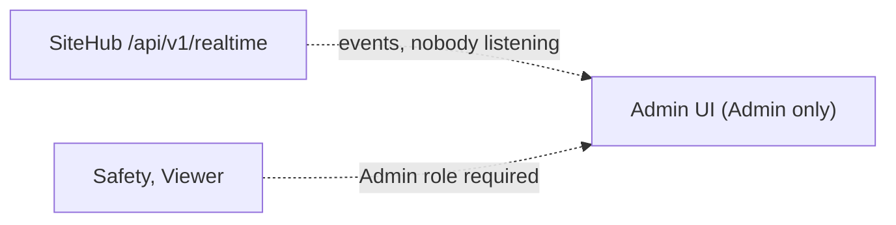
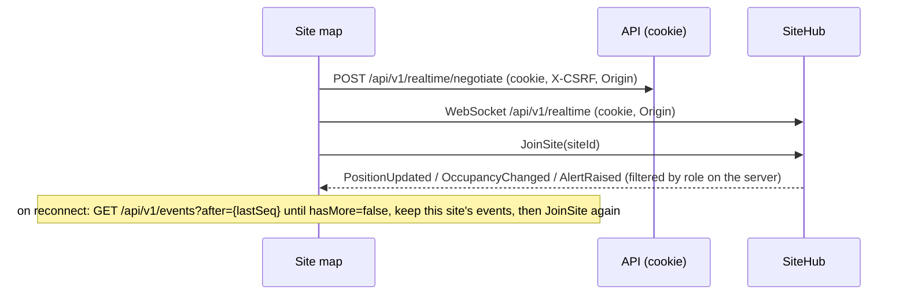

# SS-49 — Real-time site map per role

- Status: Approved
- Issue: #138
- Plan PR: #141   Implementation PR: #<n>
- Depends on: SS-50 (#139) publishes `PositionUpdated`; occupancy and alerts come from their own stories

## Problem

The site map (SS-48) is static, and only Admin can open the UI. The real-time hub (SS-35) sends events per
site and role, but no page listens. Safety cannot follow devices live; Viewer cannot see occupancy at all.

## Goal

Every user role opens the UI and sees, on the site map, what the role may see, updated live:

| Role | Sees on the map | Can do |
|---|---|---|
| Admin | structure, occupancy per area | manage sites, maps, devices (as today) |
| Safety | structure, occupancy, live device dots, alerts list | read only |
| Viewer | structure, occupancy per area | read only |

Out of scope: producing the events (SS-50 and the area / alert stories), tracks history, alert REST list,
routing UI.

## Solution

### Who opens what

- **Capabilities, not role names (IDN-03):** `GET /api/v1/me` adds `capabilities: { manage, seeIndividuals, seeAggregates }`,
  computed on the server with `IAuthorizationService` against the named policies. The UI decides only from these
  flags (today `session.tsx` checks `roles.includes('Admin')`: replaced). Roles stay for display (the badge).
- The gate lets in any user with `seeAggregates`. The sidebar shows "Sites" for all.
- Users without `manage` get the same sites list and site page, without create, edit, upload or device actions.
- Listing sites needs a role change on `GET /api/v1/sites` (open question 1). `GET /sites/{id}` and
  `GET /sites/{id}/map` already allow all roles.

### Live connection

- `@microsoft/signalr` (exact version) with `headers: { 'X-CSRF': '1' }`: applied to negotiate (POST) and long
  polling, not to the browser WebSocket. Same-origin requests carry the cookie.
- **Order:** connect → `JoinSite` → catch-up with `GET /events?after={lastSeq}`, looping while `hasMore` (a page is a
  window of 1,000 seqs and may be empty with `hasMore` true); live events that arrive meanwhile are buffered and any
  `seq <= lastSeq` is dropped; the client keeps only its site's events.
- **Reconnect:** a custom retry policy with capped backoff (1 s, 2 s, 5 s, then every 10 s) that never gives up, so the
  chip never sticks on "Offline". The cookie lives 1 h and a socket does not slide it; the hub closes on expiry
  (`CloseOnAuthenticationExpiration`). A negotiate that returns 401 calls `/me`, which shows the sign-in screen.
- **CSRF on the hub (Q117):** a browser WebSocket cannot send `X-CSRF`. The CSRF check exempts only a cookie `GET`
  whose path **equals** `/api/v1/realtime` (the WebSocket upgrade) **and** whose `Origin` is in `Auth:UiOrigins`
  (default `http://localhost:3000`, `http://localhost:5173`). Negotiate is a POST under the path and still needs
  `X-CSRF`. Other origins or no origin: `403`. Standard defence against cross-site WebSocket hijacking; Bearer and
  `access_token` callers are unchanged.
- **Proxies:** nginx `map $http_upgrade $connection_upgrade` and, on the `/api` location, `proxy_http_version 1.1`,
  `Upgrade` / `Connection` headers, `proxy_read_timeout 1h`, `proxy_buffering off`. Vite: `ws: true` on `/api`;
  `changeOrigin: false` keeps `Origin` and `Host`.

### What the map draws

| Event | Data | Drawn as |
|---|---|---|
| `OccupancyChanged` | `{ areas: [{ areaId, count }] }` (SS-35, same as `GET /occupancy`) | a count badge per area in the popup and a small label at the area centre; areas with `capacity` turn amber at 80 %, red at 100 % |
| `PositionUpdated` (Safety) | `{ deviceId, timestampMs, lat, lon, areaId }` (Q115, SS-50) | one dot per device at its latest position (older `timestampMs` ignored); dot fades after 5 minutes without updates (the occupancy rule) |
| `AlertRaised` (Safety) | `{ alertId, type, eventTimeMs, deviceId, areaId, late }` (Q116, same fields as the contract's alert item) | a red pulse on the device / area and a row in a small "Live alerts" list under the map (last 20) |

- A status chip on the map: "Live" / "Reconnecting…" / "Offline".
- Until the producing stories exist, `OccupancyChanged` and `AlertRaised` simply never arrive; the map shows
  the structure and the chip.

## Steps

| # | Step | Files | Done when | PR |
|---|---|---|---|---|
| 1 | BE: `Auth:UiOrigins` option (validated at start); CSRF exemption exactly as above (GET, path equals the hub path, allowed Origin) | `Auth/AuthOptions.cs`, `Program.cs`, `appsettings.example.json`, `docker-compose.yml` | tests pass | impl |
| 1b | BE: `MeResponse.Capabilities` from `IAuthorizationService` and the named policies | `Dtos/MeResponse.cs`, `Controllers/MeController.cs` | tests pass | impl |
| 2 | BE: `GET /api/v1/sites` policy per open question 1 | `Controllers/SitesController.cs` | tests pass | impl |
| 3 | BE tests: WebSocket-style GET on the hub path with cookie and allowed Origin passes the CSRF check; other or no Origin → 403; negotiate POST without `X-CSRF` → 403, with it → 200; `/me` capabilities per role; sites list per role | `tests/.../Auth/BffTests.cs`, `SitesTests.cs` | tests pass | impl |
| 4 | Proxies as above; `@microsoft/signalr` added at an exact version | `frontend/nginx.conf`, `frontend/vite.config.ts` | WebSocket opens through both | impl |
| 5 | FE: session reads `capabilities`; the gate needs `seeAggregates`; `manage` shows the Admin actions; no role name in a condition | `session.tsx`, `App.tsx`, pages | Viewer sees read-only pages | impl |
| 6 | FE: `useSiteEvents(siteId)` hook (connect, join, catch-up, status) and map layers for occupancy, devices, alerts | `frontend/src/realtime.ts`, `MapView.tsx`, `SitePage.tsx` | events render | impl |
| 7 | Docs: ASSUMPTIONS Q116 (alert payload), Q117 (hub Origin check), Q118 (UI per role), Q119 (sites list access); security skill rows; KNOWN_ISSUES; README | docs | docs match the code | impl |

## Risks

| Risk | Impact | Mitigation |
|---|---|---|
| Cross-site WebSocket with the user's cookie | another site reads live positions | Origin allow-list on the hub; `SameSite=Lax` cookie |
| Wrong guess of the alert payload | alerts render wrong when the alert story lands | payload fixed in Q116 from the contract's alert item; the alert story uses it |
| Many devices | slow map | one marker per device updated in place, not re-created |
| Cookie expires under an open socket (1 h) | hub closes, reconnect gets 401 | 401 → `/me` → sign-in screen; documented in KNOWN_ISSUES |
| Hub drops during a deploy | missed events | automatic reconnect + `GET /events?after=` catch-up (RTM-05) |

## Tests

- BE: `HubUpgrade_CookieWithUiOrigin_PassesCsrf`, `HubUpgrade_CookieWithOtherOrigin_Returns403`, `HubUpgrade_CookieWithoutOrigin_Returns403`,
  `HubNegotiate_CookieWithoutCsrf_Returns403`, `HubNegotiate_CookieWithCsrf_Returns200`, `Hub_BearerOrQueryToken_Unchanged`,
  `Me_Capabilities_<role>`, `List_<role>` per open question 1.
- Browser (you check, after SS-50): Safety with the simulator running sees dots move; Viewer sees the read-only
  page and no dots; Admin sees management actions and no dots; the chip shows "Live", then "Reconnecting…"
  when the API restarts, then "Live" again with no gap in the dots.

## Open questions

| # | Question | Options (recommended first) | Decision |
|---|---|---|---|
| 1 | Who may list sites (`GET /api/v1/sites`) | All roles (`CanSeeAggregates`): site names are not personal data, and Safety and Viewer need to pick a site / Admin only, others type the site URL | All roles (`CanSeeAggregates`), Q109 changed (user, 2026-11-27) |
| 2 | Roles on the map | Per role as in the Goal table / everything for Admin | Per role (user, 2026-11-27) |
| 3 | Hub CSRF | Origin check / short-lived hub token | Origin check (user, 2026-11-27) |
| 4 | Payload guesses for events not yet produced | Fix them now from the contract (Q115 in SS-50, Q116 here) / wait | Fix now (user, 2026-11-27) |

## Changelog

| Date | Change | Why (review comment or finding) |
|---|---|---|
| 2026-11-27 | First version | User: real-time on the map, per role |
| 2026-11-27 | Capabilities from `/me` instead of role names (IDN-03); narrow CSRF exemption; endless reconnect and 401 handling; nginx WebSocket config; catch-up order | Sonnet plan validation |
| 2026-11-27 | Open question 1 decided; Approved | User review |
