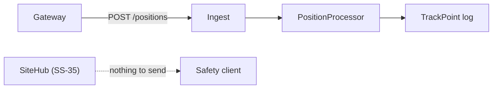
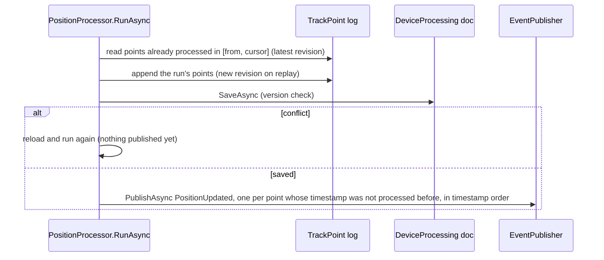

# SS-50 — Publish `PositionUpdated` from position processing

- Status: In review
- Issue: #139
- Plan PR: #<n>   Implementation PR: #<n>

## Problem

The real-time hub exists (SS-35: `/api/v1/realtime`, groups per tenant, site and audience; event log with
`GET /api/v1/events?after=`), but nothing publishes events. Position processing (SS-23) writes a pass-through
`TrackPoint` per accepted position and stops there. A Safety user connected to the hub never receives
`PositionUpdated`, so no client (the demo client, the map in SS-49) can show devices moving.



## Goal

After a track point is persisted, the processor publishes one `PositionUpdated` event for it, to the
device's site, Safety audience only (EventAudience, Q36). Each position is published **once**, also when a
late batch makes the processor replay. Occupancy and alerts are out of scope: they need the area of each
point (SS-25) and the alert rules; those stories publish `OccupancyChanged` and `AlertRaised`.

## Solution

### Payload (fixed here, Q115)

The same fields as a track point in the contract (`GET /devices/{id}/track` → `points[]`), plus the device:

```json
{ "seq": 42, "type": "PositionUpdated", "siteId": "site-01", "atMs": 1793268000500,
  "data": { "deviceId": "dev-001", "timestampMs": 1793268000000, "lat": 45.5001, "lon": 9.2004, "areaId": null } }
```

`areaId` is `null` until SS-25 assigns areas; the filter (SS-24) changes the coordinates, not the shape.

### When and how often



- **New vs replayed:** before appending, the run reads the timestamps already in the track for its range.
  Only raw positions whose timestamp is not among them are published. A late batch replays old points with a
  new revision, but publishes only the late positions themselves.
- **After persistence (RTM-03):** events go out only after `DeviceProcessing.SaveAsync` succeeds. A version
  conflict re-runs the loop and recomputes the same set, so a retry publishes nothing twice.
- **Site:** `Device.GetAsync(tenantId, deviceId).SiteId`; a device deleted meanwhile publishes nothing.
- **Crash window:** a crash after the save and before the publish loses those events (at most once). The
  track is still correct; catch-up (`GET /events`) cannot return what was never logged. Recorded in KNOWN_ISSUES.
- `PositionProcessor` gets `IRealtimePublisher` through its constructor (already registered in `Program.cs`).
- `POST /api/v1/test/drain` waits for processing, which now includes the publish, so tests see the events.

## Steps

| # | Step | Files | Done when | PR |
|---|---|---|---|---|
| 1 | `PositionUpdatedData(DeviceId, TimestampMs, Lat, Lon, AreaId)` record next to `EventTypes` | `Realtime/TenantEvent.cs` | build passes | impl |
| 2 | `PositionProcessor`: inject `IRealtimePublisher`; in `RunAsync` read known timestamps for `[from, cursor]` before the append; after a successful save, publish the new ones in timestamp order | `Services/PositionProcessor.cs` | build passes | impl |
| 3 | Tests (see Tests) | `tests/SiteSense.Tests/...` processing / realtime tests | all pass | impl |
| 4 | Docs: ASSUMPTIONS Q115 (payload, once per position, after persistence, at most once on crash); KNOWN_ISSUES (crash window; `areaId` null until SS-25); `docs/simulator.md` or README one line: run the simulator and watch `PositionUpdated` | docs | docs match the code | impl |

## Risks

| Risk | Impact | Mitigation |
|---|---|---|
| Replay publishes old positions again | duplicate dots / events | known-timestamp check; test with a late batch |
| 100 positions/s × events | event log and SignalR load | one small JSON per position (Q34, no throttle); the event log is append-only |
| Publish failure (log write) | processing stops for the device | `PublishAsync` errors are logged and swallowed per event, like SS-35's send path; the track is already saved |
| Slow publish holds the device run | backlog | publish is an append plus a fire-and-forget send (SS-35) |

## Tests

- `PositionEventsTests`: `Batch_PublishesOnePositionUpdatedPerPosition` (via the test publisher or `GET /events` after drain, data fields as in Q115);
  `DuplicateBatch_PublishesNothingNew`; `LateBatch_PublishesOnlyTheLatePositions`;
  `Events_GoToTheDeviceSite`; `Viewer_DoesNotSeePositionUpdatedInEvents` (audience filter, Q36);
  `ConcurrentMark_DoesNotPublishTwice` (a mark during the run forces the retry path).

## Open questions

| # | Question | Options (recommended first) | Decision |
|---|---|---|---|
| 1 | Which events now | `PositionUpdated` only / also a simple occupancy | `PositionUpdated` only (user, 2026-11-27) |
| 2 | Branch | Standalone from `main` / on top of the UI stack | From `main` (user, 2026-11-27) |
| 3 | Crash between save and publish | At most once, documented / publish before save (at least once, needs dedup in clients) | — |

## Changelog

| Date | Change | Why (review comment or finding) |
|---|---|---|
| 2026-11-27 | First version | User: publish the real-time signal so the map UI can work |
