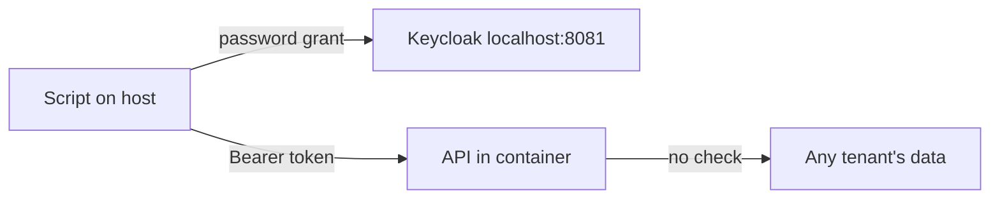
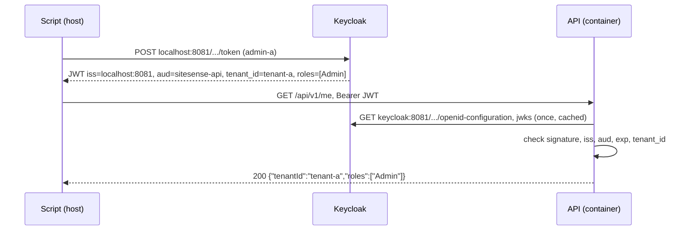

# SS-6 — JWT validation and tenant context

- Status: In review
- Issue: #38
- Plan PR: TBD at push   Implementation PRs: stacked on the plan branch

## Problem
The API accepts every request: there is no authentication. It cannot tell who calls, which
tenant (customer company) the caller belongs to, or which role (`Admin`, `Safety`, `Viewer`) it has.
So no endpoint can keep one tenant's data away from another (IDN-01, IDN-02).
Keycloak (SS-5) already issues tokens with `tenant_id`, `roles` and audience `sitesense-api`;
the API ignores them.

A trap: the evaluator takes a token from the host (`http://localhost:8081`), but the API runs in a
container, where `localhost:8081` is the container itself. If the API fetched Keycloak's keys from
the token's issuer, every call would fail with 401.



## Goal
- Every token is validated: signature (Keycloak keys), issuer, audience, lifetime.
- The caller's tenant comes only from the `tenant_id` claim; realm roles become role claims.
- A resource of another tenant answers `404`.
- A token from the host validates in the container too.
- Out of scope: named role policies (`CanManage`, ...) and the gateway scope policy: SS-7, SS-8.

## Solution
ASP.NET Core JWT bearer authentication, configured from an `Auth` section.

- **Issuer** is fixed: Keycloak always signs `iss = http://localhost:8081/realms/sitesense`
  (`KC_HOSTNAME`, Q74). The API checks exactly that value.
- **Keys** are fetched from `Auth:MetadataAddress`. In compose it points to the internal name
  `http://keycloak:8081/...`; Keycloak keeps the jwks URL on the host the caller used
  (`KC_HOSTNAME_BACKCHANNEL_DYNAMIC`). On the host (`dotnet run`) it is empty and the issuer is used.
- **Claims**: no inbound claim renaming; role claim type `roles`, name claim `preferred_username`.
- **Tenant**: a token without `tenant_id` fails validation → `401`. Code reads the tenant with
  `User.TenantId()` and passes it to the store, which only reads that tenant's folder (SS-9),
  so another tenant's document is "not found" → `404`.
- **Default**: a fallback policy requires an authenticated user on every endpoint.
  `/health`, `/openapi/v1.json` and `/scalar` stay anonymous (Q69).
- **`GET /api/v1/me`**: returns the caller's tenant and roles, for live checks and the demo client.



Example config (compose):

```text
Auth__Issuer=http://localhost:8081/realms/sitesense
Auth__Audience=sitesense-api
Auth__MetadataAddress=http://keycloak:8081/realms/sitesense/.well-known/openid-configuration
```

## Steps
| # | Step | Files | Done when | PR |
|---|---|---|---|---|
| 1 | Add `Microsoft.AspNetCore.Authentication.JwtBearer` 10.0.14 | `Directory.Packages.props`, `backend/SiteSense.Api/SiteSense.Api.csproj` | `dotnet build` passes | impl |
| 2 | `AuthOptions` (`Issuer`, `Audience` required; `MetadataAddress` optional) and its validator, checked at start like `StoreOptions` | `backend/SiteSense.Api/Auth/AuthOptions.cs` | Missing `Auth:Issuer` stops the start with a clear error | impl |
| 3 | `AuthSetup.AddSiteSenseAuth(builder)`: JwtBearer with `MetadataAddress` when set, otherwise `Authority = Issuer`; `RequireHttpsMetadata=false` (Q74); `MapInboundClaims=false`; `TokenValidationParameters { ValidIssuer, ValidAudience, NameClaimType="preferred_username", RoleClaimType="roles", ClockSkew=30s }`; `OnTokenValidated` fails unless there is exactly one `tenant_id` matching the store's id rule (`^[A-Za-z0-9_-]{1,128}$`); no token or claim values in logs; fallback policy = authenticated | `backend/SiteSense.Api/Auth/AuthSetup.cs` | Step 7 tests pass | impl |
| 4 | `ClaimsPrincipal.TenantId()` and claim name constants | `backend/SiteSense.Api/Auth/ClaimsPrincipalExtensions.cs` | Used by `MeController` and the test probe | impl |
| 5 | Wire it: `AddSiteSenseAuth`; order `UseExceptionHandler`, `UseStatusCodePages`, `UseAuthentication`, `UseAuthorization`, maps; `AllowAnonymous` on health, OpenAPI, Scalar | `backend/SiteSense.Api/Program.cs` | `/health` 200 without token; any other route 401 without token | impl |
| 6 | `GET /api/v1/me` → `MeResponse(TenantId, Roles)`; `Roles` is `[]` when the token has none (gateways) | `backend/SiteSense.Api/Controllers/MeController.cs`, `backend/SiteSense.Api/Models/MeResponse.cs` | 200 with tenant and roles of the token | impl |
| 7 | Tests: test RSA key and token factory; `ApiFactory` sets `Auth:Issuer`/`Auth:Audience` (no metadata address) and, in `ConfigureTestServices`, `Configure<JwtBearerOptions>` (not `PostConfigure`) with `Configuration = new OpenIdConnectConfiguration { Issuer, SigningKeys = { testKey } }`, so no network call; auth tests; tenant probe controller (route under `/probe/`) + isolation test in an xUnit collection with `DisableParallelization`, seeding through `SiteSenseContext.Store` after `CreateClient()`; error-probe and unknown-route tests send a token | `tests/SiteSense.Tests/Api/Auth/TestTokens.cs`, `tests/SiteSense.Tests/Api/Auth/AuthTests.cs`, `tests/SiteSense.Tests/Api/Auth/TenantProbeController.cs`, `tests/SiteSense.Tests/Api/Auth/TenantIsolationTests.cs`, `tests/SiteSense.Tests/Api/ApiFactory.cs`, `tests/SiteSense.Tests/Api/ErrorResponseTests.cs` | `dotnet test` green | impl |
| 8 | Config: `Auth` section in the template; `Auth__*` env in compose | `backend/SiteSense.Api/appsettings.example.json`, `docker-compose.yml` | `docker compose up` healthy | impl |
| 9 | Docs: decisions, config table, skill rules, AI log | `ASSUMPTIONS.md`, `docs/architecture.md`, `.claude/skills/sitesense-security/SKILL.md`, `.claude/skills/sitesense-testing/SKILL.md`, `AI_LOG.md` | Each decision in one place | impl |
| 10 | Live check: compose up; for 6 users (`sitesense-verify`, password grant) and 2 gateways (client credentials) get a token from `localhost:8081`, call `localhost:8080/api/v1/me` | none (manual, result in PR) | 8 × 200 with right tenant and roles; no token / tampered token → 401 | impl |

## Risks
| Risk | Impact | Mitigation |
|---|---|---|
| Unknown routes now answer `401` without a token (fallback policy runs with no endpoint) | Error tests expecting `404` break | Those tests send a valid token; with a token an unknown route is still `404` |
| Keycloak not ready when the API starts | First calls 401 | Keys are fetched lazily on the first token and retried; compose already starts the API after `keycloak-init` |
| Static `SiteSenseContext.Store` shared by parallel test hosts | Flaky isolation test | Isolation test in an xUnit collection with `DisableParallelization` (Q67) |
| Token lifetime uses the system clock, not `SiteSenseContext.Time` | Test clock (`PUT /test/clock`) does not expire tokens | Wanted: tokens follow real time. Written in Q79's entry in `ASSUMPTIONS.md` |
| A hostile `tenant_id` (`../x`) reaches the store | Store throws, 500 | Rejected in `OnTokenValidated` → 401, tested |
| Scalar "Try it" has no Bearer button | Manual calls need curl | Out of scope; OpenAPI security scheme can come with SS-7 |
| New Q numbers clash with parallel stories | Merge conflict in `ASSUMPTIONS.md` | Renumber at merge, as SS-9 did |

## Tests
- `AuthTests`: valid token for each role → `/api/v1/me` 200 with tenant and roles; gateway-like token (no roles) → 200, `roles: []`; no token, wrong issuer, wrong audience, wrong signing key, expired (more than 30 s ago), missing `tenant_id`, `tenant_id="../x"` → 401 with `application/problem+json`; unknown route → 401 without token, 404 with token; `/health` and `/openapi/v1.json` 200 anonymous.
- `AuthSetupTests`: with no `Auth:MetadataAddress`, the options use `Authority = Issuer` (host case).
- `TenantIsolationTests`: a document saved for `tenant-b`; `tenant-a` token → 404, `tenant-b` token → 200.
- Manual live check (step 10), results in the PR.

## Open questions
| # | Question | Options (recommended first) | Decision |
|---|---|---|---|
| Q02 | Issuer from host vs container | Fixed issuer (Q74) + internal metadata address / accept both issuers | Fixed issuer + internal metadata (follows Q74) |
| Q10 | Wrong role, right tenant | 403 / 404 | 403 (already accepted); tested in SS-7, when role policies exist |
| Q77 | How tests get tokens | RSA-signed JWTs through the real handler / fake auth handler | Signed JWTs (user) |
| Q78 | Endpoint to check identity live | `GET /api/v1/me` always / test mode only / none | `/api/v1/me` always (user) |
| Q79 | Valid token without `tenant_id` | 401 / 403 | 401 (user) |
| Q80 | Endpoints without an attribute | Fallback: authenticated / open until SS-7 | Fallback authenticated (user) |

## Changelog
| Date | Change | Why (review comment or finding) |
|---|---|---|
| 2026-11-24 | First draft | — |
| 2026-11-24 | Authority vs MetadataAddress branch, `Configure` not `PostConfigure` in tests, ClockSkew 30 s, `tenant_id` format check, middleware order, more tests | Sonnet validation |
