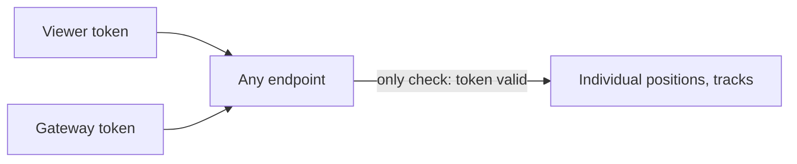
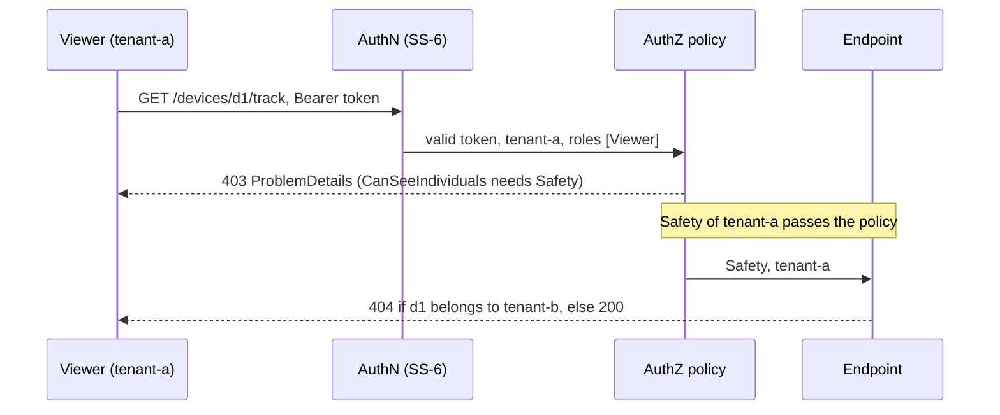

# SS-7 — Authorization policies

- Status: In review
- Issue: #39
- Plan PR: #TBD-plan   Implementation PRs: #TBD-impl
- Requirement IDs: IDN-03, PRV-03

## Problem

Today the API knows *who* the caller is (SS-6: valid JWT, one `tenant_id`), but not *what* the
caller may do. The only rule is "any valid token". A `Viewer` token could call an endpoint that
returns individual worker positions, and a gateway token could call a management endpoint. Each
endpoint would have to check roles by hand (`User.IsInRole("Safety")`), which is easy to forget
and hard to review.

## Goal

Four named policies, registered once, that every endpoint uses by name:

| Policy | Granted to |
|---|---|
| `CanManage` | role `Admin` |
| `CanSeeIndividuals` | role `Safety` |
| `CanSeeAggregates` | roles `Admin`, `Safety`, `Viewer` |
| `CanWritePositions` | token with scope `positions:write` (gateway client) |

- A caller in the right tenant without the policy gets **403** (Q10). A resource of another tenant
  stays **404** (IDN-02).
- `Viewer` never passes `CanSeeIndividuals`, so it never gets positions or tracks (PRV-03).
- No `IsInRole` or role strings in endpoint code (IDN-03); a test enforces it.

Out of scope: real endpoints (they come with their stories and pick a policy from the table), the
gateway token flow and the `POST /positions` guard (SS-8), the `TestMode` policy (comes with the
test-mode story, it needs `SITESENSE_TEST_MODE`).

## Solution

Policy names and role/scope strings are constants in one file,
`backend/SiteSense.Api/Auth/SiteSensePolicies.cs` (already pushed so SS-8 can reuse
`CanWritePositions`). `AddSiteSenseAuth` registers the four policies next to the fallback policy:

- Role policies: `RequireAuthenticatedUser().RequireRole(...)`. Roles come from the `roles` claim
  (`RoleClaimType`, SS-6). Matching is exact and case-sensitive.
- Scope policy: `RequireAuthenticatedUser()` plus a `RequireAssertion` that splits every `scope`
  claim value on spaces and looks for exactly `positions:write` (ordinal). Keycloak puts all scopes in one space-separated string, e.g.
  `"scope": "profile positions:write"`, so a plain `RequireClaim` would not match.

Endpoints write `[Authorize(Policy = SiteSensePolicies.CanSeeIndividuals)]` (controllers) or
`.RequireAuthorization(SiteSensePolicies.X)`.

## Steps

| # | Step | Files | Done when | PR |
|---|---|---|---|---|
| 1 | Constants: policy names, roles, `scope` claim, `positions:write`. Already on the implementation branch `story/SS-7-policies`, which merges this plan branch. | `backend/SiteSense.Api/Auth/SiteSensePolicies.cs` | Pushed (done, for SS-8). | impl |
| 2 | Register the four policies in `AddAuthorizationBuilder()`. | `backend/SiteSense.Api/Auth/AuthSetup.cs` | Builds. | impl |
| 3 | `TestTokens.Create` gets an optional `scope` object (string, or string[] for an array claim). | `tests/SiteSense.Tests/Api/Auth/TestTokens.cs` | Existing tests unchanged and green. | impl |
| 4 | Test-only `PolicyProbeController`: one `GET probe/policy/{name}/{id}` action per policy, each reads a `TestDoc` of the caller's tenant (404 if missing). | `tests/SiteSense.Tests/Api/Auth/PolicyProbeController.cs` | Builds. | impl |
| 5 | Tests (below). | `tests/SiteSense.Tests/Api/Auth/PolicyTests.cs` | `dotnet test` green. | impl |
| 6 | Docs: policy table in the security skill points to `SiteSensePolicies` and marks `TestMode` "pending, test-mode story"; `AI_LOG.md` entry. | `.claude/skills/sitesense-security/SKILL.md`, `AI_LOG.md` | Skill names the constants file. | impl |

## Risks

| Risk | Impact | Mitigation |
|---|---|---|
| Keycloak sends `scope` in another shape (array). | Gateway gets 403. | Assertion accepts every `scope` claim value and splits each; SS-8 tests with a real gateway token. |
| A future endpoint forgets a policy. | Any authenticated caller passes. | New-endpoint checklist in the security skill; per-endpoint policy tests in each story. |
| Gateway token has no roles, user tokens have no scope. | None intended. | Matrix test covers both directions. |

## Tests

`PolicyTests` (xUnit collection `Api`):

- `Policy_RoleOrScope_ReturnsExpectedStatus` — theory over every caller (Admin, Safety, Viewer,
  gateway with `positions:write`, user without role, Admin with `positions:write`) × every policy:
  200 when granted, **403** with `application/problem+json` and `status: 403` when not. Includes
  Viewer → `CanSeeIndividuals` = 403 (PRV-03). Denied rows ask for a missing id, which proves the
  policy runs before the handler (403, not 404).
- `ScopePolicy_LookAlikeOrArrayScope` — `positions:write2`, `xpositions:write`, `positions:read`,
  role `admin` (lower case) → 403; scope as a JSON array containing `positions:write` → 200.
- `Policy_NoToken_Returns401` — every policy, no token → 401.
- `Policy_OtherTenantsDocument_Returns404` — theory: for each allowed caller/policy pair, a document
  of tenant-b requested with a tenant-a token returns **404**.
- `Backend_DoesNotCheckRolesInCode` — walks up from the test bin folder to the folder with
  `SiteSense.slnx`, scans `backend/**/*.cs` (skipping `bin/`, `obj/`) for the regex
  `IsInRole|\bRoles\s*=`; asserts at least one file was scanned and none matches (IDN-03).
- Cross-tenant 404 rows seed tenant-b documents after `CreateClient()` (host start resets the store).

## Open questions

| # | Question | Options (recommended first) | Decision |
|---|---|---|---|
| Q09 | Does Admin see individual data? | No (separate roles) | Accepted: no |
| Q10 | Wrong role, right tenant? | 403 | Accepted: 403 |

## Changelog

| Date | Change | Why (review comment or finding) |
|---|---|---|
| 2026-11-25 | First draft. | — |
| 2026-11-25 | Explicit authenticated requirement, exact scope match, 401/look-alike/array tests, robust source scan, TestMode marked pending. | Plan validation (Sonnet). Not taken: endpoint-metadata test (fallback policy already blocks anonymous callers; per-endpoint tests come with each story). |
