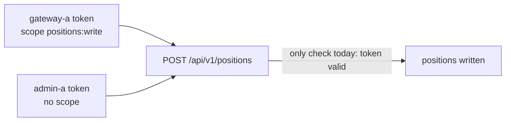
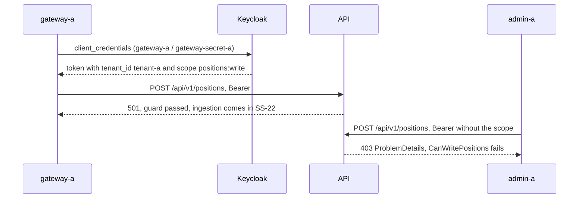

# SS-8 — Gateway authentication

- Status: Approved
- Issue: #40
- Plan PR: #72   Implementation PRs: #TBD
- Requirement IDs: IDN-05

## Problem

Devices send positions through a **gateway**: a machine client, not a person. It logs in to
Keycloak with *client credentials* (`gateway-a` / `gateway-b`, realm from SS-5) and gets a token
with scope `positions:write` and the client's `tenant_id` (SS-6 reads it).

Today the API has no route for positions and nothing ties "write positions" to that scope. When
`POST /api/v1/positions` arrives (SS-22), a user token (Admin, Safety, Viewer) would pass the
"any valid token" fallback rule and could inject positions.



## Goal

- `POST /api/v1/positions` exists and is guarded by the policy `CanWritePositions`
  (SS-7: token whose `scope` contains `positions:write`).
- A gateway token passes; any user token gets **403** ProblemDetails; no token gets **401**.
- The policy table in the security skill already maps `POST /api/v1/positions` → `CanWritePositions`; nothing to add.
- Tenant from the token, never the body (IDN-02), and the foreign-tenant / isolation checks are enforced and tested in SS-22: the stub reads no data.

Out of scope: accepting and storing positions (SS-22). Until SS-22 the route answers
**501 Not Implemented** after the guard passes.

## Solution

SS-7 owns the policy names and their registration (`SiteSensePolicies.CanWritePositions`, the
`scope` split on spaces), now on `main`. SS-8 adds only the guarded route and the proof.

`backend/SiteSense.Api/Controllers/PositionsController.cs`:

```csharp
[ApiController]
[Route("api/v1/positions")]
[Authorize(Policy = SiteSensePolicies.CanWritePositions)]
public sealed class PositionsController : ControllerBase
{
    // shortcut: guard only; SS-22 replaces the body with batch ingestion (202).
    [HttpPost]
    public IActionResult Post() => Problem(statusCode: 501, title: "Position ingestion is not implemented yet.");
}
```



Example live check (compose running):

```bash
T=$(curl -s -d grant_type=client_credentials -d client_id=gateway-a -d client_secret=gateway-secret-a \
  http://localhost:8081/realms/sitesense/protocol/openid-connect/token | jq -r .access_token)
curl -s -o /dev/null -w '%{http_code}\n' -X POST -H "Authorization: Bearer $T" http://localhost:8080/api/v1/positions   # 501
```

## Steps

| # | Step | Files | Done when | PR |
|---|---|---|---|---|
| 1 | Merge `main` (SS-7 policies and `TestTokens` `scope` are there). | — | `AddAuthorizationBuilder` registers `CanWritePositions`; tests green. | plan |
| 2 | Guarded route, 501 body. | `backend/SiteSense.Api/Controllers/PositionsController.cs` | Builds. | impl |
| 3 | Tests (below). | `tests/SiteSense.Tests/Api/Auth/GatewayAuthTests.cs` | `dotnet test` green. | impl |
| 4 | Docs: Q12 in `ASSUMPTIONS.md`, `AI_LOG.md` entry, live check line in `README.md`. | those files | Q12 recorded as decided. | impl |
| 5 | Live check with compose: real `gateway-a` token → 501, real `admin-a` token → 403. | — | Both codes seen; decoded `scope` / `tenant_id` and codes in the PR. | impl |

## Risks

| Risk | Impact | Mitigation |
|---|---|---|
| The policy name or registration changes later. | Build break or wrong guard. | Use only `SiteSensePolicies.CanWritePositions`. |
| Keycloak adds scopes (`profile email …`) or sends `scope` differently. | Gateway gets 403. | Live check with a real token (step 5). |
| The 501 stub is mistaken for a finished endpoint. | Evaluator sees 501. | `shortcut:` comment; SS-22 depends on SS-8 and replaces the body. |

## Tests

`GatewayAuthTests` (xUnit collection `Api`), signed test tokens (Q77):

All non-2xx answers assert `Content-Type: application/problem+json` and the `status` field.

- `PostPositions_GatewayToken_PassesGuard` — theory over tenant-a and tenant-b, `scope=positions:write`, no roles → **501**.
- `PostPositions_UserRoleWithScope_PassesGuard` — Admin role plus `positions:write` → **501** (the policy is scope-only).
- `PostPositions_UserToken_Returns403` — theory over Admin, Safety, Viewer of tenant-a → **403** ProblemDetails.
- `PostPositions_GatewayTokenWithoutScope_Returns403` — no `scope` → **403**.
- `PostPositions_NoToken_Returns401`.

## Open questions

| # | Question | Options (recommended first) | Decision |
|---|---|---|---|
| Q12 | A batch has positions for a device unknown in the gateway's tenant (or of another tenant). | 202, drop them, return the dropped count, log without coordinates; 422 for the whole batch | **202, drop + count** (owner). Implemented in SS-22. |
| — | How to prove the guard before SS-22? | 501 stub route in the API; test-only probe | **501 stub** (owner). |

## Changelog

| Date | Change | Why (review comment or finding) |
|---|---|---|
| 2026-11-25 | First draft. | — |
| 2026-11-25 | Step 1 waits for SS-7 registration; ProblemDetails asserts; tenant-b and role+scope cases; tenant checks moved to SS-22. | Sonnet plan review. |
| 2026-11-25 | SS-7 merged into `main`; plan PR retargeted to `main`. | SS-7 #71, #73 merged. |
