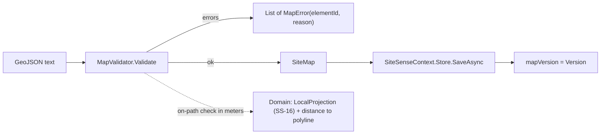

# SS-15 — Map import and validation

- Status: In review
- Issue: #46
- Plan PR: #62   Implementation PRs: #66 (domain), endpoint PR later
- Requirement IDs: MAP-01, F-6.2, C-7.3b

## Problem

A site has no map yet. The Admin must upload one GeoJSON file (a `FeatureCollection`, see
[sitesense-context](../../.claude/skills/sitesense-context/SKILL.md)) with areas, walking paths,
assembly points and entrances. Today nothing reads that file, so nothing can say what is wrong
with it, and tracking and navigation have no map to work on.

A **feature** is one element of that file: one object `{ "type": "Feature", "geometry", "properties" }`
in the `features` array. Its `properties.kind` says what it is (`area`, `path`, `assemblyPoint`, `entrance`).


## Goal

Read a GeoJSON map, list every problem as `{ elementId, reason }`, and save a valid map as a store
document with a `mapVersion`.

This story ships in two stacked PRs:

1. **Domain PR (this plan's first implementation PR):** map model, GeoJSON reading, `MapValidator`,
   saving through the store, unit tests. No endpoint, no auth.
2. **Endpoint PR (later):** `PUT /api/v1/sites/{siteId}/map` → `200 { "mapVersion" }`, `422`
   ProblemDetails with `errors`, `If-Match` (Q45), cross-tenant 404. Waits for SS-14 (sites API,
   gives `connectToleranceM`) and SS-6 (tenant from the token).

Out of scope (the spec says the test maps guarantee them): geometry validity, area overlap, areas
inside the perimeter. Building the metric geometry and the path graph (SS-16 and later).

## Solution

`MapValidator.Validate(json, connectToleranceM)` reads the file once with `System.Text.Json`
(`JsonDocument`, no new package) and returns either a `SiteMap` or the list of `MapError`.
It never stops at the first error: the Admin sees all of them in one upload.

`SiteMap.ImportAsync(tenantId, siteId, json, expectedVersion, connectToleranceM, ct)` validates,
and if there are no errors saves the map as one document (id = `siteId`). The store version is the
`mapVersion`: the first map is 1, each new upload +1. `ImportAsync` sets `Version = expectedVersion`
before `SaveAsync`: `0` creates; any value that is not the stored version throws
`ConcurrencyException` (JDB-03, Q45), and nothing is written. An invalid map never touches the store.
`siteId` must be a safe id: the endpoint PR gets it from an existing site (SS-14), not raw from the URL.



### Checks (MAP-01 plus Q41)

| Check | elementId | reason (example) |
|---|---|---|
| Not JSON, top-level `type` is not `FeatureCollection`, or `features` is not an array | `null` | `not a GeoJSON FeatureCollection` |
| A feature is not an object with `type` `Feature` and an object `properties` | `features[3]` | `not a GeoJSON Feature` |
| Feature has no `properties.id` (missing, not a string, empty or blank) | `features[3]` (index in the array, Q40) | `missing property 'id'` |
| `kind` missing or unknown | id, or `features[i]` | `unknown kind 'tree'` |
| Required property missing or wrong type (table in the spec §6.2) | id | `missing property 'name'` |
| Enum value not allowed (`areaType`, `surface`) | id | `invalid areaType 'office'` |
| Geometry missing, or type does not match `kind` (Polygon / LineString / Point) | id | `geometry must be Polygon` |
| Coordinates cannot be read: not numbers, not finite, lon outside ±180, lat outside ±90, a Point without 2 numbers, a LineString with < 2 positions, a Polygon without a ring of ≥ 4 positions | id | `invalid coordinates` |
| Same `id` twice (reported on every later occurrence) | id | `duplicate id` |
| No `perimeter` area | `null` (Q40) | `perimeter missing` |
| More than one `perimeter` | each perimeter's id | `multiple perimeters` |
| Assembly point or entrance farther than `connectToleranceM` from every path | id | `not on a path` |

Required properties and types (spec §6.2). Only the type is checked, not the range (the spec lists
fields, not limits): a negative `capacity` is accepted.

| `kind` | Required | Optional |
|---|---|---|
| `area` | `id` string, `name` string, `areaType` enum | `capacity` integer |
| `path` | `id` string, `surface` enum, `steps` boolean, `slopePercent` number, `widthM` number | — |
| `assemblyPoint` | `id` string, `name` string, `capacity` integer | — |
| `entrance` | `id` string, `name` string | — |

Distance in meters: SS-16's `LocalProjection.FromCentroid` with the mean of the first perimeter's
outer ring (or of all readable points when there is no perimeter), then the shortest distance from
the point to each path segment (`PlanarGeometry.DistanceToPolyline`; a zero-length segment is a
point). The on-path check uses only features whose coordinates were read; with no readable path,
every assembly point and entrance is `not on a path`. Geometry validity is still not checked:
"invalid coordinates" only means the numbers cannot be read, so the projection never throws.

Errors come in a stable order: feature checks by feature index, then the perimeter check, then the
on-path checks by feature index.

Tolerance: validation runs at upload with the site's `connectToleranceM` at that moment. A later
change of the setting does not re-validate a stored map. In the domain PR it is a parameter; the
endpoint PR reads it from the site (SS-14).

### Types

| Type | Where | Content |
|---|---|---|
| `PlanarGeometry.DistanceToPolyline` | `backend/SiteSense.Domain/Geometry/PlanarGeometry.cs` | Pure math on `(X, Y)` meters |
| `LocalProjection` | `backend/SiteSense.Domain/Geometry/LocalProjection.cs` | From SS-16, merged in (merge commit) |
| `MapError(string? ElementId, string Reason)` | `backend/SiteSense.Api/Models/MapError.cs` | Wire shape later in the 422 |
| `SiteMap` + `MapArea`, `MapPath`, `MapAssemblyPoint`, `MapEntrance` | `backend/SiteSense.Api/Models/SiteMap.cs` | `IDocument`; coordinates kept WGS84 `[lon, lat]` as received; spec field names (`areaType`, `slopePercent`, `widthM`, ...) |
| `MapValidator` | `backend/SiteSense.Api/Models/MapValidator.cs` | Read + check, returns `(SiteMap? Map, IReadOnlyList<MapError> Errors)` |

Example error list for a file with two problems:

```json
[
  { "elementId": null, "reason": "perimeter missing" },
  { "elementId": "ap-1", "reason": "not on a path" }
]
```

## Steps

| # | Step | Files | Done when | PR |
|---|---|---|---|---|
| 1 | First: merge `story/SS-16-local-projection` (merge commit). If SS-16 reaches `main` first, merge `main` instead; merge commits keep its commits once | — | `LocalProjection` builds on the branch | domain |
| 2 | Point-to-polyline distance (pure, no JSON types) | `Domain/Geometry/PlanarGeometry.cs`, `tests/.../Domain/PlanarGeometryTests.cs` | Tests: on segment, beyond the end, on a vertex, zero-length segment | domain |
| 3 | Map model and error record | `Api/Models/SiteMap.cs`, `Api/Models/MapError.cs` | Builds | domain |
| 4 | `MapValidator` | `Api/Models/MapValidator.cs` | All checks in the table | domain |
| 5 | `SiteMap.GetAsync` / `ImportAsync` | `Api/Models/SiteMap.cs` | Valid map saved, version 1 then 2; invalid map not saved | domain |
| 6 | Tests: one valid inline GeoJSON base plus one mutation per invalid case (no fixture files, no csproj change) | `tests/SiteSense.Tests/Api/Maps/MapValidatorTests.cs`, `SiteMapImportTests.cs` | Tests pass | domain |
| 7 | Docs: Q17, Q40, Q41 in `ASSUMPTIONS.md`, AI_LOG entry, `Models/` row if needed | root docs | Done | domain |
| 8 | Endpoint, 422 ProblemDetails, tenant tests, `.http` entry | `Api/Controllers/SitesController.cs` | Acceptance criteria of #46 | endpoint |

## Risks

| Risk | Impact | Mitigation |
|---|---|---|
| A field name differs from the spec | Evaluator test fails | Names copied from spec §6.2; test file uses them |
| `connectToleranceM` is 0.5 m: a point a few cm off the path due to rounding | False `not on a path` | Distance uses the exact segment, not vertices only; test with a point on a segment middle |
| Large real map (SS-18) slow to validate | Slow upload | Points × segments is small (hundreds); add the real map as a test when it lands |
| `JsonDocument` with odd input (numbers as strings, nulls) | Crash instead of 422 | Every property read checks `ValueKind`; test with wrong types |

## Tests

- `MapValidatorTests`: valid map → no errors; one test per check row (missing perimeter, two
  perimeters, missing property, feature without id, unknown kind, bad enum, wrong geometry,
  duplicate id, assembly point off path, entrance off path, no paths, not a FeatureCollection,
  not a Feature, string coordinate, out-of-range coordinate); several errors in one file are all
  reported, in the stable order.
- `SiteMapImportTests`: valid map → saved, `mapVersion` 1, second upload with 1 → 2; stale 1 →
  `ConcurrencyException`; invalid map → errors, stored map unchanged.
- `PlanarGeometryTests`, including a zero-length segment.
- Later: SS-18's `data/map.geojson` as one more valid input.

## Open questions

| # | Question | Options (recommended first) | Decision |
|---|---|---|---|
| Q17 | What happens to positions and state when a new map version arrives? | Forward only: new positions use the current map, no reprocessing, each TrackPoint keeps its `mapVersion` / recompute current areas | Forward only (owner) |
| Q40 | `elementId` when there is no id | `null` for a missing perimeter, `features[i]` for a feature without id / always a string | `null` + `features[i]` (owner) |
| Q41 | Checks beyond the three in the spec | Extended set (table above), "on a path" = within `connectToleranceM` / spec three only | Extended (owner) |

## Changelog

| Date | Change | Why (review comment or finding) |
|---|---|---|
| 2026-11-25 | First version | — |
| 2026-11-25 | Added coordinate and Feature read guards, id and type rules, version rule, on-path edge cases, stable error order, inline test maps | Sonnet plan review |
