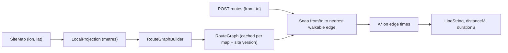

# Routing: path graph and fastest route

How SiteSense turns a site map into a graph and finds the fastest walking route on it
(MAP-02, MAP-03, NAV-01, NAV-02, NAV-03). The design choice is in
[ADR 0001](adr/0001-path-graph-structure.md); the decisions are in [`ASSUMPTIONS.md`](../ASSUMPTIONS.md)
(Q18, Q19, Q21–Q25, Q86, Q87, Q124).

| Step | Code |
|---|---|
| WGS84 → local metres | `backend/SiteSense.Domain/Geometry/LocalProjection.cs` |
| Graph build | `backend/SiteSense.Domain/Navigation/RouteGraphBuilder.cs`, `RouteGraph.cs` |
| Blocked test | `PlanarGeometry.SegmentCrossesInterior` in `backend/SiteSense.Domain/Geometry/PlanarGeometry.cs` |
| Snapping and A* | `backend/SiteSense.Domain/Navigation/RouteFinder.cs` |
| Cache and endpoint | `backend/SiteSense.Api/Services/RouteService.cs`, `Controllers/RoutesController.cs` |

## 1. Local metres

GPS coordinates are degrees, so distances in degrees are wrong. Every geometric step first converts
`[lon, lat]` to flat `x, y` metres around the centroid of the site perimeter (equirectangular projection on the
WGS84 ellipsoid). On a campus a few kilometres wide the error is millimetres. The route is converted back to
`[lon, lat]` with the same projection at the end.

## 2. The graph

The graph is undirected: walking a stretch costs the same both ways (slope is not in the cost, Q21).

| Part | Rule |
|---|---|
| Node | Every path vertex. Vertices at the same position, rounded to 1 cm, are one node, so paths that share a vertex join (Q19). |
| Edge | Every pair of consecutive vertices of a path. |
| Connector | An extra edge between end points of two different paths closer than `connectToleranceM` (Q18). |
| Length | `LengthM` = straight distance between the two nodes in metres. |
| Time | `TimeS = LengthM / (walkingSpeedMps × unpavedSpeedFactor if unpaved × stepsSpeedFactor if steps)`. Connectors use the plain walking speed. |
| Traversable | `false` when the edge passes through the inside of a `restricted` or `hazard` area. Touching or running along the boundary is allowed (Q25, Q87). |

Storage is an adjacency list: a node list, an edge list and, for each node, the indices of its edges.
Blocked edges stay in the graph with `Traversable = false` instead of being deleted, so the rule is visible and
testable on the graph.

**Blocked test.** For an edge `a → b` and a polygon, the code finds every point where the segment meets a polygon
side (as a fraction `t` from 0 to 1 along the segment, including stretches that run along a side). Sorted, these
points cut the segment into pieces that are each fully inside or fully outside. The middle point of each piece is
tested with a point-in-polygon check (ray casting). One piece inside → the edge is blocked.

**Cost of the build.** Nodes and edges are linear in the number of vertices. The connector step compares all pairs
of path end points (O(n²)): fine for hundreds of paths.

**Cache (Q86).** The graph is built on the first route request for a site and kept in memory by
`RouteService`, keyed by (tenant, site) with the map version and site version inside. A new map upload or a site
change (for example a new walking speed) gives a new version, so the next request rebuilds. A `Lazy` makes
concurrent requests build it once.

## 3. Snapping the start and the destination (Q22, Q23)

A user can stand anywhere, not on a vertex. `from` and `to` are each projected onto every **traversable** edge:
the nearest point on the segment `a → b` is `a + t·(b − a)` with `t` clamped to `[0, 1]`. The closest of these is
the snap point, at fraction `t` of its edge.

| Case | Result |
|---|---|
| Start farther than `maxSnapDistanceM` from every walkable edge | `422`, `reason: START_TOO_FAR` |
| Destination farther than `maxSnapDistanceM` | `422`, `reason: UNREACHABLE` (detail says the destination is too far) |

The start is checked first. Blocked edges are never snap targets, so a route never starts on a stretch inside
a hazard area.

## 4. A* search (NAV-01, NAV-02, NAV-03)

The search runs on the graph plus two **virtual nodes**, one per snap point. The start node links to the two ends of
its edge with the pro-rata time (`TimeS × t` and `TimeS × (1 − t)`); the destination node is linked the same way
from the two ends of its edge. When both snap points are on the same edge, a direct link along that edge is added
too.

A* is Dijkstra with a hint. Each node `n` has:

- `g(n)`: the best known time from the start;
- `h(n)`: an estimate of the time still to go = straight-line distance to the destination / `walkingSpeedMps`.

The open set is a priority queue (.NET `PriorityQueue`) ordered by `g(n) + h(n)`. The loop:

1. Take the node with the lowest `g + h`. Skip it if it was already closed. Stop when it is the destination.
2. For every **traversable** edge of that node, `g' = g(n) + TimeS`. If `g'` beats the neighbour's `g`, store it,
   remember where it came from, and push the neighbour.
3. Queue empty without reaching the destination → `422`, `reason: UNREACHABLE`.

**Why the answer is the fastest.** Every speed factor is at most 1, so no edge is faster than walking speed. The
straight line at walking speed is therefore never slower than the real remaining time: `h` never overestimates
(admissible) and never drops by more than an edge's cost (consistent). With such an `h`, the first time A* takes
the destination off the queue its `g` is optimal, and each node is closed once. Compared with plain Dijkstra, the
hint makes the search go toward the destination first, so it opens fewer nodes.

**Complexity.** O((V + E) log V) for the search, plus O(E) per request for snapping (a scan of all edges).

## 5. The answer (Q24)

The route is rebuilt from the "came from" links, then wrapped with the two off-path legs:
`from → start snap → graph nodes → destination snap → to`. Points closer than 1e-9 m to the previous one are
dropped (a snap exactly on a vertex).

- `distanceM` = on-path length (partial edges pro rata) + the two straight legs.
- `durationS` = A* time + the two legs at `walkingSpeedMps`.

The legs are not checked against blocked areas; each is at most `maxSnapDistanceM` long
([`KNOWN_ISSUES.md`](../KNOWN_ISSUES.md)).

## 6. Example

Two paths join point A to point B: a short one (100 m) that crosses a `restricted` area and a long one (140 m)
around it. The short path's middle edge is `Traversable = false`, so A* never expands across it and returns the
140 m path, `durationS = 140 / 1.3 ≈ 107.7 s` at the default walking speed. If the long path were unpaved
(factor 0.8), the time would be `140 / (1.3 × 0.8) ≈ 134.6 s`. Tests: `RouteFinderTests`
(`tests/SiteSense.Tests/Domain/`) and `RoutesTests` (`tests/SiteSense.Tests/Api/`).
